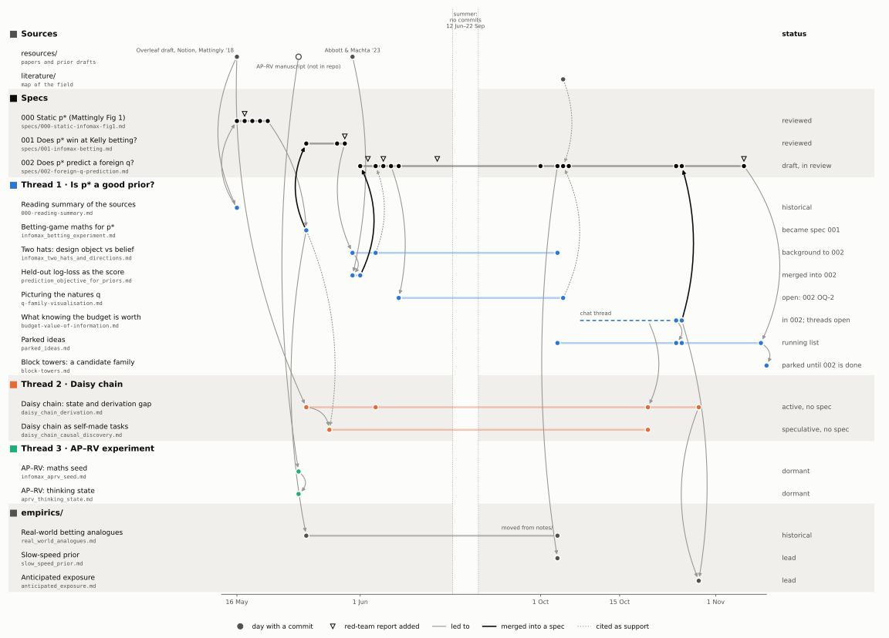

# Notes

**What this is.** A map of `notes/`: each note's thread, where it came from, what it fed,
and whether it is still live. Nothing to decide; correct any row that is wrong.

*Drafted by Claude on 2026-11-06 from commit dates and cross-references; not yet reviewed
by MB.*

Dates are commit dates. The exception is the budget note, whose chat thread ran for two
weeks before the note was committed; that stretch is drawn dashed. Arrows follow an
explicit reference or a shared commit, except four read from content.[^edges]

## Threads

1. **Is `p*` a good prior?** (blue) The main line, and the only one with specs. `p*` is
   the prior that maximises the information `N` observations carry about the parameter
   ([spec 000](../specs/000-static-infomax-fig1.md)).
   [Spec 001](../specs/001-infomax-betting.md), drafted from the
   [betting note](infomax_betting_experiment.md), scored `p*` as a betting belief and
   found that it loses. Finding F1 of spec 001's
   [third red-team](../specs/001-infomax-betting-redteam_third.md) led to the
   [two-hats note](infomax_two_hats_and_directions.md), whose diagnosis is the
   [two-hat error](../GLOSSARY.md#two-hat-error). The
   [prediction-objective note](prediction_objective_for_priors.md) then set the score
   that [spec 002](../specs/002-foreign-q-prediction.md) uses. Two later notes work on
   spec 002's open parts.
2. **Daisy chain** (orange) A process model from the Overleaf draft
   (`resources/overleaf_doc/main.tex`): the agent alternates computing `p*`, inferring
   with it, and refitting its likelihood. Two notes, no spec. The
   [budget note](budget-value-of-information.md) and `empirics/` touched it again in
   October.
3. **AP–RV experiment** (green) Infomax applied to a perceptual-decision experiment in
   which the appearance probability (AP) and the relative visibility (RV) of a stimulus
   are learned differently. It rests on a manuscript that is not in the repo. Two notes
   from 24 May, untouched since.

`literature/` and `empirics/` have their own maps
([literature/README.md](../literature/README.md), [empirics/README.md](../empirics/README.md));
the figure shows only where notes connect to them. Pending actions on notes are listed in
the root [README](../README.md).

## The notes

| Note | Thread | What it is | From → to | Status |
|---|---|---|---|---|
| [Reading summary of the sources](000-reading-summary.md) | 1 | First pass over `resources/`: the Overleaf and Notion drafts, Mattingly et al. 2018, the notebook | `resources/` → spec 000 | historical |
| [Betting-game maths for `p*`](infomax_betting_experiment.md) | 1 | A Kelly-betting test of `p*` against [Jeffreys](../GLOSSARY.md#jeffreys-prior) and uniform priors | spec 000 → spec 001; real-world analogues | became spec 001 |
| [Two hats: design object vs belief](infomax_two_hats_and_directions.md) | 1 | Why `p*` lost at betting, and where infomax can still ground a normative theory | spec 001, red-team 3, F1 → prediction-objective note; spec 002 | background to 002 |
| [Held-out log-loss as the score](prediction_objective_for_priors.md) | 1 | The held-out predictive log-loss objective, set against Abbott & Machta's [posterior-deviation](../GLOSSARY.md#posterior-deviation) score | two-hats note; Abbott & Machta 2023 → spec 002 | merged into 002 |
| [Picturing the natures `q`](q-family-visualisation.md) | 1 | Figures of candidate families of [natures](../GLOSSARY.md#nature) for spec 002's open question OQ-2; recommends a panel. Scripts in `q-family-viz/` | spec 002 OQ-2 → spec 002 §4.3 | open: 002 OQ-2 |
| [What knowing the budget is worth](budget-value-of-information.md) | 1 | When knowing the budget `N` in advance pays. Scripts in `budget-value-of-information/` | chat, 8–24 Oct → spec 002; daisy-chain derivation; parked ideas; anticipated exposure | in 002; threads open |
| [Parked ideas](parked_ideas.md) | 1 | Ideas raised in passing, each with what would settle it. Created empty on 4 Oct | budget note; spec 002 red-team (conc04) chat → block-towers note | running list |
| [Block towers: a candidate family](block-towers.md) | 1 | Judging block towers (Battaglia et al. 2013) as a model family and an experiment; a first Fisher spectrum of the static tower. Script in `block-towers/` | chat, 10 Nov; parked ideas → none yet (candidate spec 003) | parked until 002 is done |
| [Daisy chain: state and derivation gap](daisy_chain_derivation.md) | 2 | The loop, its gaps, and a derivation step (`main.tex` line 316) that does not follow | Overleaf draft → self-made-tasks note; anticipated exposure | active, no spec |
| [Daisy chain as self-made tasks](daisy_chain_causal_discovery.md) | 2 | The chain read as an agent that sets its own sequence of tasks, i.e. active discovery within one agent | derivation note; the betting note's Kelly readout → none yet | speculative, no spec |
| [AP–RV: maths seed](infomax_aprv_seed.md) | 3 | The maths needed to run the [Blahut–Arimoto algorithm](../GLOSSARY.md#blahut-arimoto-algorithm) on the AP–RV model, and the curves to plot | AP–RV manuscript → thinking state | dormant |
| [AP–RV: thinking state](aprv_thinking_state.md) | 3 | MB's running state, maintained by MB: whether infomax explains why RV updates in jumps and AP drifts | maths seed → none yet | dormant |

**Status.** *Became* or *merged into*: the content lives in the spec now; the note keeps
the derivations and the history. *Background*: a spec cites it for support. *Open*,
*active*, *speculative*: being worked, the last without a firm claim yet. *Running list*:
added to, never finished. *Parked*: waiting for something named. *Dormant*: untouched since it was written, with no successor.
*Historical*: superseded, kept as a record.

Removed: `intro_collation.md` (23 Sep – 1 Oct), intro prose collated for the publication
format, deleted once used.

Scripts with no note of their own: `spec-002-motives-example/` (6 Nov), behind the
numbers of spec 002's §0 example.

## Upkeep

A commit that adds a note, or changes a note's status or links, updates its row here and
in `diagrams/notes-map.py` (then re-runs the script) in the same commit. A new note
names its origin in its first lines (a spec section, a red-team finding, a chat), so its
arrow can be drawn.

[^edges]: Read from content, not from a reference or shared commit: spec 000 → betting
    note (the note computes `p*` as spec 000 does, five days later); betting note →
    real-world analogues (same day; the analogues are for "the kind of betting game we
    want to use to test `p*`"); Overleaf draft → daisy-chain derivation (the note works
    on `main.tex` line 316); budget chat → daisy-chain derivation (the note's 20 Oct gap
    entry states the mixing bound of the budget note's §2 while that chat was running).
