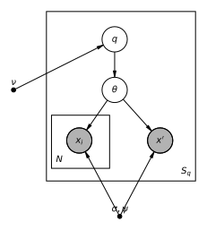
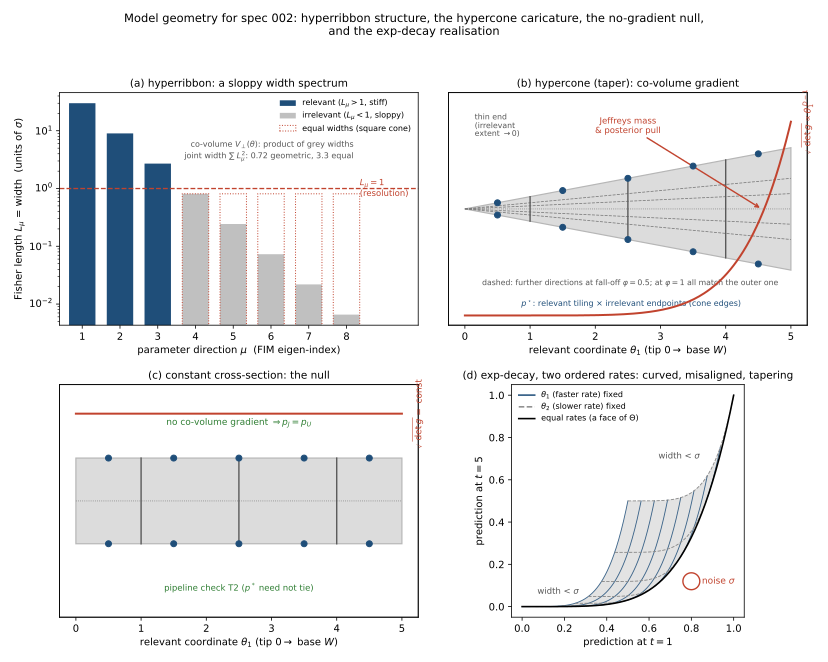

# Spec 002 — Does the infomax prior's high-`D` unbiasedness transfer to a foreign nature? (held-out predictive log-loss in ribbon geometry)

| Section | Status | Date |
|---|---|---|
| [0. Context](#0-context) | reviewed | 261120 |
| [1. Setup](#1-setup) | reviewed | 261120 |
| [1.2 Generative model](#12-generative-model) | reviewed | 261120 |
| [2. Objective](#2-objective) | reviewed | 261120 |
| [3. The case for transfer (and how it could fail)](#3-the-case-for-transfer-and-how-it-could-fail) | reviewed | 261120 |
| [4. Algorithm](#4-algorithm) | draft | — |
| [5. Properties to verify](#5-properties-to-verify) | draft | — |
| [6. Report](#6-report) | draft | — |
| [7. Open questions](#7-open-questions) | draft | — |
| [8. References](#8-references) | draft | — |
| [9. Derivations](#9-derivations) | draft | — |
| [10. Revision log](#10-revision-log) | n/a | — |

## 0. Context

### 0.1 Human summary

- We want to be able to make normative choices about the Bayesian prior used in learning tasks and Kelly betting games
- A principle on which we could base this is not offered by either RL or Bayesian inference, so we need to look at an additional one, and we choose an information theoretic characterisation of the observation budget, as a way to formalise the agent's situatedness
- However, the infomax prior is not aimed to be a belief prior, but a minimax hedge, and in simple scenarios is inferior as one to conitnuous choices like the uniform or the Jeffreys
- In more complex scenarios, where the agent doesn't have privileged knowledge about the parameter space, the uniform or a reference prior is not in general possible to construct, at least not in a parametrisation-independent way
- Jeffreys priors on the other hand are subject to bias originating in the concentration of measure in higher dimensions in conjunction with co-volume gradients in the parameters space, which points at the possible usefulness of a hedge after all
- testing priors about arbitrary natures risks triviality by stating that every prior wins in natures closest to it, becuse there is no natural choice of a hyperprior over natures. Consequently, we do a round robin over all candidate prior construction algorithms, and score them according to how bad they do in each other's home turf, as well as their robustness against spurious modeller-intruduced dimansions and some particularly adversarial natures
- we include variants of the main candidates when appropriate, like the one-step p*, misbudgeted p*s, the MDL-derived budget-conscious prior, or the Bernardo reference prior or the log-normal
- the long-term goal this spec is a part of is to test budget consciousness as a principle, so while the primary goal is to test p*, we also want to note if _any_ of the budget-conscious priors seem reasonable in an unknown novel scenario with a known likelihood structure as a belief prior

### 0.2 Introduction

**What this spec tests.** Whether the infomax prior `p*` predicts held-out data from a
*foreign* [nature](../GLOSSARY.md#nature) `q` better than [deployable priors](../GLOSSARY.md#deployable-prior) and the [MDL](../GLOSSARY.md#minimum-description-length-mdl) prior `p_proj`, in
high-dimensional [sloppy models](../GLOSSARY.md#sloppy-model), under a [strictly proper score](../GLOSSARY.md#proper-scoring-rule). *Foreign* means
that `q` is chosen independently of the agent's prior. The sign of the answer is open;
the spec fixes how it is measured.

**Where this comes from.** Spec 000 reproduced the static `p*`: discrete, with about
`√N` [atoms](../GLOSSARY.md#atom) for `N` observations, and approaching Jeffreys as `N` grows. Spec 001
scored it as a *betting belief* and found it loses to smooth priors: a *design* object
scored as an *inference* belief, the [two-hat error](../GLOSSARY.md#two-hat-error). Abbott & Machta (2023, "A&M") make
the opposite-seeming claim. In [**ribbon-geometry**](../GLOSSARY.md#hyperribbon) models with many parameters
([§1.2](#12-generative-model)), [Jeffreys](../GLOSSARY.md#jeffreys-prior) carries an enormous posterior bias from the
unresolvable [**co-volume**](../GLOSSARY.md#co-volume), and `p*` does not [read: A&M §2.2, Figs. 3–5].
Log-normal also degrades as parameters are added, less severely [read: A&M §2.2].

**An example.** You hire a plumber, or move in with a new flatmate, and wonder whether they
will overcharge you: pad the bill, or fiddle the split of the household costs. Several
motives hold them back: conscience, habit, liking you, avoiding a row, fear of
consequences, someone checking their accounts, the effort that fiddling takes, and not
needing the money. Each motive holds back its own share of what they could take, and each
has a price, a stake beyond which it gives way. You have seen how much they held back at
stakes from the change for a coffee up to a full bill, and you want to predict how much
they will hold back next time. Only the motives priced among the stakes you have seen
leave a mark on what you saw, and which motives those are depends on the person, so none
comes first.
A seemingly neutral observer counts two *characters* (a character being a price for every
motive) as different whenever their dealings would differ, however slightly. This
observer then favours characters whose motives give way one by one from small stakes up,
since that is where characters differ in the most ways. Modelling 12 motives, the observer
takes someone seen holding back 87% of what they could take at small stakes and 77% at
larger ones for 74% and 63%: a cynic. Modelling 4, the same evidence gives 88% and 72%.
The shift comes from the prior, not from the evidence, and it grows with the number of
motives the observer chose to model. An observer who weighs only the characters the
evidence can tell apart is barely moved by that number, at least on data drawn from its
own prior [read: A&M §2.2, Figs. 4–5]; whether it also predicts real people better is what
this spec tests. How finely to tell characters apart depends on how much one will see of
them, which circumstances set: the plumber once, the flatmate for a year. In the terms of
[§1.2](#12-generative-model) this is the exponential-decay model, with the stakes as its
observation times and each motive's price as one component's decay time; the variety of
characters the evidence cannot tell apart, larger in some regions than in others, is the
[co-volume](../GLOSSARY.md#co-volume) gradient behind Jeffreys' bias[^0-motives].

**Why A&M do not settle it.** Their [bias pressure](../GLOSSARY.md#bias-pressure) `b(θ)`, which scores how
strongly a prior disfavours parameter value `θ`, is measured against the data
distribution that same prior predicts; `b = 0` is `p*`'s
[equalizer condition](../GLOSSARY.md#equalizer-condition) [read: A&M Eq. 5]. Their evidence that bias pressure
tracks real posterior bias uses data drawn from `p*` itself[^0-am-data]. So they show
that `p*` is unbiased on data it generates, not that it predicts a foreign `q`. This
spec tests the latter: the **transfer** question of
`notes/prediction_objective_for_priors.md` (hereafter *the note*), §0 and §3. Does the
high-dimensional ribbon geometry hurt the deployable priors disproportionately, through
a co-volume pathology that `p*` is structurally less sensitive to? And does `p*`'s
advantage transfer to held-out predictive accuracy under a foreign `q`, scored by a
proper rule?

It is **not** "is `p*` a good epistemic prior". Under a strictly proper score, any prior
whose [Bayes mixture](../GLOSSARY.md#bayes-mixture) matches nature's data distribution beats `p*`[^0-matched], by
the compensation identity ([§2.1](#21-the-scores-cumulative-and-one-step-held-out-log-loss)), and `p*` is a design object by
construction.

**Why transfer could hold: an asymmetry.** Jeffreys' bias is a fixed property of its posterior: it appears whatever generated the data, and it grows with
the number of parameters `D`. Jeffreys' worst-case bias pressure exceeds 500 bits at
`D=26` in A&M's exponential-decay model, and is about 55 bits in their hypercone model
(both in [§1.2](#12-generative-model)) [read: A&M §3; App. A.1]. Log-normal degrades too [read: A&M §2.2]; no such case is made against `p_U` or `p_ref` ([§3.2](#32-the-heuristic-the-average-case-asymmetry-in-high-d), *Scope*). `p*`'s lack of bias is
shown only on its own data. Against a foreign `q`, its loss is capped by the
[channel capacity](../GLOSSARY.md#channel-capacity), which stays roughly flat as `D` grows where the added directions are jointly irrelevant ([§1.2](#12-generative-model))
([§3.1](#31-the-one-guarantee-worst-case-over-q)). Whether its advantage survives
without [self-sampling](../GLOSSARY.md#self-sampling) is the open question. Every prior is scored in every other prior's
own world, the nature equal to that prior, with its own as the control
([§2.3](#23-the-natures), [§2.5](#25-controls-the-ceiling-and-self-sampling)), so that
no unstated choice of `q` fixes the result. That failure sank spec 001 (finding F1 of
`specs/001-infomax-betting-redteam_third.md`).

**Second protagonist: budget dependence.** An [uninformative prior](../GLOSSARY.md#uninformative-prior) should
depend on the experiment's resolving power: its noise level and number of observations.
Jeffreys ignores it, being the infinite-data limit [read: A&M §2.1], and that is the
choice the high-dimensional setting punishes. `p*` is one budget-dependent prior; the
projected-ML / [NML](../GLOSSARY.md#normalized-maximum-likelihood-nml) prior `p_proj` is another, carried as **co-protagonist**.
The two solve the same [universal-coding](../GLOSSARY.md#universal-coding) problem under different
[regret](../GLOSSARY.md#redundancy-and-regret) notions and nearly coincide on hyperribbons, so the sharpest question
is whether the harder capacity object buys anything over the cheap MDL one on held-out
prediction ([§3.4](#34-the-second-protagonist-infomax-vs-mdl)). A third, `p_lat`, is the
minimax prior for predicting observation `N+1` after `N` (Komaki 2011; proven for finite outcome spaces, [§2.2](#22-the-cast)); it comes with a
second score, the one-step `r_N`, next to the cumulative `R_N`
([§2.1](#21-the-scores-cumulative-and-one-step-held-out-log-loss), [§2.2](#22-the-cast)).
Mis-budgeted copies of `p*`, built for a tenth and for ten times the true budget, measure
what knowing the budget is worth to an agent that commits to one prior
([§2.2](#22-the-cast)), such as an observer in the example who expects a flatmate to stay a year, when the flatmate leaves after a tenth of it.

[^0-motives]: **The example in detail.** It is A&M's exponential-decay model
    ([§1.2](#12-generative-model), [§4.1](#41-model-families)) read as a model of motives. A
    *character* is one point `θ = (θ_1, …, θ_D)`: a price for every motive.

    - *Motives* `μ = 1, …, D`, each holding back an equal share `a_μ = 1/D` of what could
      be taken. The eight of §0 are examples: conscience (guilt at padding the bill), habit
      (always the standard rate, always splitting down the middle), liking you, avoiding a
      row (at the door, in the kitchen), fear of consequences (a second quote, the receipts
      on the fridge), oversight (the firm's price list, the landlord), effort (inventing
      extra parts takes work), and not needing the money (a comfortable month raises this
      motive's price, a tight one lowers it). The shares add up: each motive still holding
      keeps its share off the bill, and none is enough on its own.
    - *Stakes* `t_1, …, t_m`: `m = 26` stakes from 1 to 5, in units of the smallest. These
      are A&M's observation times.
    - *Prices.* With `k_μ = e^{−θ_μ}`, a component decays as
      `e^{−k_μ t} = F(θ_μ − log t)`, where `F(z) = exp(−e^{−z})` is the Gumbel
      distribution function. So motive `μ` holds at stake `t` with weight
      `F(θ_μ − log t)`. It gives way around the stake `e^{θ_μ} = 1/k_μ`, its price, and
      softly: from 90% to 10% over about a twentyfold range of stakes.
    - *Fairness* `y_t = Σ_μ a_μ F(θ_μ − log t)`: the share of what could be taken that is
      held back at stake `t`. You judge it with noise `σ = 0.1`, ten percentage points, at
      each stake, in each of `N` encounters. The held-out `x′` is the next encounter, at the
      same stakes.
    - *Which motives show.* A motive's effect on fairness,
      `∂y_t/∂θ_μ = a_μ t k_μ e^{−k_μ t}` ([§9.3](#93-exponential-decay-fim)), peaks at the
      stake equal to its price. Motives priced among the stakes seen are relevant. Those
      priced far above them (holding at every stake seen) or far below (giving way at
      every one) are irrelevant, except as a block. Which motives are which depends on the
      character, so the relevant directions vary across `Θ` and no ranking is given
      ([§3.5](#35-a-third-route-ordering-instead-of-budget)).

    *The seemingly neutral observer* uses Jeffreys. Counting characters by how
    differently they would deal is the only local, budget-free weighting that does not depend on how prices
    are measured (in euros, in log-euros, as rates); that is Jeffreys' appeal. The table
    gives the posterior mean fairness at small stakes (1–2) and at larger ones (4–5), for
    one noiseless encounter with a character of 12 motives, judged by observers who model
    `D` of them; `Δ` is A&M's posterior deviation from the best fit, in noise units
    (`notes/spec-002-motives-example/jeffreys_pull.py`, two seeds agreeing to 0.1):

    | Character seen | Seen | `D = 4` | `D = 8` | `D = 12` |
    |---|---|---|---|---|
    | Mostly honest: 9 motives never give way, 3 do at stakes 1.2–3.3 | 0.87 / 0.77 | 0.88 / 0.72 (`Δ` 1.6) | 0.80 / 0.67 (4.4) | 0.74 / 0.63 (6.7) |
    | Honest up to one price, 2.5 | 0.56 / 0.17 | 0.50 / 0.21 (2.2) | 0.43 / 0.24 (4.1) | 0.39 / 0.23 (5.2) |
    | Steady: half the motives never give way, half always | 0.50 / 0.49 | 0.54 / 0.45 (2.0) | 0.52 / 0.41 (3.1) | 0.48 / 0.37 (4.7) |
    | Eroding: prices spread from 0.4 to 20 | 0.53 / 0.29 | 0.51 / 0.30 (0.5) | 0.47 / 0.30 (1.8) | 0.42 / 0.28 (3.3) |

    Every row is pulled toward gradual erosion: a single sharp price is smeared over a
    wider range of stakes, a steady character acquires a decline, and from `D = 8` the
    mostly honest one loses fairness at every stake. The pull grows with `D`. The Jeffreys prior on its
    own has this shape and is cynical: at `D = 12` it expects 29% held back at small stakes
    and 16% at larger ones, with prices spread from about 0.13 to 14 (10th to 90th
    percentile). It expects less the more motives are modelled: 43%, 34% and 29% at small
    stakes for `D = 4`, 8 and 12. So the more reasons for honesty the neutral observer
    models, the less honest it expects anyone to be; equal shares contribute, since each
    added motive guards a smaller share. With A&M's 26 motives the posterior lies over 20
    noise units from the data [read: A&M §2.2]. A&M
    name the principle this violates: predictions should be independent of unobservable
    model details [read: A&M §2.2].

    *No continuum needed.* The bias needs a distinguishability metric and a count of
    characters finer than the evidence can resolve. Count characters on a grid of
    spacing `h` in fairness units: wherever `h` is finer than every width of the model ([§1.2](#12-generative-model)),
    the count in a region is proportional to its Fisher volume, so the tilt is Jeffreys' at
    every such `h`, and Jeffreys is the `h → 0` limit. At the evidence's own resolution
    (`h` about one noise unit) each sub-resolution direction holds a single cell and its
    contribution to the tilt vanishes. Counting at that resolution is roughly what `p*`
    does [guess: `p*` is the optimal version, not a grid]. With discrete characters,
    counting is legitimate when they are real, equally common individuals: that is a base
    rate, part of nature. The bias concerns counts of modelling distinctions, such as how
    many motives the observer chose to model.

    *A few-motives observer* models two or three, as traditional model selection would:
    it keeps the dimension small enough that every direction is resolvable, and on these
    data A&M's scores prefer at most three [read: A&M §3]. This observer's bias is small
    (the `D = 4` column), but it must choose which motives to keep, misses one once more
    exposure makes it readable, and must choose again for the next person, whose readable
    motives differ.
    A&M argue that avoiding this measure-induced bias, not overfitting, is the real job of
    model selection [read: A&M §3].

    *The infomax observer* (`p*`) weighs only distinguishable characters, and its weights
    form a shortlist of types. With little evidence all its weight sits on the model's 0-
    and 1-dimensional edges [read: A&M §2.1, Fig. 2, at `D = 4`]. Read as characters (our
    reading): on a 0-dimensional edge every motive either never gives way or always does
    at the stakes seen, so how much is held back does not depend on the stake ("honest",
    "a crook", "honest about half the time"); on a 1-dimensional edge, motives share one
    price ("honest up to a price") [read: Mattingly et al. 2018 p. 1763, on edges where
    decay constants coincide]. With two motives and very little evidence, only "honest"
    and "a crook" remain [read: Mattingly Fig. 4]. More evidence adds characters with two
    prices, then more, toward the continuum the neutral observer counts [read: A&M §2.1].
    The infomax observer's estimate should stay near what was seen whatever `D`, as it does
    on data drawn from `p*` itself [read: A&M Fig. 4]; for these characters this is what the
    spec computes.

    *More evidence, and circumstances.* Each encounter stretches every [Fisher length](../GLOSSARY.md#fisher-length) by
    `√N`, so unreadable prices become readable and the shortlist grows. For two motives,
    Mattingly et al. place the change from one readable direction to two at about fifty
    times more data, "perhaps the difference between a week's data and a year's" [read:
    Mattingly p. 1763]. An observer who builds the prior for the exposure it expects uses
    `p*_N` for a plumber seen once, and a prior built for more, such as `p*_{10N}`, for a
    flatmate expected to stay a year. The mis-budgeted copies of [§2.2](#22-the-cast) are observers whose
    expectation is wrong: one builds `p*_{10N}` for a year with the flatmate, who leaves
    after a tenth of it, and is scored on the `N` encounters that happen. The mistake must
    be the observer's alone, such as a move the flatmate has not announced. Otherwise keeping the
    arrangement becomes a motive whose price changes with the circumstance, and nature
    changes too. Whether the mistaken observer's finer shortlist predicts better over those `N` encounters is
    `Δ^{bud}` ([§2.4](#24-what-is-reported-and-what-cannot-be-asserted)). In the square
    hypercone `p*`'s own tilt grows with its budget
    (`notes/budget-value-of-information.md` §3.3); in exp-decay this is not computed.

    *Handing over the ranking.* Had the story said which price matters ("only the lowest
    price counts: once one motive gives way, the rest follow"), it would hand over the
    ranking, and the reference prior with that price first would remove the bias with no
    budget at all [guess]. Naming a motive would not do: conscience and habit have the
    same share and the same form, so the likelihood cannot tell them apart, and only a
    price can be ranked ([§1.2](#12-generative-model)).
    That is the axis-aligned cone's position in
    [§3.5](#35-a-third-route-ordering-instead-of-budget): the control where ranking is
    free. Here the data reveal different motives in different people, and nothing is
    handed over.

    *Controls and coordinates.* A&M's log-normal prior, normal in the log-prices, is pulled
    too, toward its own centre at a price of 1. At `D = 12` it is pulled less than Jeffreys
    for every character above; it reads the mostly honest one as 0.87 / 0.67 (`Δ` 3.3).
    Exp-decay has no constant-cross-section counterpart: no setting removes the gradient.

    *The projected-ML observer* (`p_proj`) imagines every pattern of dealings it could
    see, credits each to its best-fitting character, and weights characters by the
    patterns they collect. Characters on the edges, the stakes-independent types and
    those with a single price, also collect the patterns that fall outside the possible
    range, so they get extra weight [read: A&M App. A.3].

    *Nature.* Staying near what was seen is A&M's notion of unbiasedness (a small
    posterior deviation `Δ`), not proof of better predictions. Real plumbers' and
    flatmates' characters are the foreign `q`. If most people's motives do give way one by
    one from small stakes up, the neutral observer's cynicism happens to point the right
    way. If most are mostly honest, it is at its worst (the table's largest `Δ`), while a
    true character can also fall between the infomax observer's types. Which observer predicts real people better
    on average is this spec's question.

    *Limits.* Equal shares, additive motives and the Gumbel shape of each motive's give
    are stipulated, and so are A&M's 26 stakes over a fivefold range and the noise. The
    numbers are for one noiseless encounter and `D ≤ 12`; beyond that the determinants
    need more than double precision (`notes/spec-002-motives-example/jeffreys_pull.out`,
    check 4), so `D = 26` rests on A&M. On this model, the cynic is not someone who has met
    many cheats but someone who has imagined many motives.

[^0-am-data]: A&M compare bias pressure with the posterior deviation `Δ` (defined in
    [§1.1](#11-notation)) at 100 observations drawn from `p*`'s data distribution, in
    Fig. 4. Fig. 3's headline, the `D=26` Jeffreys posterior over 20 standard deviations
    from the data, uses one fixed observation whose origin A&M do not state [read: A&M
    §2.2].

[^0-matched]: E.g. `q` itself. The matching prior is unique wherever the model is
    [identifiable](../GLOSSARY.md#identifiable-model): Gaussian noise blurs no two laws of
    the prediction `y(θ)` into one data marginal, so `m_π = m_q` forces the same law of
    `y(θ)` [read: `specs/002-foreign-q-prediction-redteam-conc04.md` F4]. Ordering
    exp-decay's rates removes its swaps ([§1.2](#12-generative-model)); whether it is
    then identifiable at `D = m` is not checked.

## 1. Setup

### 1.1 Notation

| Symbol | Meaning |
|---|---|
| `D` | Number of model parameters (the dimension being stressed); A&M's `d`. |
| `θ ∈ Θ ⊂ ℝ^D` | Parameter vector; `Θ` a compact box per model ([§4.1](#41-model-families)). In exp-decay `Θ` is the ordered part of the box, `θ_1 ≤ … ≤ θ_D` ([§1.2](#12-generative-model)). |
| `m` | Number of observation times, i.e. the dimension of each observation `x ∈ ℝ^m` (the number of observations is `N`). |
| `y(θ) ∈ ℝ^m` | Prediction (mean-data) map; the model manifold is `{y(θ) : θ ∈ Θ}`. |
| `σ` | Gaussian observation-noise scale. |
| `p(x\|θ)` | Likelihood `𝒩(y(θ), σ²𝟙_m)`. |
| `N` | Data budget: number of i.i.d. training observations `x_i ∼ p(·\|θ)`. `N` observations scale the Fisher information by `N`, equivalent to one observation at noise `σ/√N` ([§4](#4-algorithm)); A&M call `N` the repetition count `M` [read: A&M §2.1]. |
| `X_{1:N}` | The training sample `(x_1, …, x_N)`. |
| `x'` | A fresh held-out observation `∼ p(·\|θ)`, the target of the one-step score `r_N`. |
| `g(θ)` | [Fisher information metric](../GLOSSARY.md#fisher-information-metric), `g_{μμ'}(θ) = σ^{-2} Σ_t ∂_μ y_t ∂_{μ'} y_t` (Gaussian, [§4.1](#41-model-families)). |
| `L` | [Fisher length](../GLOSSARY.md#fisher-length) `∫ ds` of a path, with `ds` from eq. (1.2.2) in [§1.2](#12-generative-model); a direction is [relevant](../GLOSSARY.md#relevant-and-irrelevant-directions) if `L>1`, irrelevant if `L<1`. Lengths are stated at noise `σ`. At budget `N` they are longer by `√N` ([§4](#4-algorithm)), and relevance is judged at the budget. |
| `W` | Range of the hypercone's relevant coordinate, `θ_1 ∈ [0, W]` ([§1.2](#12-generative-model)); A&M's `L`. |
| `φ` | Fall-off of the hypercone's irrelevant widths, `φ ∈ (0, 1]` ([§1.2](#12-generative-model)). |
| `q` | Nature's distribution over `θ` (the *foreign* truth). |
| `m_q(X_{1:N})` | Nature's `N`-fold data marginal `∫ p(X_{1:N}\|θ) q(dθ)`. |
| `ν` | The nature of a cell: a prior's own world, a fixed nature or a stress nature ([§2.3](#23-the-natures)); it selects `q`. `m_ν` is its data marginal. |
| `D_0` | Number of distinct rates of a few-rates nature, `D_0 < D` ([§2.3](#23-the-natures)). |
| `π` | Agent's prior, one of `{p*, p_lat, p_proj, p*_{N/10}, p*_{10N}, p_J, p_U, p_LN, p_ref}`, with `q̄` as reference ceiling ([§2.2](#22-the-cast)). |
| `p*` | Infomax ([capacity](../GLOSSARY.md#channel-capacity)-achieving) prior of the budget-`N` channel `θ→X_{1:N}`: `argmax_π I_π(Θ;X_{1:N})`, equivalently the single-observation achiever at noise `σ/√N` ([§4.2](#42-prior-construction)). Usually discrete[^1-discrete]. |
| `p_proj` | Projected-ML / NML prior: the [pushforward](../GLOSSARY.md#pushforward) of the [NML distribution](../GLOSSARY.md#normalized-maximum-likelihood-nml) through the MLE map `θ̂(x)` ([§3.4](#34-the-second-protagonist-infomax-vs-mdl), [§4.2](#42-prior-construction)). |
| `p_lat` | Latent information prior at `(N, 1)`: `argmax_π I_π(Θ;X_{N+1}\|X_{1:N})`, the minimax prior for the one-step score, proven for finite outcome spaces ([§2.2](#22-the-cast)). `p*` is the same construction at `(0, N)`. |
| `p*_M` | Mis-budgeted `p*`: the `p*` of budget `M`, used at the true budget `N`. The cast carries `M = N/10` and `M = 10N`; Jeffreys is the `M → ∞` limit ([§2.2](#22-the-cast)). |
| `p_J` | [Jeffreys prior](../GLOSSARY.md#jeffreys-prior) `∝ √{det g(θ)}`, normalised on `Θ`. |
| `p_U` | Uniform on the parameter box `Θ`. |
| `p_LN` | Normal in `θ`, i.e. log-normal in the rate `k_μ = e^{-θ_μ}` (A&M Eq. 10): `∝ Π_μ e^{-(θ_μ-θ̄)²/2τ²}` (A&M's `σ̄` is `τ`). |
| `p_ref` | [Reference prior](../GLOSSARY.md#reference-prior) with the relevant direction ranked first: the irrelevant directions are integrated out under their conditional prior before the relevant one gets its prior ([§3.5](#35-a-third-route-ordering-instead-of-budget), [§4.2](#42-prior-construction)). Closed form in the cones; in exp-decay, one per candidate ranking of OQ-8 ([§7](#7-open-questions)). |
| `q̄` | Equal-weight average of all natures of [§2.3](#23-the-natures); reference ceiling only ([§2.5](#25-controls-the-ceiling-and-self-sampling)). |
| `m_π(X_{1:N})` | Agent's Bayes mixture `∫ p(X_{1:N}\|θ) π(dθ)`. |
| `π(θ\|X_{1:N})` | Posterior under prior `π`. |
| `I_π(Θ;X_{1:N})` | Mutual information between `Θ ∼ π` and the training sample `X_{1:N} ∼ p(·\|Θ)`: `𝔼_{θ∼π} D_{KL}(p(X_{1:N}\|θ)‖m_π)`. The subscript names the distribution of `Θ` (a prior `π`, or nature's `q`); `I_π(Θ;X_1)` is the single-observation version; the short form `I_π` means the budget-`N` one. `I_π(Θ;X_{N+1}\|X_{1:N})` is the conditional version: what observation `N+1` adds after `N`. A&M's `I⋆` is `I_{p*}(Θ;X_1)`. |
| `D_eff` | [Effective dimensionality](../GLOSSARY.md#effective-dimensionality): the number of resolvable parameter directions (A&M Eq. 8). |
| `C` | Channel capacity `sup_π I_π(Θ;X_{1:N}) ≡ C_N` ([§3.1](#31-the-one-guarantee-worst-case-over-q)). |
| `b_π(θ)` | [Bias pressure](../GLOSSARY.md#bias-pressure) `D_{KL}(p(x\|θ)‖m_π) − I_π(Θ;X_1)` (A&M Eq. 5); `b(θ)` when `π` is clear from context. Its worst case is `B(π) = max_θ b_π(θ)`. |
| `Δ(x)` | [Posterior deviation](../GLOSSARY.md#posterior-deviation) `σ^{-1}\|y(θ̂_x) − 𝔼_{π(θ\|x)} y(θ)\|` (A&M Eq. 9), with `θ̂_x` the maximum-likelihood estimate for `x`. In the hypercones the figures quoted are its `θ_1` component ([§1.2](#12-generative-model)). |
| `R_N^q(π)` | The cumulative score: redundancy = cumulative held-out predictive log-loss ([§2.1](#21-the-scores-cumulative-and-one-step-held-out-log-loss)). |
| `r_N^q(π)` | The one-step score: excess log-loss on `x'` given `X_{1:N}`, `= R_{N+1}^q(π) − R_N^q(π)` ([§2.1](#21-the-scores-cumulative-and-one-step-held-out-log-loss)). |
| `I_q` | Matched floor `I_q(Θ;X_{1:N})`: nature's own mutual information, prior-independent ([§2.1](#21-the-scores-cumulative-and-one-step-held-out-log-loss)). |
| `R_N^θ(π)` | Per-state redundancy `D_{KL}(p(X_{1:N}\|θ)‖m_π)`: the loss of `π` at state `θ`, that is, the score under a point nature at `θ`. `R_N^q(π)` is its average over `θ ∼ q` ([§2.1](#21-the-scores-cumulative-and-one-step-held-out-log-loss), [§3.2](#32-the-heuristic-the-average-case-asymmetry-in-high-d)). |
| `A(θ)` | The states indistinguishable from `θ`: those whose prediction lies within one [Fisher length](../GLOSSARY.md#fisher-length) of `y(θ)` at budget `N` ([§3.2](#32-the-heuristic-the-average-case-asymmetry-in-high-d)). |
| `Θ_π` | Covered set of `π`: the states where `R_N^θ(π) ≤ C_N` ([§3.2](#32-the-heuristic-the-average-case-asymmetry-in-high-d)). |
| `G` | Per-axis grid resolution of the discrete `p*` solver ([§4.2](#42-prior-construction)). |

All logs in nats; bits `= nats/log 2` at report time.

[^1-discrete]: Proven for scalar [amplitude-constrained Gaussian channels](../GLOSSARY.md#amplitude-constrained-gaussian-channel) (Smith 1971)
    [recalled: the paper could not be fetched; its title restricts it to scalar
    channels]. The repo's 1-D [Blahut–Arimoto](../GLOSSARY.md#blahut-arimoto-algorithm) (BA) solver recovers Smith's two-atom threshold
    (`notes/infomax_two_hats_and_directions.md` §7.4). For multi-`D` models A&M call `p*`
    "usually discrete" [read: A&M §1, citing their refs 9, 13–18].

### 1.2 Generative model

Nature's side of the experiment, and the model geometry that every conceptual claim in
[§0](#0-context), [§2](#2-objective) and
[§3](#3-the-case-for-transfer-and-how-it-could-fail) is about.



The diagram is the *external environment*, **not** what the agent assumes (as in spec
001). Uncircled nodes are fixed inputs: the noise scale `σ`, the geometry config `ψ`
(dimension `D`, observation times `t_1,…,t_m`, taper, fall-off, rotation and curvature, defined below; [§4.1](#41-model-families)),
and the nature `ν` that selects `q` ([§2.3](#23-the-natures)).

**The data-generating process.** One draw:

1. `θ ∼ q`: nature's true parameter.
2. `x_i ∼ 𝒩(y(θ), σ²𝟙_m)` for `i = 1,…,N`: the training observations. The mean-data map
   `y(θ) ∈ ℝ^m` is the only place the geometry enters (below; exact maps in
   [§4.1](#41-model-families)).
3. `x' ∼ 𝒩(y(θ), σ²𝟙_m)`: a fresh held-out observation.

Each *cell*, one setting of model, `D`, `σ`, `N`, the geometry knobs and the nature, repeats this for `S_q` independent draws of `(θ, X_{1:N}, x')`. The agent sees
only `X_{1:N}` and is scored on predicting `x'` and, cumulatively, each `x_{i+1}` from
`x_{1:i}` ([§2.1](#21-the-scores-cumulative-and-one-step-held-out-log-loss)).

**Agent ≠ nature.** The agent's prior `π ∈ {p*, p_lat, p_proj, p*_{N/10}, p*_{10N}, p_J, p_U, p_LN, p_ref}` (with `q̄` as
reference ceiling) is chosen from the likelihood geometry and a budget alone (the true
`N`/`σ`, or a wrong one for the mis-budgeted `p*`),
**decoupled from `q`**, as in spec 001. The decoupling is what makes the held-out score
test transfer rather than self-consistency, and why `π` is absent from the diagram.

**The model geometry.**



All three families share the Gaussian likelihood, so a model is fixed by its prediction
map `θ ↦ y(θ)`: as `θ` ranges over the box `Θ ⊂ ℝ^D`, `y(θ)` sweeps a `D`-dimensional
**model manifold** in data space `ℝ^m`. What the data can *resolve* on it is measured by
the [**Fisher metric**](../GLOSSARY.md#fisher-information-metric)[^1-fisher]

$$
g_{\mu\mu'}(\theta) \;=\; \frac{1}{\sigma^{2}}\sum_{t=1}^{m}
\frac{\partial y_t}{\partial \theta_\mu}\,\frac{\partial y_t}{\partial \theta_{\mu'}},
\qquad \mu,\mu' \in \{1,\dots,D\}, \tag{1.2.1}
$$

the [pullback](../GLOSSARY.md#pullback) of data-space distance onto parameter space: `g` measures a
parameter step by how far it moves the prediction. An infinitesimal step `dθ` moves
the prediction by `Σ_μ (∂y/∂θ_μ) dθ_μ`. The length of that move in units of the noise `σ`
is the step's [**Fisher length**](../GLOSSARY.md#fisher-length) `ds`:

$$
ds^{2} \;=\; \frac{1}{\sigma^{2}}\,\Big\|\sum_{\mu=1}^{D}\frac{\partial y}{\partial\theta_\mu}\,d\theta_\mu\Big\|^{2}
\;=\; \sum_{\mu,\mu'} g_{\mu\mu'}(\theta)\,d\theta_\mu\,d\theta_{\mu'} . \tag{1.2.2}
$$

The left side defines `ds`. The right side, obtained by expanding the square and using
(1.2.1), shows that `g` alone converts a parameter step into it. A path's Fisher length is
`∫ ds` along it.

Two scales follow. *Locally*, the square roots of the eigenvalues of `g(θ)` give how fast
a step along each principal direction moves the prediction. *Globally*, the Fisher length `L_μ = ∫ ds` of the manifold along principal direction `μ` (an eigenvector of `g`), also called its *width*, counts the resolvably distinct predictions from end to end. Directions with `L_μ > 1` are [**relevant**](../GLOSSARY.md#relevant-and-irrelevant-directions) (stiff), those with `L_μ < 1` **irrelevant** (sloppy). 

Two volumes carry the argument. The **distinguishable-prediction volume** `V_g` is the
Fisher volume of the whole manifold. The local [**co-volume**](../GLOSSARY.md#co-volume)
`V_⊥(θ)` is the Fisher volume of the cross-section through `θ` spanned by the irrelevant
directions: the product of their widths `L_μ(θ)` there.

$$
V_g \;:=\; \int_{\Theta}\!\sqrt{\det g(\theta)}\;d\theta,
\qquad
V_\perp(\theta) \;:=\!\!\prod_{\mu:\,L_\mu(\theta)<1}\!\! L_\mu(\theta),
\qquad
p_J(\theta) \;=\; \frac{\sqrt{\det g(\theta)}}{V_g}. \tag{1.2.3}
$$

`V_g` normalises the **Jeffreys prior**, which places mass per unit of Fisher volume. Its
mass on a stretch of the relevant directions is therefore proportional to the co-volume
there: extent the data cannot pin down, which a `√det g` measure still weights. That
mismatch is the mechanism behind everything below.

**Irrelevant one by one, or jointly.** `L_μ(θ) < 1` says that direction `μ` is below
resolution on its own. Many such directions can be visible together. The cross-section
through `θ` has joint extent about `½√(Σ_μ L_μ(θ)²)` and carries about `Σ_μ L_μ(θ)²/8`
nats[^1-joint]. It is **jointly irrelevant** only where that sum is well below one. The
two priors treat it differently. Jeffreys weights a state by `V_⊥(θ)`, whose log is
`Σ_μ log L_μ(θ)`, so every direction counts, however narrow. `p*` weights it by the
information the cross-section carries, so only directions near resolution count
[guess][^1-joint]. Where the widths fall off geometrically the sum converges, and the
cross-section is jointly irrelevant whatever `D`; with `D − 1` equal widths it grows
linearly in `D`. So `p*`'s independence of `D` is bounded by how much `Σ_μ L_μ(θ)²/8`
varies across states, and is exact only where that sum is negligible.

**Hyperribbons (panel a).** In the models of interest the manifold is a [*hyperribbon*](../GLOSSARY.md#hyperribbon): its widths `L_1 ≥ L_2 ≥ ⋯ ≥ L_D` fall off roughly geometrically, leaving a few stiff directions and many exponentially narrower sloppy ones. Jeffreys weights Fisher volume, which is largest in the **region of `Θ`** where the irrelevant widths are widest
(for the cone below, the thick base). That region holds nearly all of Jeffreys' mass
[read: A&M §2.2, Fig. 3] yet few distinguishable predictions: at `D=26` Jeffreys captures
under 1 bit [read: A&M Fig. 5]. A prior that tracks resolving power should discount
`V_⊥`; whether that helps *predict a foreign nature* is the open question.

**The square hypercone (panel b)** is the simplest manifold with a hyperribbon's decisive
feature in closed form [read: A&M App. A.1]: `y(θ) = (θ_1, r θ_2, …, r θ_D)`, with one
relevant coordinate `θ_1 ∈ [0, W]` and `D−1` irrelevant ones `θ_μ ∈ [0,1]` scaled by the
**taper** `r(θ_1) = θ_1/W`. The cross-section shrinks linearly from the base (`θ_1 = W`)
to a point at the tip, so `√det g ∝ θ_1^{D-1}`: a **co-volume gradient**[^1-everyday] toward the thick
base. This one factor is what punishes Jeffreys. Its mass piles at the base, and for an observation at relevant-coordinate value `x_1` its posterior mean is pulled toward the thick end by `Δ = (D−1)/x_1`
([§9.2](#92-hypercone-posterior-deviation-eq-922)), *largest at the thin end*, where a
foreign `q` can place data. The formula holds for `x_1² ≫ 4(D−1)`. Nearer the tip the pull saturates: it is 3.75
at `x_1 = 3` and `D = 26`, where the formula gives 8.33
[read: `specs/002-foreign-q-prediction-redteam-conc04.md` F6, from `cone_pstar.out`]. This `Δ`,
like every cone figure in this spec, is the `θ_1` component of the deviation of
[§1.1](#11-notation). And the cone has one relevant direction only while `σ/√N ≥ 1`:
each cross-section width is `(θ_1/W)·√N/σ`, so at `N = 16` and `σ = 1` the cross-section
is resolved beyond `θ_1 = W/4`. `p*` instead places [atoms](../GLOSSARY.md#atom) an `O(1)` Fisher length apart along
the relevant axis[^1-spacing] and on the corners of each irrelevant
cross-section[^1-corners], so its posterior deviation `Δ` stays far below Jeffreys'. In
this equal-width cone it still grows with `D` near the thick end, at about `r²/4` of
Jeffreys' pull[^1-pstar-bias].

**Three families: caricature and realisation.** The hypercone strips a hyperribbon to one
relevant direction and one tunable co-volume gradient, buying closed forms at the cost of
realism. Exp-decay is the realistic instance.

| | Square hypercone (panel b) | Constant cross-section (panel c) | Exponential decay (panel d) |
|---|---|---|---|
| Map | `y = (θ_1, rθ_2, …, rθ_D)`, `r = θ_1/W` | same, with `r = r_0` constant | `y_t = Σ_μ a_μ e^{-k_μ t}`, `k_μ = e^{-θ_μ}` (A&M Eq. 6) |
| Role | analytic caricature: closed forms | pipeline check (test T2, [§5.2](#52-test-descriptions)) | realism |
| Co-volume gradient | `√det g ∝ θ_1^{D-1}` | none: `√det g` constant | yes, with Fisher eigenvalues spanning many orders [read: A&M §2.1, citing Transtrum et al. 2010] |
| Relevant direction | `θ_1`, on a coordinate axis | `θ_1` | curved, off the axes |
| Biased priors | Jeffreys only: uniform-`θ` projects to flat on `θ_1` | none: `p_J = p_U` [read: A&M App. A.1] | Jeffreys and log-normal [read: A&M §2.2]; uniform-`θ` [guess][^1-uniform] |

**Ordered rates.** Exp-decay's components have equal shares, so swapping two of them leaves `y(θ)` unchanged. `Θ` is therefore restricted to ordered rates, `θ_1 ≤ θ_2 ≤ … ≤ θ_D`, as A&M and Mattingly et al. do [read: `specs/002-foreign-q-prediction-redteam-conc04.md` F4, which reads A&M Fig. 1 caption and Mattingly p. 1763]. Each coordinate is then an order statistic, from the fastest rate `θ_1` to the slowest `θ_D`, and coinciding rates are faces of `Θ`: the manifold's edges. No score changes, since every prior and nature of the cast is symmetric under swaps. What changes is that a ranking can name a coordinate ([§3.5](#35-a-third-route-ordering-instead-of-budget)).

Three knobs reshape the hypercone:

- **Rotation** `θ ↦ Qθ` moves the relevant direction off the axes, so coordinate priors
  can fail there too. Without it, a `p*` win in the cone is a win over Jeffreys alone
  (note §6.3).
- **Boundary curvature** sharpens a convex vertex, whose [noise halo](../GLOSSARY.md#noise-halo) `p_proj`
  over-weights [read: A&M App. A.3: `p_proj` "has extra weight on the edges"] while `p*`
  is expected to be unmoved [guess]. This is the axis on which the two are expected to
  differ ([§3.4](#34-the-second-protagonist-infomax-vs-mdl)).

- **Fall-off** `φ ∈ (0, 1]` shrinks each further irrelevant direction by a factor `φ`: `y_μ = r φ^{μ−2} θ_μ` for `μ ≥ 2`. At `φ = 1` this is the square cone, whose `D − 1` equal widths are jointly observable. For `φ < 1` the widths fall off geometrically and the cross-section stays jointly irrelevant, as in A&M's own variant [read: `specs/002-foreign-q-prediction-redteam-conc04.md` F5, which reads A&M App. A.1]. `√det g ∝ θ_1^{D−1}` for every `φ`, so Jeffreys is the same prior throughout; what changes is what `p*` can see.

Exact maps, Fisher metrics and knob ranges are in [§4.1](#41-model-families).

**Why the claims ride on this geometry.** Each load-bearing claim about Jeffreys and `p*` reduces to `g(θ)` and
its gradient; the contrast between `p*` and `p_proj` ([§3.4](#34-the-second-protagonist-infomax-vs-mdl)) turns instead on the [noise halo](../GLOSSARY.md#noise-halo), a property of the boundary that `g` does not encode. The co-volume bias is the pull of `√det g ∝ θ_1^{D-1}`; its absence makes
the constant-cross-section model a pipeline check, where `p_J` and `p_U` must coincide
(test T2 in [§5.2](#52-test-descriptions)); and the claimed
asymmetry is a co-volume gradient that steepens with `D` against a cap `C_N` that does not
([§3.2](#32-the-heuristic-the-average-case-asymmetry-in-high-d)).

[^1-fisher]: (1.2.1) is the Fisher information of the Gaussian likelihood. With
    `log p(x|θ) = −‖x−y(θ)‖²/(2σ²) + const`, the score is
    `∂_μ log p = σ^{-2}(x−y(θ))·∂_μ y(θ)`, so
    `g_{μμ'} = 𝔼_{x|θ}[∂_μ log p · ∂_{μ'} log p] = σ^{-4}(∂_μ y)^⊤ 𝔼[(x−y)(x−y)^⊤](∂_{μ'} y)`,
    which collapses to (1.2.1) because `𝔼[(x−y)(x−y)^⊤] = σ²𝟙_m`. Indices `μ, μ'` run
    over the `D` parameters, `t` over the `m` observation times.

[^1-everyday]: **Everyday co-volume gradients.** In each, one quantity the evidence
    pins down scales how strongly many others show, and those others stay below
    resolution. The example of [§0](#0-context) is of another kind: in exp-decay the
    gradient comes from the curvature, not from one quantity that scales the rest.

    - *Neural gain.* A neuron's firing rate to each stimulus is a gain `γ` times a
      tuning curve with `D − 1` shape parameters, normalised to sum to one. The spike
      count pins down `γ`, but with few spikes all tuning curves look alike: `γ = 0` is
      the tip. Under Poisson noise the Fisher information is `1/γ` along the gain,
      proportional to `γ` along each shape direction, and zero between the two (the
      normalisation), so `√det g ∝ γ^{(D−2)/2}`.
      Jeffreys favours high gain, the more so the more shape parameters it models.
    - *Seasoning.* Taste tells reliably how strongly a dish is seasoned, but each spice
      adds the strength times its share of the blend, so in a mild dish all blends taste
      alike. A taster who counts distinguishable dishes leans toward "strongly
      seasoned", the more so the larger their spice rack.
    - *A face down the street.* A person's distance is judged well from their height in
      view, but facial detail fades with distance, so far away all faces look alike (the
      tip is at infinity). An observer who counts distinguishable people judges the
      figure nearer, the more faces they know.

    In each case the conclusion moves with the size of a repertoire (shape parameters,
    spices, faces) that the evidence cannot see. Not every prior does this: one uniform
    in the parameters as written (gain and shape, strength and blend) has no such pull.
    Uniform priors fail in other ways. They depend on the parametrisation, and in many
    dimensions a uniform prior on a vector badly overstates its length, a case where
    uniform and Jeffreys coincide [read: Stein 1959; Kass & Wasserman 1996 §4.2.2].
    Together the two failures point to priors set by what the data budget can resolve,
    such as `p*`; whether those predict better is what this spec tests. Which kind of
    prior describes human judgement, and in which situations, is open as far as we know.

[^1-spacing]: About 2.5 Fisher lengths per atom on a 1-D bounded Gaussian channel, from
    the repo's Blahut–Arimoto (`notes/infomax_two_hats_and_directions.md` §7.4).

[^1-corners]: Along a sub-resolution direction a short bounded channel puts mass at
    **both** ends, not at one interior point: the two endpoints are the most
    distinguishable placement and carry the `<1` bit the direction still has. So `p*`
    coarse-grains to the boundary (`≥2` atoms per irrelevant axis) and collapses to a
    point only at the cone tip, where the endpoints merge. This is Smith's two-atom
    regime, which the repo's BA recovers for interval lengths `≲3.3` Fisher lengths; a
    2-atom direction carries `O(L²)` bits while its endpoints are `≲1` Fisher length
    apart (`notes/infomax_two_hats_and_directions.md` §7.4). Panel b shows the pairs
    splaying onto the two cone edges. Exp-decay collapses the same way: at large `σ`, `p*`
    puts all its weight on 0- and 1-dimensional edges [read: A&M §2.1, Fig. 2].

[^1-pstar-bias]: A&M find `p*`'s posterior deviations mostly shorter than its atom
    spacing, but only for data drawn from `p*` [read: A&M Fig. 4]. A reduced computation
    of the square hypercone (`σ = 1`, `N = 1`, `W = 50`; the irrelevant directions exact
    as parallel channels, ignoring what their data say about `θ_1`) finds that `p*` has its
    own tilt toward the thick end, by a factor `exp((D−1)·c(θ_1/W))`. Here `c(a)` is the
    capacity of a bounded channel of Fisher length `a`, with `c(1) = 0.11` nats: each
    sub-resolution direction still carries about `L²/8` nats, and in this cone all `D − 1`
    have the same width. The posterior deviation at `x_1 = 40` is 0.10 at `D = 26` and 0.32
    at `D = 100`, against Jeffreys' 0.62 and 2.34, and it is negligible at the thin end
    (`notes/budget-value-of-information/cone_pstar.py`). In exp-decay, where the widths
    fall off geometrically, the sum of `L²` converges and the tilt should stay bounded
    [guess]. Settled by: the same quantities in the full, unreduced hypercone and in
    exp-decay.

[^1-joint]: A bounded channel much shorter than one Fisher length puts its mass at the two
    ends and carries about `L²/8` nats, and independent directions add: the reduced cone
    gives `c(1) = 0.11` nats per direction (footnote on `p*`'s tilt, above). The joint
    extent is the half-diagonal of a box with sides `L_μ`. That `p*` weights a state by
    this information is computed in the reduced cone only
    (`notes/budget-value-of-information.md` §3.2). Settled beyond it by computing `p*`'s
    tilt for several width profiles, with the fall-off knob below.

[^1-uniform]: A&M test Jeffreys, `p*` and log-normal, not uniform-`θ` [read: A&M §2.2,
    Figs. 3–5]; the claim is carried over from `notes/prediction_objective_for_priors.md`
    §6.3. Settled by: adding `p_U` to the A&M Fig. 5 reproduction (test T9, [§5.2](#52-test-descriptions)).

## 2. Objective

Every prior is scored on two scores, each a held-out log-loss in excess of an oracle that
knows `θ`: the cumulative `R_N` (the mainline) and the one-step `r_N`
([§2.1](#21-the-scores-cumulative-and-one-step-held-out-log-loss)). The cast has three
budget-dependent protagonists, `p*`, `p_lat` and `p_proj`, against deployable priors and
mis-budgeted copies of `p*` ([§2.2](#22-the-cast)). Every prior is scored in every other prior's
own world, with its own as the control ([§2.3](#23-the-natures)). No overall winner is declared
([§2.4](#24-what-is-reported-and-what-cannot-be-asserted)).

### 2.1 The scores: cumulative and one-step held-out log-loss

The agent with prior `π` predicts through its [Bayes mixture](../GLOSSARY.md#bayes-mixture) `m_π`. The **cumulative
score** is the [**redundancy**](../GLOSSARY.md#redundancy-and-regret) of `π` against a foreign nature `q`, over budget `N`:

$$
\begin{aligned}
R_N^q(\pi)
  &= \mathbb{E}_{\theta\sim q}\,\mathbb{E}_{X_{1:N}\sim p(\cdot\mid\theta)}\Big[\log p(X_{1:N}\mid\theta) - \log m_\pi(X_{1:N})\Big] \\
  &= \mathbb{E}_{\theta\sim q}\,D_{\mathrm{KL}}\!\big(p(X_{1:N}\mid\theta)\,\|\,m_\pi(X_{1:N})\big).
\end{aligned}
\tag{2.1.1}
$$

**Lower is better.** `R` is the excess [code length](../GLOSSARY.md#code-length) (log-loss) over an oracle that knows
`θ`[^2-oracle], with `R_N^q(π) ≥ I_q(Θ;X_{1:N}) ≥ 0`. The floor `I_q`, not `0`, is reached only by a
predictor that matches nature's marginal, `m_π = m_q`.

By the **compensation identity** (Topsøe 1979 [recalled]; derived in
[§9.1](#91-the-compensation-identity-for-the-n-fold-marginal-eq-212)), applied to the
`N`-fold data marginals `m_q` and `m_π`,

$$
\boxed{\;R_N^q(\pi) \;=\; \underbrace{I_q(\Theta;X_{1:N})}_{\text{matched floor, }\pi\text{-free}} \;+\; \underbrace{D_{\mathrm{KL}}\!\big(m_q \,\|\, m_\pi\big)}_{\text{the only }\pi\text{-dependent term}}\;}\tag{2.1.2}
$$

with the prior-independent **matched floor**
`I_q(Θ;X_{1:N}) = 𝔼_{θ∼q} D_KL(p(X_{1:N}|θ)‖m_q)`, the redundancy nature would pay against its
own marginal. The whole prior-dependence of the score is the **marginal mismatch**
`D_KL(m_q‖m_π)`, and the contest between two priors is exactly

$$
\delta R(\pi,\pi') \;=\; R_N^q(\pi) - R_N^q(\pi') \;=\; D_{\mathrm{KL}}(m_q\|m_\pi) - D_{\mathrm{KL}}(m_q\|m_{\pi'}). \tag{2.1.3}
$$

**Cumulative means held out at every step.** By the chain rule, `R_N^q` is the sum of
one-step-ahead losses, each on an observation not yet seen ([`tutorials/math/redundancy-capacity.md`](../tutorials/math/redundancy-capacity.md);
`notes/prediction_objective_for_priors.md` §1.2, §4):

$$
R_N^q(\pi) \;=\; \sum_{i=0}^{N-1}\, \mathbb{E}_{\theta\sim q}\,\mathbb{E}_{X_{1:i}\sim p(\cdot\mid\theta)}\, D_{\mathrm{KL}}\!\big(p(\cdot\mid\theta)\,\big\|\,m_\pi(\cdot\mid X_{1:i})\big). \tag{2.1.4}
$$

The score is thus [prequential](../GLOSSARY.md#prequential): `R_N` is the area under the learning curve (the
expected one-step loss against the number of observations seen) up to `N`.
Log-loss is [strictly proper](../GLOSSARY.md#proper-scoring-rule), so it scores the *full* predictive distribution. A&M's
`Δ` does not: it is the distance from the posterior-mean prediction to the MLE, blind to
the predictive's spread.

**The one-step score** is the height of the learning curve at `N`: learn from `N`
observations, then predict a fresh one, `x' ∼ p(·|θ)` at noise `σ`, with the posterior
predictive `m_π(x'|X_{1:N}) = ∫ p(x'|θ) π(dθ|X_{1:N})`:

$$
r_N^q(\pi) \;=\; \mathbb{E}_{\theta\sim q}\,\mathbb{E}_{X_{1:N}\sim p(\cdot\mid\theta)}\, D_{\mathrm{KL}}\!\big(p(\cdot\mid\theta)\,\big\|\,m_\pi(\cdot\mid X_{1:N})\big) \;=\; R_{N+1}^q(\pi) - R_N^q(\pi). \tag{2.1.5}
$$

It has its own compensation identity[^2-onestep]: the floor is nature's conditional mutual
information, and the prior-dependent part is the mismatch between posterior predictives
after the data,

$$
r_N^q(\pi) \;=\; I_q(\Theta;X_{N+1}\mid X_{1:N}) \;+\; \mathbb{E}_{X_{1:N}\sim m_q}\, D_{\mathrm{KL}}\!\big(m_q(\cdot\mid X_{1:N})\,\big\|\,m_\pi(\cdot\mid X_{1:N})\big), \tag{2.1.6}
$$

so `δr(π,π') = r_N^q(π) − r_N^q(π')` is the difference of the two expected posterior-predictive
mismatches. `r_N` is closer than `R_N` to A&M's `Δ`, which also judges the posterior after
the experiment. Two consequences for the algorithm:

- **σ and `N` separate.** `R_N` depends on them only through `σ/√N`
  ([§4.4](#44-score-estimation)); `r_N` does not, since for a fixed prior it is
  `R_1` at noise `σ/√(N+1)` minus `R_1` at noise `σ/√N`. The sweep needs an `N` axis at
  fixed `σ` ([§5.4](#54-sweep-design), to revise).
- **`x'` is the one-step target.** §4.4's single-step diagnostic currently scores `x'` under
  the prior predictive `m_π` at `σ_eff`; it has to use the posterior predictive above, with
  `x'` at noise `σ` (to revise).

**Why expect a *maximiser* of mutual information to help minimise a loss?** Three
different "redundancies" hide behind one word, each with a cumulative and a one-step
version. All are built from the per-`θ` loss `R_N^θ(π) = D_KL(p(X_{1:N}|θ) ‖ m_π)` or its
one-step analogue, and the design objects' "max" and our "min" act on different ones:

| "redundancy" | `θ` ranges over | cumulative (`R_N`) | one-step (`r_N`) | the operation |
|---|---|---|---|---|
| self-consistent (**mutual information**) | the prior `π` itself | `I_π(Θ;X_{1:N})`, maximised by `p*`; value `C_N` | `I_π(Θ;X_{N+1}\|X_{1:N})`, maximised by `p_lat` | **`max` over `π`**: design, the least-favourable source |
| **worst-case** | an adversarial `θ` | minimised by `p*`, the same object as above | minimised by `p_lat`, proven for finite outcome spaces | **`min` over `π`**: the minimax-robust predictor |
| **foreign-`q` average** (this spec's scores) | a foreign nature `q` | `R_N^q(π)`, eq. (2.1.2) | `r_N^q(π)`, eq. (2.1.6) | **`min` over `π`**: the loss we report, minimised by the prior matched to `q` |

In each column the first two rows are one object (in the one-step column, proven for finite outcome spaces), the two faces of the
[redundancy–capacity saddle](../GLOSSARY.md#redundancy-capacity-theorem) [read: A&M Eqs. 3–4; Haussler 1996 preprint §1; Komaki 2011 Thm 2;
Fogel & Feder 2024 Thm 1]. Our scores are the third row, minimised by the prior matched to
`q` and, across the sweep, by `q̄` ([§2.5](#25-controls-the-ceiling-and-self-sampling)), **not**
by a design object. So no protagonist has a guarantee on the third row. A protagonist can
beat the deployable priors only where their mismatch (for Jeffreys, the co-volume bias) exceeds its own:
the open bet ([§2.4](#24-what-is-reported-and-what-cannot-be-asserted)).

**Computability.** Both scores are Monte-Carlo estimates ([§4.4](#44-score-estimation)). The
closed-form pieces (FIM, Jeffreys density, the hypercone `Δ = (D−1)/x_1` of
[§9.2](#92-hypercone-posterior-deviation-eq-922), the Gaussian KL split of
[§3.3](#33-score-decomposition-bias-vs-calibration-a-diagnostic)) feed the controls and
unit tests (T4–T6, [§5.2](#52-test-descriptions)), not the reported numbers.

[^2-oracle]: **Why excess over an oracle, not raw log-loss.** The two rank priors
    identically: the oracle's term `𝔼_q log p(X_{1:N}|θ)` is the same for every prior.
    The excess is reported because (a) it isolates what a prior can affect: raw log-loss
    adds the noise entropy, `(Nm/2) log(2πeσ²)`, which shifts with `σ`, `N` and `m`
    across the sweep and would swamp the differences between priors, while the excess
    has a meaningful zero (the oracle) and floor (`I_q`); (b) it does not depend on how
    the data are represented: the raw log-density of continuous data shifts with the
    units of `x`, and scoring `X_{1:N}` or its sufficient statistic `x̄` gives different
    raw numbers but the same excess, which is what lets [§4.4](#44-score-estimation)
    simulate a single `x̄`; (c) the identities and bounds of §2.1 and
    [§3.1](#31-the-one-guarantee-worst-case-over-q) are stated in it. The oracle exists
    only in simulation. On real data only the raw held-out log-likelihood can be
    computed, and its differences between priors equal the differences in excess.

[^2-onestep]: Apply (2.1.2) at budgets `N+1` and `N` and subtract. The chain rule for
    mutual information gives `I_q(Θ;X_{1:N+1}) − I_q(Θ;X_{1:N}) = I_q(Θ;X_{N+1}|X_{1:N})`, and
    the chain rule for KL divergence gives
    `D_KL(m_q^{(N+1)}‖m_π^{(N+1)}) − D_KL(m_q^{(N)}‖m_π^{(N)}) = 𝔼_{X_{1:N}∼m_q} D_KL(m_q(·|X_{1:N})‖m_π(·|X_{1:N}))`,
    where `m_q(·|X_{1:N})` is nature's own posterior predictive.

### 2.2 The cast

Each protagonist is a design object, built from the likelihood and the budget alone,
**decoupled from `q`** ([§1.2](#12-generative-model)). Each plays at home on one score,
the one it is minimax for, and away on the other.

| Prior | What it is | Home score | Guarantee | Discrete? |
|---|---|---|---|---|
| `p*` | capacity prior of the budget-`N` channel, `argmax_π I_π(Θ;X_{1:N})`; Komaki's latent information prior at `(0, N)` | `R_N` | minimax for `R_N`, value `C_N` ([§3.1](#31-the-one-guarantee-worst-case-over-q)) | usually[^1-discrete] |
| `p_lat` | latent information prior at `(N, 1)`, `argmax_π I_π(Θ;X_{N+1}\|X_{1:N})` [read: Komaki 2011 §3] | `r_N` | minimax for `r_N` for finite outcome spaces [read: Komaki 2011 Thm 2; Fogel & Feder 2024 Thm 1]; for Gaussian data expected but unproven [read: Komaki 2011 §4] | open; for some budgets near-full support [read: Fogel & Feder 2024 §VII] |
| `p_proj` | [pushforward](../GLOSSARY.md#pushforward) of the [NML](../GLOSSARY.md#normalized-maximum-likelihood-nml) distribution through the MLE map ([§3.4](#34-the-second-protagonist-infomax-vs-mdl)) | neither | NML is minimax for the pointwise regret of the `N`-sequence; `p_proj` for neither score | no, but with point masses on the lowest-dimensional edges [read: `specs/002-foreign-q-prediction-redteam-conc04.md` m6, which reads Quinn §5.2] |
| `p*_{N/10}`, `p*_{10N}` | `p*` built for a tenth or ten times the true budget: an agent that knows the construction but not its budget, and commits to one resolution | `R_M`, at the wrong budget | none at `N` | usually |
| `p_J`, `p_U`, `p_LN`, `p_ref` | the [deployable priors](../GLOSSARY.md#deployable-prior): Jeffreys, uniform, log-normal, ranked reference (`p_ref`: closed form in the cones, one per OQ-8 ranking in exp-decay) | — | none | no |
| `q̄` | matched to the average of the swept natures | — | the ceiling on both scores ([§2.5](#25-controls-the-ceiling-and-self-sampling)) | — |

`p*` and `p_lat` are two members of one family, maximising the information gained over two
different windows of the learning curve: observations `1…N`, and observation `N+1` after
`N` ([`literature/komaki-school.md`](../literature/komaki-school.md)). `p_lat` is built by a
Blahut–Arimoto variant whose update uses the difference of the per-`θ` divergences at
budgets `N+1` and `N` ([§4.2](#42-prior-construction), to add).

**Mis-budgeted `p*`.** They measure what knowing the budget is worth, for agents that
commit to one prior. An agent that may instead mix the priors built for many budgets
`N_k`, with weights `w_k`, does at most `log(1/w_k)` worse than `p*_{N_k}` at budget `N_k`
on every [nature](../GLOSSARY.md#nature), because its data marginal is at least
`w_k·m_{p*_{N_k}}` everywhere. Against such an agent knowing `N` is worth a few nats
([`notes/budget-value-of-information.md`](../notes/budget-value-of-information.md) §2).
The agent is mis-budgeted: it built `p*_M` for a budget `M` that is not the one it gets, and is scored at the true `N`. What a wrong resolution costs depends on the side and on the geometry (`notes/budget-value-of-information.md` §3):

- *Too coarse* (`M < N`): the [atoms](../GLOSSARY.md#atom) lie farther apart than the data
  resolve, each observation is charged the divergence to the nearest atom, and in the worst
  case in 1-D the loss grows linearly in `N/M` (that note's §3.1). In the reduced hypercone
  the coarser prior nonetheless wins on both natures computed, at every budget tested: at
  budget 16, `p*_1` beats `p*_{16}` by 4.4 nats on a nature uniform in the relevant
  coordinate (its §3.3). A coarser prior winning is reported as a finding in its own right.
- *Too fine* (`M > N`): the prior tilts toward the states where more detail is resolvable
  at `M` than at `N`, the [co-volume](../GLOSSARY.md#co-volume) gradient of the directions
  that cross resolution between the two budgets. The tilt helps natures concentrated where
  that detail is and hurts the others. In 1-D the worst case stays under a nat (its §3.1).

So the sign of the budget's value is a result, like every summary of
[§2.4](#24-what-is-reported-and-what-cannot-be-asserted). Jeffreys is the `M → ∞` end of
the fine side.

### 2.3 The natures

A prior's **own world** is the nature equal to it, `q = π`: there the prior is *at home*,
under any other nature *away*. The natures are chosen so that every prior is scored away,
in every other prior's own world, and so that what is read is the size of each loss, not
who wins.

**Who wins is not a finding.** By (2.1.3), `π` beats `π'` under nature `q` exactly when
`m_π` is closer to `m_q` than `m_{π'}` is. That each prior wins where nature resembles it
most is therefore an identity, true of any set of priors. Nor is any nature neutral. Both
scores average over `θ ∼ q` a per-state loss that does not depend on `q` (2.1.1), so a
nature is a weighting of states, and each weighting we have drawn lies close to some
prior's own world (`notes/q-family-visualisation.md`, *B′ drawn*; partly `[guess]` there).
A sweep along one axis of natures shows which own worlds the axis passes.

**What is a finding.** The identity gives the sign of a comparison once the distances are
known. The distances are what the experiment measures, and three questions about them are
open:

1. *Price.* How much does each prior lose away, in a world built for another?
2. *Exchange.* Does `π` lose less in the world of `π'` than `π'` loses in the world of
   `π`? KL divergence is not symmetric: one prior's mixture can cover another's cheaply
   without the reverse.
3. *Invariance.* Does a prior's loss move when the modeller changes something nature knows
   nothing of, the number of parameters `D`, while nature stays fixed? This is the
   asymmetry of [§0](#0-context), asked of every prior alike.

**The natures** are the rows of one table with a column per prior. Each cell holds the
prior's **mismatch**, its score minus the row's floor
([§2.1](#21-the-scores-cumulative-and-one-step-held-out-log-loss)): `D_KL(m_q‖m_π)` for
`R_N`, the posterior-predictive mismatch of (2.1.6) for `r_N`.

- **Round robin** (questions 1 and 2): nature equal to each prior of the cast in turn. We
  choose none of these natures: each candidate nominates the world most favourable to
  itself, and every other candidate is scored there. The diagonal is 0 by construction. It
  is the [self-sampling](../GLOSSARY.md#self-sampling) control
  ([§2.5](#25-controls-the-ceiling-and-self-sampling)) and a test of the pipeline, since
  no cell of a row may fall below it. The off-diagonal cells are the result.
- **Fixed natures** (question 3): natures defined without reference to `D`, scored as `D`
  grows. In the hypercones, a law for the relevant coordinate `θ_1` (its thin half; its
  thick half) with the cross-section uniform; `p_U`'s own world is fixed in this sense
  too. In exp-decay, two kinds, one for each sense in which a nature can be simpler than
  the model[^2-fixed]:
  - *few rates*: `D_0 < D` distinct rates, each shared by `D/D_0` components. Such a
    nature lies on the manifold's edges, where `p*` and `p_proj` keep weight;
  - *a fixed spectrum*: the `D` rates fill out one smooth law of rates, the same for
    every `D`. Such a nature lies in the bulk, with all rates distinct; `p_U`'s and
    `p_LN`'s own worlds are of this kind.

  What is read is the trend of each column in `D`, and the contrast between the two kinds.
- **Stress natures**, each declared with the prior it is aimed against and the mechanism
  ([§3.4](#34-the-second-protagonist-infomax-vs-mdl)):
  - *a sharpened convex vertex, with nature on the interior and faces*: against `p_proj`,
    whose NML weighting over-weights the vertex's
    [noise halo](../GLOSSARY.md#noise-halo) [guess];
  - *a smooth nature in the interior bulk*: against `p*`'s discreteness, and likely in
    favour of a `p_lat` with fuller support [guess].

  A nature aimed against one prior may lie near another's home. Its row shows this: the
  cells are distances, so a win at a mismatch below ½ nat is a home win and is not counted
  ([§3.7](#37-falsification)).

**Reading the table** ([§2.4](#24-what-is-reported-and-what-cannot-be-asserted)). Along a row:
the gaps between priors. Down a column: the largest and the mean mismatch. Per pair of
priors: the two crossed cells. Per fixed nature: the trend in `D`. Cells settled in
advance are marked and not counted: home wins, the diagonal among them, and on `R_N` any
cell whose redundancy exceeds `C_N`, which `p*` wins by theorem
([§3.7](#37-falsification)). Neither column summary is neutral[^2-lean], so the table
itself is the result. It is relative to the cast: another prior adds a row. And it is
conditional: if nature is like this row, this prior loses this much. Which rows resemble
real natures is outside this spec (`notes/parked_ideas.md`, *Benchmark natures*).

Parametrisations are pinned in [§4.3](#43-foreign-q-family). Each draw records
its nature and its `θ`, so results split by nature and map over `Θ`.

[^2-fixed]: [TODO] Pin in [§4.3](#43-foreign-q-family): `D_0` and the law of the few
    rates; the spectrum's law and how the rates fill it.

    *Few rates.* A `D`-component model produces fewer rates only by neutralising
    components: two rates coincide, or one leaves the observation window. Each time, a
    parameter direction stops moving the prediction at first order and the Fisher rank
    drops, which makes the point an edge [read:
    `specs/002-foreign-q-prediction-redteam-conc04.md` F1, citing A&M Fig. 2 caption].
    `p*` keeps weight on edges for a different reason: along a sub-resolution direction
    the two ends are the most distinguishable points ([§1.2](#12-generative-model),
    footnote on corners). The two reasons meet in models built from interchangeable parts
    whose effect saturates [recalled: Transtrum's manifold-boundary reduction; Watanabe's
    singular models], not in general: the hypercones' fixed natures are not on edges.

    *Fixed spectrum.* Simple in the other sense: a smooth law of rates takes a centre and
    a width to describe, yet every rate is distinct. With rates drawn independently from
    the law, `y_t` is a mean of `D` independent terms in `[0, 1]`, so its spread is at
    most `1/(2√D)` and the nature narrows onto one curve as `D` grows; `p_U`'s and
    `p_LN`'s own worlds behave so. Rates placed at the quantiles of a law whose centre and
    width are drawn afresh for each `θ` keep the spread free of `D`; this is the
    candidate. Shrinking the width to zero gives a single rate, so the width runs from
    the edge kind to the bulk kind. That a fixed spectrum favours the product priors is a
    [guess], settled by its row: each product prior is at home on one spectrum only, its
    own.

    *Hypercone.* In the equal-width cone the cross-section law shows in the data (same
    report, F5), so "uniform" is a declared choice there; where the widths fall off
    geometrically it should matter little [guess].

[^2-lean]: The largest mismatch has the form of the minimax criterion that `p*` (on
    `R_N`) and `p_lat` (on `r_N`) are built for: by (2.1.2) and (3.1.1),
    `D_KL(m_q‖m_{p*}) ≤ C_N − I_q` for every `q`. The mean is, up to a constant, the
    score under the average of the rows, which is smallest for the prior nearest that
    average ([§2.5](#25-controls-the-ceiling-and-self-sampling)).

### 2.4 What is reported, and what cannot be asserted

No overall winner is declared. The result is the table of [§2.3](#23-the-natures): for
every nature, the mismatch of every prior on both scores. That one score or nature prefers
one prior and another prefers another is itself a finding. The table is read in four
directions, for each model, `σ` and `N`.

**Along a row** (one nature), per protagonist `π ∈ {p*, p_lat, p_proj}` and per score
`S ∈ {R_N, r_N}`. Within a row, differences of scores are differences of mismatches.

- **The gap to the best deployable prior**,
  `Δ_S(π) = max_{π'} δS(π, π') = S(π) − min_{π'} S(π')` over
  `π' ∈ {p_J, p_U, p_LN, p_ref}`, with `p_ref` where defined and, in exp-decay, once per
  OQ-8 ranking ([§7](#7-open-questions)). It is negative exactly when `π` beats every
  deployable prior[^2-max]. In a deployable prior's own world that prior is left out of
  the minimum: it is at home, and `π` is compared with the priors that are away like
  itself.
- **The pairwise gaps** between protagonists, `δS(p*, p_lat)`, `δS(p*, p_proj)` and
  `δS(p_lat, p_proj)`.
- For `p*` alone, **the gap to the best mis-budgeted `p*`**,
  `Δ^{bud}_S = S(p*) − min_{M ∈ {N/10, 10N}} S(p*_M)`, negative when knowing the budget
  to within a factor of ten helps ([§2.2](#22-the-cast)). The two gaps are also
  reported one by one, `S(p*) − S(p*_{N/10})` and `S(p*) − S(p*_{10N})`, so that a coarser
  prior winning shows.

**Down a column** (one prior): its largest and its mean mismatch over the rows. Each prior
of the cast has one row at home, where its mismatch is 0. Neither summary is neutral
([§2.3](#23-the-natures)); the mean is read against that of the ceiling `q̄`
([§2.5](#25-controls-the-ceiling-and-self-sampling)).

**Across the diagonal** (a pair of priors): the **exchange**, what `π` loses in the world
of `π'` minus what `π'` loses in the world of `π`. For `R_N` it is
`D_KL(m_{π'}‖m_π) − D_KL(m_π‖m_{π'})`; for `r_N`, the same difference of
posterior-predictive mismatches. It is negative when `π` loses less away than `π'` does.

**Across `D`** (a fixed nature): each prior's mismatch against `D`.

We **cannot** assert the sign of any of these, and must not: that a protagonist wins
anywhere is the open question, and asserting it would make the experiment unfalsifiable
([§5](#5-properties-to-verify)). The test suite asserts only the *machinery*
(decomposition, construction, controls), never the results.

[^2-max]: Not `min_{π'} δS(π, π')`, which is the gap to the *worst* deployable prior and is
    negative whenever `π` beats any one of them, Jeffreys included. An earlier version of
    this spec used it (red-team report `specs/002-foreign-q-prediction-redteam01.md`,
    finding F1).

### 2.5 Controls: the ceiling and self-sampling

**The ceiling `q̄`.** Two floors must be kept apart. *Per nature* `q`, the floor of `R_N^q`
is `I_q(Θ;X_{1:N})`, and that of `r_N^q` is `I_q(Θ;X_{N+1}|X_{1:N})`, each attained by the
prior matched to *that* `q`, not by `q̄`; a cell's mismatch is measured from it. *Across
the rows*, both scores are linear in nature's distribution, so for any fixed prior the
average over the rows equals the score under their average `q̄`; by (2.1.2) and (2.1.6) it
is minimised by matching `q̄`
([hierarchical / empirical Bayes](../GLOSSARY.md#empirical-and-hierarchical-bayes);
`notes/infomax_two_hats_and_directions.md` §5.3).
So no fixed prior, protagonists included, beats `q̄` on the row average, and "does `p*`
beat `q̄`" is a non-question.

`q̄` averages all rows of the table with equal weight. A prior's mean mismatch then splits
exactly[^2-qbar]: `q̄`'s own mean mismatch, which any single prior must lose because the
rows differ, plus the prior's mismatch to `q̄`. `q̄`'s mean is plotted as the **reference
ceiling** for the column means of
[§2.4](#24-what-is-reported-and-what-cannot-be-asserted). The cast's own worlds outnumber
the other rows and so dominate `q̄`: the weighting is a declared choice, as every
weighting of natures is.

**Self-sampling controls.** Each prior's own world is a row of the round robin
([§2.3](#23-the-natures)). There the prior is matched and attains the floor, so no other
prior's mismatch in that row may be negative; the test suite asserts this (T20,
[§5.2](#52-test-descriptions)). A protagonist whose lead appears only at or near home is
self-served: the [self-sampling](../GLOSSARY.md#self-sampling) failure that sank spec 001
(finding F1 of `specs/001-infomax-betting-redteam_third.md`). "Near home" is a mismatch
below ½ nat ([§3.7](#37-falsification)).

[^2-qbar]: With `m_ν` the data marginal of row `ν` and `m_{q̄}` their average, the
    compensation identity
    ([§9.1](#91-the-compensation-identity-for-the-n-fold-marginal-eq-212)), applied with
    the rows in the place of `θ`, gives
    `mean_ν D_KL(m_ν‖m_π) = mean_ν D_KL(m_ν‖m_{q̄}) + D_KL(m_{q̄}‖m_π)`. For `r_N`,
    subtract the identity at budgets `N+1` and `N`.

## 3. The case for transfer (and how it could fail)

Each score's prior-dependent part is a mismatch: of data marginals for `R_N`, of
posterior predictives for `r_N` ([§2.1](#21-the-scores-cumulative-and-one-step-held-out-log-loss)). *Nothing forces either to be smallest
for `p*`* on a foreign `q`. What follows is the strongest case we can make for `p*` on its
home score `R_N`, one guarantee and one geometric heuristic, and the ways it can fail. The
case for `p_lat` on `r_N` has the same form, with a guarantee proven only for finite
outcome spaces ([§2.2](#22-the-cast)). It argues for *plausibility*, not for any result.

### 3.1 The one guarantee: worst-case over `q`

`p*`'s mixture `m_{p*}` is the [information radius](../GLOSSARY.md#information-radius) (KL-centre) of the model family. The [equalizer condition](../GLOSSARY.md#equalizer-condition) gives `D_KL(p(·|θ)‖m_{p*}) ≤ C` for **every** `θ`, with equality on
`supp(p*)` ([`tutorials/math/redundancy-capacity.md`](../tutorials/math/redundancy-capacity.md); Kemperman 1974 and Haussler 1997 [recalled]) [read: A&M Eqs. 4–5:
`p*` has `b = 0` on its support and minimises `B = max_θ b`]. Averaging over *any* nature
`q`,

$$
R_N^q(p^\star) \;=\; \mathbb{E}_{\theta\sim q}\, D_{\mathrm{KL}}\!\big(p(X_{1:N}\mid\theta)\,\big\|\,m_{p^\star}\big) \;\le\; \max_\theta D_{\mathrm{KL}}\!\big(p(X_{1:N}\mid\theta)\,\big\|\,m_{p^\star}\big) \;=\; C_N \qquad\text{for every } q. \tag{3.1.1}
$$

So `p*`'s foreign-`q` redundancy is **capped at capacity for any `q`**: `p*` can never be
catastrophic. The deployable priors have no such cap. A prior's worst-case single-observation redundancy is
`I_π(Θ;X_1) + B(π)`, with `B(π) = max_θ b_π(θ)` (from the definition of `b`), and `B(p_J)` grows
rapidly with `D`: over 500 bits at `D=26` in exp-decay, about 55 in the hypercone [read:
A&M §3; App. A.1]. This is empirical for these models, not a proven rate. Log-normal's `B`
rises too [read: A&M Fig. 5]; `p_U` is assumed to behave alike [guess][^1-uniform].

`C_N`, by contrast, tracks only the **resolvable** complexity. At `N=1` it is `I_{p*}(Θ;X_1)`,
which in exp-decay is flat in nominal `D` once `D>3` [read: A&M §2.2, Fig. 5]. In the
equal-width hypercone it is not: each sub-resolution direction still carries some
information, and a reduced computation gives `C_1 = 4.02` nats at `D = 26` and `11.25`
at `D = 100`, about 0.1 nats per added direction
(`notes/budget-value-of-information/jeffreys_capacity_region.py`). That is slow next to
Jeffreys' bias, but not flat. Since budget `N` acts as
noise `σ/√N`, `C_N` grows like `(D_eff/2) log N`, with `D_eff` the [effective dimensionality](../GLOSSARY.md#effective-dimensionality) [read: A&M Eq. 8, §2.1]; that it stays
flat in `D` at `N>1` is the same saturation at smaller noise [guess]. The bound cannot
*fail*, so it is a unit test (T3,
[§5.2](#52-test-descriptions)). Its *content*, a `D`-controlled ceiling for `p*` against a competitor
worst case that climbs steeply with `D`, is the load-bearing half of the case for
transfer. For `p_lat` the analogue caps `r_N^q(p_lat)` by the conditional capacity
`max_π I_π(Θ;X_{N+1}|X_{1:N})` for every `q`, wherever its minimaxity holds
([§2.2](#22-the-cast)).

### 3.2 The heuristic: the average-case asymmetry in high `D`

(3.1.1) is worst-case; the experiment scores an average. The bridge is a reading of what a
prior's loss at a state measures: the mass it has put on the states indistinguishable
from that one. `p*` spreads its mass evenly over distinguishable states, Jeffreys over
Fisher volume, and with many unresolved directions the two counts part. The case is made
against Jeffreys alone (*Scope*, below).

**Loss as missing mass.** Write `R_N^θ(π) = D_KL(p(X_{1:N}|θ)‖m_π)` for the loss of `π` at
state `θ`, so that `R_N^q(π) = 𝔼_{θ∼q} R_N^θ(π)` (2.1.1). Let `A(θ)` be the states whose
prediction lies within one [Fisher length](../GLOSSARY.md#fisher-length) of `y(θ)` at
budget `N`: the states one experiment cannot reliably tell from `θ`. For every prior
([§9.4](#94-the-mass-bound-eq-321)),

$$
R_N^\theta(\pi) \;\le\; -\log \pi\big(A(\theta)\big) \;+\; \tfrac12. \tag{3.2.1}
$$

A prior is cheap at a state when it has put mass on that state's indistinguishable
neighbours. A flat loss profile, the
[equalizer condition](../GLOSSARY.md#equalizer-condition) that makes `p*` minimax
([§3.1](#31-the-one-guarantee-worst-case-over-q)), therefore goes with equal mass per
distinguishable state, and A&M's [bias pressure](../GLOSSARY.md#bias-pressure),
`R_N^θ(π) − I_π` at `N = 1`, measures how far a prior is from it. (3.2.1) bounds the loss
from above only; reading it as an approximate equality is a [guess][^3-tight].

**Two counts.** Jeffreys puts mass in proportion to Fisher volume. In a
[hyperribbon](../GLOSSARY.md#hyperribbon), `A(θ)` is a slab: about one Fisher length
along each relevant direction and the whole width of each irrelevant one[^3-slab]. Its
Jeffreys mass is proportional to the local [co-volume](../GLOSSARY.md#co-volume), so
Jeffreys' loss profile is, up to a constant, minus the log of the co-volume: a volume the
data cannot see sets what each state costs. `p*`'s loss is at most `C_N` at every state.

**Where `D` enters.** Each irrelevant direction multiplies the variation of the co-volume
across the manifold. In the square hypercone, where it goes as `θ_1^{D−1}`, the relevant
coordinate's datum alone gives ([§9.5](#95-jeffreys-loss-in-the-hypercone-eq-322))

$$
R_N^\theta(p_J) \;\gtrsim\; (D-1)\log\frac{W}{\theta_1} \;+\; \log\frac{W}{D} \;-\; \tfrac12\log\frac{2\pi e\,\sigma^{2}}{N},
\qquad \theta_1 \gg D\sigma/\sqrt{N}, \tag{3.2.2}
$$

linear in `D`, against `C_N` for `p*`. In exp-decay Jeffreys' worst-case bias pressure
exceeds 500 bits at `D = 26` while `p*`'s information stays flat (§3.1). With every
direction resolved there is no co-volume, Jeffreys' profile is flat, and Jeffreys is
asymptotically minimax [recalled: Clarke & Barron 1994][^3-cb]. So the asymmetry needs
unresolved directions with a co-volume gradient, and their number sets its size. In the
equal-width hypercone `C_1` grows too, by about 0.1 nats per direction (§3.1), so two
slopes are compared there.

**From the worst case to an average.** Call `Θ_J = {θ : R_N^θ(p_J) ≤ C_N}` Jeffreys'
**covered set**: the states where it costs no more than `p*`'s cap. Since
`R_N^θ(p*) ≤ C_N` everywhere and `R_N^θ(p_J) ≥ 0`,

$$
R_N^q(p_J) - R_N^q(p^\star) \;\ge\; \int_{\Theta\setminus\Theta_J}\!\big(R_N^\theta(p_J) - C_N\big)\,q(d\theta) \;-\; C_N\,q(\Theta_J). \tag{3.2.3}
$$

The first term is the loss insured against, the second the premium. `p*` beats Jeffreys on
every nature for which the first exceeds the second. The premium is at most `C_N`, and the
insured loss per state grows with `D` (3.2.2), so what remains is one property of nature:
**its mass on Jeffreys' covered set**.

In the reduced cone at `D = 26` the covered set is `θ_1 > 41.1` of 50
(`notes/budget-value-of-information.md` §4; (3.2.2) gives 41.3). That is 18% of the
relevant coordinate, and it holds 99.4% of Jeffreys' own mass[^3-shell]. So how much of
nature is covered depends on how nature is counted: by distinguishable states, a share of
order `C_N/(D−1)` of the relevant coordinate; by Fisher volume, nearly all. Neither count
is forced on nature, which is why [§2.3](#23-the-natures) scores every prior in every
other's world and [§2.4](#24-what-is-reported-and-what-cannot-be-asserted) declares no
winner. In the hypercones the covered set is an interval of `θ_1`, and a nature's mass on
it is read off directly; [TODO] its estimate in exp-decay.

The reduced cone also previews the average. On a nature uniform in `θ_1` at `D = 26`,
Jeffreys' mismatch on the relevant datum is 18.65 nats against `p*`'s 0.51, and Jeffreys
wins only on natures inside `θ_1 > 48`, by under a nat
(`notes/budget-value-of-information.md` §4). How strongly `p*` itself depends on the
budget is predicted by the criterion of that note's §3.2, which
[`budget_value.png`](#61-outputs) checks in the full models.

**Scope.**

- *Which priors.* The case is against `p_J`, whose mass per distinguishable state follows
  the co-volume. Log-normal degrades with `D` too [read: A&M §2.2], by a route this
  section does not derive. No case is made against `p_U` or `p_ref`: in the axis-aligned
  cone neither weights the co-volume ([§1.2](#12-generative-model), table), and against
  `p_ref` in exp-decay the expectation rests only on the ranking being unavailable
  ([§3.5](#35-a-third-route-ordering-instead-of-budget)).
- *Which bias.* A flat loss profile is exactly zero bias pressure. For A&M's other
  measure, the posterior deviation `Δ`, it is only suggestive: in the equal-width cone
  `p*`'s own `Δ` grows with `D` ([§1.2](#12-generative-model), footnote on `p*`'s tilt).
- *Which evidence.* A&M put the point as an invariance, *predictions should be independent
  of unobservable model detail*, which `m_{p_J}` violates [read: A&M §2.2] and `m_{p*}`
  respects where the widths fall off geometrically. Nothing here uses data drawn from
  `p*`, the part of A&M's evidence that does not transfer.

[^3-tight]: The missing half is a lower bound: that a prior with little mass near `θ`
    must lose much there. It holds for the relevant datum in the hypercone, where (3.2.2)
    reproduces the reduced computation ([§9.5](#95-jeffreys-loss-in-the-hypercone-eq-322)).
    Settled in general by comparing each prior's computed loss profile with
    `−log π(A(θ))` in exp-decay; test T21 ([§5.2](#52-test-descriptions)) computes both.

[^3-slab]: This holds where the cross-section as a whole stays within about one Fisher
    length, as it does when the widths fall off geometrically (the sum of their squares
    converges). In the equal-width hypercone the `D − 1` irrelevant directions jointly
    exceed it (`specs/002-foreign-q-prediction-redteam-conc04.md`, F5), which is why
    (3.2.2) uses the relevant datum alone.

[^3-cb]: Settled by reading Clarke & Barron (1994), listed in [§8](#8-references) and not
    yet fetched.

[^3-shell]: `1 − (41.1/50)^{26}`. Jeffreys' `θ_1`-marginal is `∝ θ_1^{D−1}`, the radial
    law of a `D`-ball, whose volume sits in a thin outer shell.

### 3.3 Score decomposition: bias vs calibration (a diagnostic)

**Interpretive, not a score.** This splits the prior-dependent part of the one-step score
`r_N`, the mismatch of posterior predictives in (2.1.6), into two readable pieces: how far
a prior moves the prediction from where the matched prior puts it, and how far it
mis-states the spread. Approximate both posterior predictives as Gaussians,
`m_π(x'|X_{1:N}) ≈ 𝒩(μ_π, Σ_π)` and `m_q(x'|X_{1:N}) ≈ 𝒩(μ_q, Σ_q)`, each with
`Σ = σ²𝟙 + Cov[y(θ)|X_{1:N}]` under its own posterior. This is exact for smooth priors in
the limit where `y(θ)` is linear and the prior flat over the posterior's extent, and a
heuristic for the discrete `p*`, whose true predictive is a finite mixture. The mismatch
is then the KL divergence between two Gaussians:

$$
\begin{aligned}
D_{\mathrm{KL}}\!\big(\mathcal{N}(\mu_q,\Sigma_q)\,\|\,\mathcal{N}(\mu_\pi,\Sigma_\pi)\big)
  &= \tfrac12\Big[\underbrace{(\mu_\pi-\mu_q)^{\!\top}\Sigma_\pi^{-1}(\mu_\pi-\mu_q)}_{\text{mean shift}} \\
  &\qquad + \underbrace{\mathrm{tr}\,\Sigma_\pi^{-1}\Sigma_q-m+\log\tfrac{\det\Sigma_\pi}{\det\Sigma_q}}_{\text{spread mismatch}}\Big].
\end{aligned}
\tag{3.3.1}
$$

Both terms are zero for the matched prior. Each therefore measures what a prior costs
against the best achievable, not against an oracle that knows `θ`. The **mean shift** is
the held-out analogue of A&M's `Δ`: theirs is measured from the in-sample MLE, this one
from the matched prior's prediction, weighted by the predictive's precision. The **spread
mismatch** is what `Δ` cannot see: a predictive too wide or too narrow next to the
matched one.

No claim is made about which term carries a prior's mismatch. For Jeffreys at large `D`
the mean shift is expected to dominate, as the pull toward high co-volume
([§3.2](#32-the-heuristic-the-average-case-asymmetry-in-high-d)) [guess][^3-decides]. `p*`'s terms depend on `D` through the information the
cross-section carries ([§1.2](#12-generative-model)), so they are flat only where it is
jointly irrelevant. Both terms are reported per prior ([§6](#6-report)), and the closed
form is unit-tested (test T5, [§5.2](#52-test-descriptions)). How well the predictive is
calibrated against the data is shown separately, as a
[PIT](../GLOSSARY.md#probability-integral-transform-pit) histogram ([§6](#6-report)). Both
scores are computed from the *exact* mixture predictive, not from this approximation.

[^3-decides]: Settled by the [§6](#6-report) diagnostic, which reports both terms per
    prior.

### 3.4 The second protagonist: infomax vs MDL

`p_proj` is a **co-protagonist**, not a control, because it reaches **budget
dependence** ([§0](#0-context)) by a different route than `p*`. Both priors below are
explicit functions of `σ`, and Jeffreys is the `σ→0` limit of both, in the interior and in
mutual information (the boundary atoms persist; see below) [read: A&M §2.1; Quinn
§5.1–§5.2].

**The two constructions.**

- **Capacity / infomax, `p*`:** `argmax_π I_π(Θ;X_{1:N})`, the [least-favourable](../GLOSSARY.md#least-favourable-prior) / [minimax](../GLOSSARY.md#minimax)-**expected**-redundancy prior, in the [reference-prior](../GLOSSARY.md#reference-prior) lineage ([§3.5](#35-a-third-route-ordering-instead-of-budget)). Its
  `σ`-dependence is the atom count (`~√N` in 1-D, spec 000).
- **NML / MDL, `p_proj`:** `p_NML(x) = max_θ p(x|θ)/Z` is the [normalized-maximum-likelihood](../GLOSSARY.md#normalized-maximum-likelihood-nml) distribution over the *data* (Shtarkov 1987 [recalled]), with normaliser `Z` and [parametric complexity](../GLOSSARY.md#parametric-complexity) `log Z` (Rissanen 1996; Grünwald 2007 [recalled]). `p_proj` is its [pushforward](../GLOSSARY.md#pushforward) through the MLE map `θ̂(x)` [read: A&M App. A.3; Quinn §5.2, as the "adaptive slab-and-spike"
  prior]: a *prior* over `θ`, distinct from the code `p_NML` it is built from (no prior's
  Bayes mixture equals `p_NML` at finite `N`; [`tutorials/math/nml-mdl.md`](../tutorials/math/nml-mdl.md) §4). Its `σ`-dependence is the
  halo width `σ`. It solves *neither* minimax exactly, but it is not arbitrary: the MLE is
  the statistic `p_NML` weights by (`p_NML(x) ∝ p(x|θ̂)`), so the pushforward carries
  NML's stochastic-complexity weighting into `θ`-space. A&M present it as an easy
  approximation of `p*` with no MDL connection; Quinn et al. note in a footnote that NML
  is also used in MDL [read: A&M App. A.3; Quinn §5.2, footnote ‡‡].

**Why they nearly coincide here.** `p*` minimises the worst-case **expected** redundancy
`max_θ 𝔼_{x|θ} log[p/η]` over predictive distributions `η` (a prior); `p_NML` minimises the worst-case **pointwise** [regret](../GLOSSARY.md#redundancy-and-regret)
`max_x[log max_θ p(x|θ) − log η]` (a code); `p_proj` approximates `p*` by the `p_NML`
route. They are expected to nearly agree in exp-decay for two reasons:

1. *Asymptotically*, both grow like `(D/2) log N + log∫√det g`, with the same `σ→0`
   limit: Jeffreys, in the interior and in mutual information[^3-asymptotics]. That is the regime where every
   direction is resolved, far from this spec's. The
   worst-case bias keeps weight on the boundary for both (atoms for `p*`; point masses on the
   lowest-dimensional edges for `p_proj` [read: `specs/002-foreign-q-prediction-redteam-conc04.md` m6, which reads Quinn §5.2]), so the convergence is *not
   uniform*: Jeffreys' worst-case bias pressure does not vanish as `σ→0` [read: A&M §2.1], the non-uniformity that the first corner below
   exploits.
2. *In hyperribbon geometry at finite `σ`*, both weight the few stiff directions and collapse
   the sloppy ones onto edges, and their mutual information nearly coincides in a
   sum-of-exponentials model [read: Quinn Fig. 12]. That they are nearly the same prior is
   not shown: Quinn's projected prior has full support where `p*` is discrete, and the
   evidence is from exp-decay only. In the square cone `p_proj` may tilt toward the base
   by many orders of magnitude (`notes/q-family-visualisation.md`, *B′ drawn*; a
   `[guess]` there).

So they are two budget-dependent [universal-coding](../GLOSSARY.md#universal-coding) objects converging to the same limit,
not an approximation with a provable optimality gap. The live question is therefore not
how well `p_proj` approximates `p*`, but **does the harder capacity object buy anything
over the cheap MDL one on held-out prediction** ([§3.7](#37-falsification)).

**Where they part, and whether it is reachable here.** Besides the pushforward through the MLE, their structural difference is
expected versus pointwise regret. NML weights by where the worst *individual* data land
(the [noise halo](../GLOSSARY.md#noise-halo) just outside convex boundaries), `p*` by *expected* distinguishability
(Fisher length). This yields two contrastive corners, **both reachable by tuning the
hyperribbon** ([§4.1](#41-model-families)), with no new model:

- *Adversarial to `p_proj`, benign for `p*`:* sharpen a **convex vertex** so the exterior
  halo piles up there, and score against a `q` on the interior or faces. NML over-weights
  the halo-collecting vertex; `p*` is expected to be unmoved [guess]. **Easy**: the
  hyperribbon already has skewed convex vertices, and a boundary-curvature knob sharpens
  them.
- *Adversarial to `p*`, benign for `p_proj`:* a **smooth interior `q` finer than the atom
  spacing**, at moderate `σ`. `p*`'s discrete mixture ripples while `p_proj`'s cloud is
  smooth; the effect is generic but expected to be mild, because neighbouring atoms'
  `σ`-wide blobs overlap [guess]. **Easy**: it needs only moderate `σ` and a smooth
  interior `q`.

Neither corner's winner is analytic; the [§4.3](#43-foreign-q-family) /
[§5.4](#54-sweep-design) sweep maps both. Locating where the two budget-dependent siblings
diverge *is* the measurement of what the capacity route uniquely contributes
([§6](#6-report)), and matters more here than discreteness per se, which it also
measures.

[^3-asymptotics]: The constants differ. NML's parametric complexity is
    `(D/2) log(N/2π) + log∫√det g + o(1)` [read: Rissanen 1996, Thm. 1]. The capacity
    (minimax expected redundancy) is `(D/2) log(N/2πe) + log∫√det g + o(1)` (Clarke &
    Barron 1994) [recalled: not fetched], smaller by `D/2` nats: the mean of the
    log-likelihood-ratio statistic, which separates expected redundancy from pointwise
    regret. Settled by: reading Clarke & Barron (1994).

### 3.5 A third route: ordering instead of budget

`p*` and `p_proj` avoid the co-volume bias through the budget. The classical fix needs no
budget: a [reference prior](../GLOSSARY.md#reference-prior) with the parameters ranked by
interest. The irrelevant directions get a prior conditional on the relevant one and are
integrated out; only then does the relevant direction get its prior, from that marginal
model [read: Kass & Wasserman 1996 §3.5.2; Berger, Bernardo & Sun 2009 §1]. Their volume
therefore never tilts it. `p_ref` is this prior with the relevant direction ranked
first[^3-lineage].

In the hypercone the Fisher information left for the relevant coordinate, once the
irrelevant ones are accounted for, is `1/σ²` everywhere[^3-schur]. So `p_ref` is uniform
in the relevant coordinate and, at each value of it, uniform across the cross-section of
`Θ` ([§4.2](#42-prior-construction)). In the axis-aligned cone that is `p_U`; under
rotation the two differ, because `p_U` inherits a tilt from the rotated box.

Ranking needs a mechanism that picks the direction of interest, something like attention;
`p*` needs none by construction. Whether `p*` removes the bias as well as `p_ref` does is
part of this spec's question, read off `δR(p*, p_ref)` ([§6.3](#63-table-schema)).

**Where the ranking comes from.** It can be handed over, computable, or unavailable, and
the geometries of [§1.2](#12-generative-model) give one of each:

1. *Handed over.* In the axis-aligned cone the relevant direction is a named coordinate,
   and `p_ref = p_U`. A story that names the quantity that matters is in this position,
   and so is an experiment whose instructions name the relevant stimulus dimension.
2. *Computable.* In the rotated cone the split is the same everywhere but lies off the
   axes. `p_ref` follows from the likelihood in the coordinates `Qθ`
   ([§4.2](#42-prior-construction)), while coordinate priors such as `p_U` inherit a
   tilt. For a learner, being told the combination may not help[^3-told].
3. *Unavailable.* In exp-decay the relevant directions curve and vary across `Θ`, so no
   global ranking is given; choosing one is OQ-8 ([§7](#7-open-questions)). The example of
   [§0](#0-context) is of this kind: which motives the data reveal depends on the person.
   With the rates ordered ([§1.2](#12-generative-model)), a candidate ranking names an order statistic, such as the slowest rate, or a function of several. It cannot name a component, since components are interchangeable. Two candidates count as two only if they give different priors.

In the cones the ranking follows from the likelihood, so `p_ref` is as automatic as `p*`
and the budget is expected to buy only insurance. A reduced-cone computation agrees: a
prior flat in the relevant coordinate beats `p*_N` on natures uniform in it or confined to
the thin end, and loses only at the thick end and in the worst case
(`notes/budget-value-of-information.md` §4, where the uniform nature is that prior's own
world). In the square cone part of such a loss is `p*`'s own tilt: the cross-section is
jointly observable there, and `p*` weights states by the information it carries ([§1.2](#12-generative-model)).
The loss is therefore read against the fall-off knob: what remains of it once the
cross-section is jointly irrelevant is what the free ranking buys. The cones are therefore the **control where ranking is free**, and the decisive
comparison is exp-decay, against `p_ref` built from at least two of the OQ-8 candidate
rankings ([§3.7](#37-falsification)). Which route
organisms take, and when being told the ranking helps them, is an empirical question
outside this spec ([`empirics/`](../empirics/README.md)).

[^3-told]: (Moved from the text, conc04 m15.) Describing the optimal strategy before
    training raised final category-learning accuracy when the strategy was a rule on named
    dimensions (0.82 against 0.65), and left it unchanged when the strategy integrated
    them (0.80 against 0.80) [read: Rosedahl, Serota & Ashby 2021, abstract and results].

[^3-lineage]: A reference prior maximises the same mutual information as `p*`, but in
    the limit of infinitely many repetitions of the experiment [read: Bernardo 2005,
    preprint pp. 15–16]. The finite-data maximiser was known to be discrete (Berger, Bernardo &
    Mendoza 1989 [recalled]), and Kass & Wasserman give that as the reason Berger and
    Bernardo took the limit [read: Kass & Wasserman 1996 p. 1355]. Bernardo's stated
    reason is conceptual: a reference prior maximises the information still missing
    relative to perfect knowledge, which only unlimited data approach [read: Bernardo
    2005, preprint p. 16]. Ranking the parameters was proposed to avoid problems such as
    marginalization paradoxes [read: Berger, Bernardo & Sun 2009 §1]. In the
    Neyman–Scott problem (pairs of observations, each pair with its own mean, and a
    common variance) Jeffreys' estimate of the variance converges to half the truth;
    ranking the variance first makes it consistent [read: Kass & Wasserman 1996 §3.5.2].

[^3-schur]: From (1.2.1) for the hypercone map, with `r = θ_1/W`:
    `g_{11} = σ^{-2}(1 + Σ_μ θ_μ²/W²)`, `g_{1μ} = σ^{-2} r θ_μ/W` and `g_{μμ} = σ^{-2} r²`
    for `μ ≥ 2`, zero between different irrelevant coordinates. The information left
    for `θ_1` is the Schur complement `g_{11} − Σ_μ g_{1μ}²/g_{μμ} = σ^{-2}`, and the
    irrelevant block has `√det ∝ r^{D−1}`, constant across each cross-section. In the
    Berger–Bernardo formula, written for the relevant coordinate `θ_1` and the rest `θ_⊥`,
    `π(θ_1, θ_⊥) ∝ j(θ_⊥|θ_1) exp{∫ j(θ_⊥'|θ_1) log √(det g / det g_{⊥⊥}) dθ_⊥'}`, with
    `j(·|θ_1)` the conditional Jeffreys density normalised over the cross-section [read: Kass & Wasserman 1996 §3.5.2], both factors are then
    constant, which gives the uniform form. Under rotation the same holds in the
    coordinates `Qθ`.

### 3.6 What would sink it

None of the above proves that `p*` *wins the average-case contest this spec scores*.
Several things can make it lose:

1. **Worst case ≠ average.** (3.1.1) bounds the worst `q`. For a **benign** `q`
   concentrated in the data-rich interior (low *effective* dimension) the deployable
   priors pay little: a prior near the matched one pays about `I_q`, while `p*` pays `C_N`
   at every state of its support, so a smooth prior can *beat* `p*` there. That is
   the 1-D / low-`D` regime where `p*` already loses (note §1); the table of
   [§2.3](#23-the-natures) shows where the sign flips.
2. **The real competitor is resolution-adapted, not Jeffreys.** `p_proj`
   ([§3.4](#34-the-second-protagonist-infomax-vs-mdl)) is smooth, easy to sample, tracks
   `p*` closely on mutual information and "avoids Jeffreys' vices" [read: Quinn §5.2]. If
   it also keeps `D_KL(m_q‖m_π)` small, `p*` wins nothing a smooth prior could not, and its
   **discreteness does no work** (OQ-5, [§7](#7-open-questions)). Whether a lead is
   `p*`'s own, rather than any budget-dependent prior's, is read off the pairwise gaps
   `δR(p*, p_proj)` and `δR(p*, p_lat)` ([§2.4](#24-what-is-reported-and-what-cannot-be-asserted)); beating only Jeffreys and
   log-normal extends A&M's comparison to a foreign `q` without separating `p*` from the
   other budget-dependent priors (A&M neither tested uniform nor scored a foreign `q`).
3. **`q̄` dominates** ([§2.5](#25-controls-the-ceiling-and-self-sampling)): `p*` cannot beat
   the matched ceiling; only the gap to the *best deployable* prior is live.
4. **A ceiling is not optimality.** (3.1.1) prevents catastrophe; it does not make `p*`
   *good* in absolute terms, since `C_N` itself can be sizeable at the small `N` this spec
   targets. `p*`'s case is **robustness / insurance**, not average-case optimality: a
   premium wasted on benign `q` (`notes/infomax_two_hats_and_directions.md` §3).
5. **Ordering may do the job.** If `p_ref` matches `p*`, the bias is removable without a
   budget, and `p*`'s remaining advantage is only that it needs no ranking. In the cones
   this is expected ([§3.5](#35-a-third-route-ordering-instead-of-budget)); in exp-decay it
   would mean that some cheap ranking does the budget's job.
6. **The setting may leave the budget nothing to do.** Settings in which knowing the
   budget is worth little or nothing are collected in
   [`notes/budget-value-of-information.md`](../notes/budget-value-of-information.md) §5:
   among them an available ranking (point 5), unconstrained mixing, and no co-volume
   gradient among the directions that cross resolution. A cell in one of them cannot
   show a budget advantage, whatever its result.

### 3.7 Falsification

The expectation is that `p*` beats the deployable priors away from home, on its home score
`R_N`. It is read off the table of [§2.3](#23-the-natures) cell by cell; no average over
rows decides it.

**Cells that are not tests** are marked and set aside, whichever prior they favour.

- *Home wins.* A prior is at home in every row where its mismatch is below ½ nat, its own
  world included, and its lead over another prior there is not counted for it. ½ nat is
  the KL divergence between two predictions one
  [Fisher length](../GLOSSARY.md#fisher-length) apart at budget `N`: below it, one
  experiment cannot tell nature from the prior's own world.
- *Cells settled by theorem.* Since `R_N^q(p*) ≤ C_N` for every `q` (3.1.1), `p*` beats
  any prior whose redundancy in that row exceeds `C_N`. In the reduced cone at `D = 26`,
  Jeffreys' per-state redundancy already exceeds `C_N` for `θ_1 < 41` of 50
  (`notes/budget-value-of-information.md` §4).

**In the remaining, live cells** the expectation is *supported* where `p*` beats every
deployable prior that is away, `Δ_{R_N}(p*) < 0`
([§2.4](#24-what-is-reported-and-what-cannot-be-asserted)), with the pairwise gaps showing
that the lead is not shared by `p_proj` or `p_lat`. It is *refuted* where `p*` ties with (within Monte-Carlo error)
or loses to the best deployable prior. The verdict is stated per group of rows:

- *Round robin.* In the own world of each other prior, `p*` against the deployable priors
  that are away there; and the exchange with each deployable prior, which supports the
  expectation where it is negative.
- *Fixed natures.* Whether `p*`'s mismatch grows more slowly with `D` than every
  deployable prior's. On the few-rates kind only this trend counts, since a level lead is
  expected there from the geometry ([§2.3](#23-the-natures)); on the fixed spectrum and in
  the hypercones the level counts too.
- *Stress natures.* Read as any other row; their purpose is the pairwise gaps between the
  protagonists ([§3.4](#34-the-second-protagonist-infomax-vs-mdl)).

The cones are the control where ranking is free
([§3.5](#35-a-third-route-ordering-instead-of-budget)), so a tie with or a loss to `p_ref`
there is the expected control result, not a refutation, read against the fall-off knob since in the square cone part of it is `p*`'s own tilt ([§3.5](#35-a-third-route-ordering-instead-of-budget)); there `p*` is read against the
other deployable priors. The verdict against `p_ref` is taken in exp-decay, under each
OQ-8 ranking, and a lead that holds under only some rankings is reported as such. The rankings are of order statistics, and must give distinct priors ([§3.5](#35-a-third-route-ordering-instead-of-budget)). The same
reading applies to `p_lat` on `r_N`, with the cap holding wherever its minimaxity does
([§2.2](#22-the-cast)).

## 4. Algorithm

> [!warning]
> §4–§7 rewritten 2026-11-20 to follow the reviewed §0–§3; diff against commit
> 7a20bb1 for every change. New: §4.5 (diagnostics); code reuse moves to §4.6.

§4 builds the models (§4.1), the priors (§4.2), the natures (§4.3), the two scores
(§4.4) and the diagnostics that §1.2, §3.2, §3.3 and §3.7 read (§4.5), and says how this
extends spec 000's code (§4.6). **Blocked as of this revision:** the `p_proj` sampler
(OQ-6), `p_ref` in exp-decay (OQ-8), the laws of the fixed and stress natures (OQ-2), the
exp-decay box (OQ-9) and the curvature knob's map (OQ-12). Everything else can be built.

Three conventions hold throughout:

- **The budget enters through the noise.** By Gaussian sufficiency, `N` observations
  reduce to one observation of their mean, `x̄ ∼ 𝒩(y(θ), σ_eff² 𝟙)` with
  `σ_eff = σ/√N`. So `p*`, the Fisher metric, Jeffreys and `R_N` are built at `σ_eff`, and
  the explicit `N`-fold channel is built only as a cross-check (T7c, T12). The one-step
  score and `p_lat` also need `σ` itself: `x'` is drawn at `σ`, and `p_lat` compares
  budgets `N` and `N+1` ([§2.1](#21-the-scores-cumulative-and-one-step-held-out-log-loss)).
- **Exact predictives.** Both scores use each prior's exact mixture predictive, a finite
  Gaussian mixture for a discrete prior. The Gaussian approximation of
  [§3.3](#33-score-decomposition-bias-vs-calibration-a-diagnostic) is used only for its
  two diagnostic terms.
- **Finite `N`.** The prior-dependent part of each score stays of order one while the
  floor `I_q` grows like `(D_eff/2) log N` [recalled: Clarke & Barron 1990], so the
  contest is a finite-budget one, as in A&M's title.

### 4.1 Model families

All three families share the Gaussian likelihood `𝒩(y(θ), σ²𝟙)` and the Fisher metric
(1.2.1). A family is fixed by its map `y(θ)` and its parameter set `Θ`.

1. **Exponential decay** (the realistic family; A&M Eq. 6).
   `y_t(θ) = (1/D) Σ_μ e^{−k_μ t}`, `k_μ = e^{−θ_μ}`, at `m = 26` times evenly spaced in
   `[1, 5]`, as A&M. `Θ` is the ordered part of a box, `θ_1 ≤ … ≤ θ_D`
   ([§1.2](#12-generative-model)); the box's range is OQ-9. The Fisher metric has a closed
   form ([§9.3](#93-exponential-decay-fim)). Its relevant directions are curved and off
   the axes, and Jeffreys and log-normal degrade with `D` [read: A&M §2.2].
2. **Square hypercone** (the analytic caricature; A&M App. A.1).
   `y = (θ_1, r θ_2, r φ θ_3, …, r φ^{D−2} θ_D)` with `r = θ_1/W`, `θ_1 ∈ [0, W]` and
   `θ_μ ∈ [0, 1]` for `μ ≥ 2`. Four knobs ([§1.2](#12-generative-model)):
   - *taper*: on (`r = θ_1/W`) or off (`r = r_0`, family 3);
   - *fall-off* `φ ∈ (0, 1]`: `φ = 1` is the square cone, whose cross-section is jointly
     observable;
   - *rotation*: `y` is applied to `Qθ`, with `Q` a rotation by angle `α` in the plane of
     `θ_1` and `θ_2` (plane auto-chosen; please confirm), so that coordinate priors can
     fail too;
   - *curvature*: sharpens a convex vertex, against `p_proj`
     ([§3.4](#34-the-second-protagonist-infomax-vs-mdl)); its map is OQ-12.

   Closed forms used below: `√det g ∝ θ_1^{D−1}` for every `φ`, so Jeffreys does not
   depend on the fall-off; Jeffreys' deviation (9.2.2); and the cross-section's widths
   `r φ^{μ−2} √N/σ` at budget `N`.
3. **Constant cross-section** (the pipeline check). Family 2 with the taper off:
   `√det g` is constant, so `p_J = p_U` (T2). `p*` stays discrete on the bounded
   relevant axis (Smith 1971, [^1-discrete]), so it need not equal them.

**Model construction (new code; pseudocode).**

```python
def build_model(family, D, m, sigma, N, *, taper=1.0, falloff=1.0, rotation=0.0, curvature=0.0):
    sigma_eff = sigma / sqrt(N)                      # the budget through the noise (§4)
    times = linspace(1.0, 5.0, m)                   # A&M's observation window

    def y(theta):                                    # theta (..., D) -> y (..., m_out)
        if family == "exp_decay":                    # A&M Eq. 6; theta ordered (§4.1)
            k = exp(-theta)
            return mean(exp(-k[..., :, None] * times), axis=-2)      # (..., m)
        th = rotate(theta, rotation)                 # Q theta, plane (theta_1, theta_2)
        r = th[..., 0] / W if taper > 0 else r0      # cross-section scale
        widths = falloff ** arange(D - 1)            # fall-off knob; 1.0 = square cone
        base = concat([th[..., :1], r[..., None] * widths * th[..., 1:]], axis=-1)
        return sharpen_vertex(base, curvature)       # [TODO] the map (OQ-12)

    def fim(theta):                                  # (1.2.1) at sigma_eff
        J = jacobian(y)(theta)                       # closed form for exp-decay (§9.3)
        return swapaxes(J, -1, -2) @ J / sigma_eff**2

    box = ordered_box(D, BOX_RANGE) if family == "exp_decay" else cone_box(D, W)   # BOX_RANGE: OQ-9
    return Model(y=y, fim=fim, sigma=sigma, N=N, sigma_eff=sigma_eff, box=box)
```

### 4.2 Prior construction

Every prior is built from the model and a budget alone, never from `q`
([§1.2](#12-generative-model)). In exp-decay every grid and every sampler lives on the
ordered `Θ`.

- **`p*`, the capacity prior at budget `N`.** Blahut–Arimoto on a grid of `G` cells per
  axis, at `σ_eff`, reusing spec 000's loop. The per-cell divergence
  `D_KL(p(x|θ)‖m_π)` is estimated for Gaussian outputs by A&M's kernel approximation (App.
  A.2, Eq. A1) or by Monte Carlo over `x`; atoms are extracted from the converged grid.
  Beyond the grid's reach, `p*` comes from `mcabbott/AtomicPriors.jl` through `juliacall`
  (OQ-1); the cross-over `D_switch` is set once both paths are profiled, and where both
  run they must agree (T7b). The `p*` solver is the main feasibility risk.
- **`p_lat`, the latent information prior at `(N, 1)`.** Maximises
  `I_π(Θ;X_{N+1}|X_{1:N}) = I_π(Θ;X_{1:N+1}) − I_π(Θ;X_{1:N})`, which is concave in `π`
  [read: Komaki 2011 §4]. By sufficiency each term is a single-observation mutual
  information, at noise `σ/√(N+1)` and `σ/√N`. The same grid Blahut–Arimoto, with the
  update `π(θ) ← π(θ)·exp(λ[f^{(N+1)}(θ) − f^{(N)}(θ)])`, where `f^{(n)}` is the per-cell
  divergence at noise `σ/√n` [read: Fogel & Feder 2024 Alg. 1]. Its support may be nearly
  full [read: Fogel & Feder 2024 §VII], so no atoms are extracted. Every trial prior
  bounds the minimax one-step loss from both sides, below by its own conditional
  information and above by `max_θ [f^{(N+1)}(θ) − f^{(N)}(θ)]` [read: Fogel & Feder 2024
  Cor. 1]; iteration stops when the gap is below tolerance. The update is a small
  difference of two large divergences, so both are estimated with common random numbers.
- **`p*_{N/10}`, `p*_{10N}`, mis-budgeted.** The `p*` build at `σ/√M` for `M = N/10` and
  `M = 10N`, scored at the true `N` ([§2.2](#22-the-cast)). `M` need not be an integer.
- **`p_proj`, the NML pushforward.** The law of the maximum-likelihood estimate `θ̂(x)`
  for `x` drawn from the NML distribution `p_NML(x) ∝ max_θ p(x|θ)` at `σ_eff` [read:
  A&M App. A.3; Quinn §5.2]. **Blocked:** the sampler below does not draw from `p_NML`
  (warning below, OQ-6).
- **`p_J`, Jeffreys.** `√det g` normalised over `Θ` by quadrature; in the cones its
  `θ_1`-marginal is `∝ θ_1^{D−1}` in closed form (T4).
- **`p_U`, uniform** on `Θ`.
- **`p_LN`, log-normal**, in exp-decay only, where it is A&M's prior (Eq. 10): each
  `θ_μ` normal with `(θ̄, τ) = (0, 1)` as A&M (OQ-3), restricted to the ordered `Θ`, that
  is, `D` independent draws sorted. In the cones a normal law in `θ` has no counterpart
  in §0–§3, so `p_LN` is not carried there (auto-decided; please confirm).
- **`p_ref`, the ranked reference prior** ([§3.5](#35-a-third-route-ordering-instead-of-budget)).
  In the cones with the curvature knob off, its density is `∝ 1/A((Qθ)_1)` on `Θ`, where
  `A(s)` is the volume of the cross-section `{θ ∈ Θ : (Qθ)_1 = s}`; at `α = 0` it is
  `p_U`. With curvature on, the Berger–Bernardo formula of `[^3-schur]` by quadrature. In
  exp-decay, one `p_ref` per candidate ranking of order statistics, by the same formula
  in coordinates that put the ranked statistic first. **Blocked** on OQ-8.
- **`q̄`, the ceiling.** Not built from the model: it is the equal-weight mixture of the
  natures of §4.3, so a draw picks a row uniformly and samples it, and `m_{q̄}` is the
  average of the rows' marginals ([§2.5](#25-controls-the-ceiling-and-self-sampling)).
  It is not deployable and is not a row itself.

**Prior construction (new code; pseudocode).** Grid Blahut–Arimoto reuses spec 000's
loop; the atomic path, the `p_lat` update and the `p_proj` sampler are new.

```python
def build_pstar(model, G, *, tol=1e-8, mc_x=4096):
    grid = grid_on(model.box, G)                     # ordered cells only, in exp-decay
    def f_kl(masses):                                # D_KL[p(.|theta_i) || m_pi] per cell
        return gaussian_fkl(model.y(grid), model.sigma_eff, masses, mc_x)
    if len(model.box) > D_SWITCH:                    # OQ-1
        return atomic_priors_optim(model)            # AtomicPriors.jl through juliacall
    result = blahut_arimoto(f_kl=f_kl, n_cells=len(grid), tol=tol)   # src/infomax/ba.py
    return extract_atoms(GridPrior(grid, result.masses))

def build_plat(model, G, *, tol=1e-6, mc_x=4096):
    grid = grid_on(model.box, G)
    s1, s0 = model.sigma / sqrt(model.N + 1), model.sigma / sqrt(model.N)
    def f_cond(masses):                              # per-cell one-step divergence after N
        f1 = gaussian_fkl(model.y(grid), s1, masses, mc_x, crn=True)
        f0 = gaussian_fkl(model.y(grid), s0, masses, mc_x, crn=True) if model.N > 0 else 0.0
        return f1 - f0
    result = blahut_arimoto(f_kl=f_cond, n_cells=len(grid), tol=tol, stop="two_sided_bound")
    return GridPrior(grid, result.masses)            # support may be full: no atom extraction

def build_pproj(model, n_samples, rng):              # BLOCKED: see the warning below (OQ-6)
    th = sample_on_manifold_by_area(model, n_samples, rng)
    x = model.y(th) + model.sigma_eff * rng.normal(size=(n_samples, model.m_out))
    return CloudPrior(atoms=mle_project(model, x))   # m_{p_proj}(x) = mean_j N(x; y(th_hat_j), sigma_eff^2 𝟙)
```

> **Warning (red-team F2 of `specs/002-foreign-q-prediction-redteam01.md`, open).**
> `build_pproj` pushes forward the uniform distribution on the manifold convolved with
> noise, not `p_NML`. The two differ at the boundaries, where the convolution
> under-weights the edge halos by a factor near π: exactly the feature that separates
> `p_proj` from `p*` ([§3.4](#34-the-second-protagonist-infomax-vs-mdl)). Not to be
> implemented as written.

### 4.3 Foreign-`q` family

The natures of [§2.3](#23-the-natures), each sampled as `θ ∼ q`:

- **Round robin.** `θ ∼ π` for each prior `π` of the cast other than `q̄`, which is
  defined from the rows (§4.2), from that prior's own sampler. In exp-decay each ranking
  of `p_ref` gives its own row.
- **Fixed natures**, with laws that do not involve `D`:
  - *Hypercones*: `θ_1` uniform on the thin half `[0, W/2]`, or on the thick half
    `[W/2, W]`; the cross-section coordinates uniform on `[0, 1]`; all in the cone's own
    coordinates, before any rotation. `p_U`'s own world is fixed in this sense too.
  - *Exp-decay, few rates*: `D_0` values drawn from one law on the box's range, each
    given to `D/D_0` components and sorted, so `D` is a multiple of `D_0`.
  - *Exp-decay, fixed spectrum*: a centre and a width are drawn, and `θ_μ` is the
    quantile `(μ − ½)/D` of the normal law with that centre and width, clipped to the
    box's range.

  [TODO] `D_0`, the law of the few rates, and the laws of the centre and the width
  (OQ-2).
- **Stress natures.** *Sharpened vertex*: the hypercone with the curvature knob on and
  nature on the interior and faces, away from the vertex. *Smooth interior*: nature in
  the interior bulk, smooth on the scale of `p*`'s atom spacing. Their parametrisation is
  OQ-2.

Each draw records its nature's label and its `θ`, so results split by nature and map
over `Θ` ([§6.3](#63-table-schema)).

**Floors.** A cell's mismatch is its score minus the row's floor
([§2.3](#23-the-natures)). In the round robin the floor is the score of the row's own
prior, so the mismatch of `π` in the world of `ν` is the mean over draws of
`log m_ν(x̄) − log m_π(x̄)`, at no extra cost. A fixed nature's floor needs its own
marginal `m_q`, a low-dimensional integral: over `θ_1` in the hypercones, where each
cross-section coordinate integrates to a difference of two normal distribution functions;
over the `D_0` rates; or over the centre and the width. [TODO] `m_q` for the stress
natures.

**Nature sampler (new code; pseudocode).**

```python
def sample_nature(model, nature, n, rng):
    kind, arg = nature                    # ("own", prior) | ("fixed", name) | ("stress", "vertex" | "interior")
    if kind == "own":
        theta = arg.sample(n, rng)                                   # round robin
    elif kind == "fixed":
        theta = draw_fixed(model, which=arg, n=n, rng=rng)           # thin | thick | few_rates | spectrum
    else:
        theta = draw_stress(model, which=arg, n=n, rng=rng)          # OQ-2
    return theta, np.full(n, label(nature))                          # label recorded per draw (§6.3)
```

### 4.4 Score estimation

For each cell `(model, D, σ, N, taper, fall-off, rotation, curvature, nature)`:

```
1.  model = build_model(family, D, m, σ, N, knobs)        # §4.1
2.  priors = {p*, p_lat, p_proj, p*_{N/10}, p*_{10N}, p_J, p_U, p_LN, p_ref, q̄}
                                                           # §4.2; p_ref once per ranking in exp-decay
3.  for s = 1 .. S_q:
        θ_s, label ← sample_nature(model, nature, rng)    # §4.3
        x̄_s ~ 𝒩(y(θ_s), σ_eff² 𝟙)                        # sufficient statistic of X_{1:N}
        x'_s ~ 𝒩(y(θ_s), σ² 𝟙)                           # the one-step target, at σ
        for each prior π:
            R_s(π) = log p(x̄_s|θ_s) − log m_π(x̄_s)              # cumulative, (2.1.1)
            r_s(π) = log p(x'_s|θ_s) − log m_π(x'_s | x̄_s)      # one-step, (2.1.5)
4.  R_N^q(π) = mean_s R_s(π);  r_N^q(π) = mean_s r_s(π);  MCSE of each.
    mismatch(π) = score(π) − the row's floor, on both scores          # floors: §4.3
5.  cross-checks: the decompositions (2.1.2) (T1) and (2.1.6) (T17).
```

**Why one draw of `x̄`.** For the Gaussian, `x̄` is sufficient:
`p(X_{1:N}|θ) = p(X_{1:N}|x̄)·p(x̄|θ)` with the first factor free of `θ`, so it cancels in
the log-ratio of every prior (`m_π(X_{1:N}) = p(X_{1:N}|x̄)·m_π(x̄)`). Hence
`R_N^q(π) = 𝔼[log p(x̄|θ) − log m_π(x̄)]` exactly, and the posterior after `X_{1:N}` depends
on `x̄` alone, so `r_N` needs one `x̄` and one `x'` per draw. The literal `N`-fold version
is built once as a cross-check (T7c, and AtomicPriors' `repeat` in T12).

**Evaluating `m_π(x̄)` and `m_π(x'|x̄)`.** For discrete or grid priors (`p*`, `p_lat`,
the mis-budgeted `p*`), exact finite sums:
`log m_π(x̄) = logsumexp_a [log λ_a + log p(x̄|θ_a)]` and
`log m_π(x'|x̄) = logsumexp_a [log λ_a + log p(x̄|θ_a) + log p(x'|θ_a)] − log m_π(x̄)`.
For continuous priors, quadrature over `Θ` at small `D`; where `x̄` lies far from the
prior's mass, importance sampling or Bennett's method (A&M App. A.4). For `p_proj`, means
over the sampled cloud. All in log space.

**The one-step target `x'`** is one observation at noise `σ`, scored under the posterior
predictive `m_π(x'|x̄)`. Its probability integral transform under that predictive feeds
the calibration histogram ([§6](#6-report)).

**Randomness.** One child generator per cell, spawned from one experiment seed
(`skills/manage-randomness.md`); Blahut–Arimoto itself is deterministic. The seed is
pinned in [§5.4](#54-sweep-design).

### 4.5 Diagnostics

Computed per cell beside the scores, for the readings of §1.2, §3.2, §3.3 and §3.7.

- **The marks of [§3.7](#37-falsification).** `C_N` is the capacity at the cell's
  budget: `I_{p*}` from the `p*` build, equal at convergence to the largest per-state
  divergence of `p*` (T3). A cell is *settled* for `π` when `R_N^q(π) > C_N`, so `p*`
  wins it by (3.1.1). `π` is *at home* in a row when its mismatch there is below ½ nat,
  on that score.
- **The two terms of [§3.3](#33-score-decomposition-bias-vs-calibration-a-diagnostic).**
  Per draw, the posterior predictives of `π` and of the row's matched prior are
  moment-matched to Gaussians, from the finite mixture or from posterior samples, and the
  mean shift and the spread mismatch of (3.3.1) are averaged over draws. The matched
  predictive is the row's own prior's in the round robin, and the integral of §4.3 for a
  fixed nature.
- **The quantities of [§3.2](#32-the-heuristic-the-average-case-asymmetry-in-high-d).**
  For `K` draws of `θ` from the row's nature:
  - the per-state loss `R_N^θ(π)`, by an inner Monte Carlo over `J` draws of `x̄` given
    `θ`;
  - the mass `π(A(θ))` on the states within one Fisher length of `θ` at budget `N`: from
    the atoms' weights for a discrete prior, and from prior samples otherwise. Jeffreys'
    mass there is small in high `D` and may need importance sampling [guess];
  - `covered_J`, the fraction of the `K` draws with `R_N^θ(p_J) ≤ C_N`: the nature's
    mass on Jeffreys' covered set `Θ_J`. In the hypercone `Θ_J` is also an interval of
    `θ_1`, which T22 checks it against.
- **The joint width of [§1.2](#12-generative-model).** `joint_width2`, the largest
  `Σ_μ L_μ(θ)²` over `Θ`, summed over the directions below resolution at `θ`. In the
  cones it is closed form, from the widths `r φ^{μ−2} √N/σ`. [TODO] In exp-decay (OQ-10).

### 4.6 Code reuse and changes to spec-000 modules

The implementation extends `src/infomax/` rather than forking it.

| Module | Spec-000 role | Spec-002 change |
|---|---|---|
| `ba.py` | 1-D Blahut–Arimoto over a finite output | **Altered, backward-compatible:** the per-cell divergence becomes an injected callable, so the Gaussian estimate replaces the finite-output sum; spec 000 passes its own. `p_lat` passes a difference of two (§4.2). |
| `prior.py` | `GridPrior` over a scalar `θ` | **Generalised:** grids of shape `(n_cells, D)`, including the ordered box; adds `CloudPrior` (sample-backed, for `p_proj`). |
| `atoms.py` | atom extraction, scalar positions | **Generalised:** an atom's position is a `D`-vector. |
| `likelihood.py` | Bernoulli `p(x\|θ)` | **Added to:** the Gaussian likelihood and the maps and metrics of §4.1. |
| `jeffreys.py` | Bernoulli closed form | **Added to:** `p_J ∝ √det g` in `D` dimensions. |
| *(new)* `models.py`, `pstar.py`, `plat.py`, `pproj.py`, `qfamily.py`, `score.py`, `diagnostics.py` | — | §4.1–§4.5. `pstar.py` holds the grid path and the bridge to AtomicPriors.jl (OQ-1). |

**Regression gate (T0).** `ba.py`, `prior.py` and `atoms.py` are shared with spec 000. Before
any spec-002 number is trusted, `tests/test_000_static_infomax_fig1.py` must pass unchanged,
and the spec-000 eye test is re-approved if its figure moved.

## 5. Properties to verify

> [!warning]
> Rewritten 2026-11-20 (see §4). New or filled: P13 (ordered rates, fall-off), P16, P17,
> P22, and parts of P8; the sweep varies one knob at a time.

Test functions live in `tests/test_002_foreign_q_prediction.py`. The suite pins the
machinery; it does **not** assert the results
([§2.4](#24-what-is-reported-and-what-cannot-be-asserted)).

### 5.1 Property-to-tests table

| # | Property (spec §) | Verified by |
|---|---|---|
| P0 | **Spec-000 regression gate** ([§4.6](#46-code-reuse-and-changes-to-spec-000-modules)): spec 000's suite passes unchanged after the shared-module edits | `pytest tests/test_000_static_infomax_fig1.py` (precondition) |
| P1 | Cumulative decomposition `R_N^q(π) = I_q + D_KL(m_q‖m_π)` ([§2.1](#21-the-scores-cumulative-and-one-step-held-out-log-loss), [§9.1](#91-the-compensation-identity-for-the-n-fold-marginal-eq-212)) | `test_t1_redundancy_decomposition` |
| P2 | Pipeline check: with no co-volume gradient, `p_J = p_U` pointwise and `R(p_J) = R(p_U)` exactly under common random numbers, at every `D` ([§4.1](#41-model-families)) | `test_t2_pipeline_pJ_equals_pU` |
| P3 | `p*` solver: equalizer `b(θ) = 0` on `supp p*` and `≤ 0` off it; `I_{p*} = C_N` ([§3.1](#31-the-one-guarantee-worst-case-over-q), [§4.2](#42-prior-construction)) | `test_t3_pstar_equalizer` |
| P4 | Jeffreys: `p_J ∝ √det g` normalises; its `θ_1`-marginal in the cones is `∝ θ_1^{D−1}` ([§4.2](#42-prior-construction)) | `test_t4_jeffreys_construction` |
| P5 | The closed form (3.3.1) matches a numeric KL of two Gaussians, and both terms vanish at the matched prior ([§3.3](#33-score-decomposition-bias-vs-calibration-a-diagnostic)) | `test_t5_gaussian_kl_split` |
| P6 | Hypercone deviation: Jeffreys' numeric posterior-mean deviation matches `(D−1)/x_1` to next order, toward the thick end, for `1 ≪ x_1 ≪ W` ([§1.2](#12-generative-model), [§9.2](#92-hypercone-posterior-deviation-eq-922)) | `test_t6_hypercone_delta` |
| P7a | `m_π(X_{1:N})`: the discrete sum and quadrature agree ([§4.4](#44-score-estimation)) | `test_t7a_mixture_marginal_consistency` |
| P7b | `p*`: the grid and atomic paths agree on `R` where both run ([§4.2](#42-prior-construction)) | `test_t7b_pstar_method_agreement` |
| P7c | Budget through the noise: `p*` and `R` at `σ_eff` agree with the explicit `N`-fold channel at small `D, N` ([§4](#4-algorithm)) | `test_t7c_budget_n_equivalence` |
| P8 | Floors and ceiling: `R_N^q(π) ≥ I_q ≥ 0` and the one-step analogue per nature; `q̄` minimises the row average; the split of `[^2-qbar]` ([§2.5](#25-controls-the-ceiling-and-self-sampling)) | `test_t8_floors` |
| P9 | A&M's prior side: `I_{p*} ≥ I_{p_J}` and `B(p*) ≤ B(p_J)` at every `D` (A&M Fig. 5) | `test_t9_am_prior_side_dominance` |
| P10 | Determinism: a fixed seed gives identical score arrays ([§4.4](#44-score-estimation)) | `test_t10_seed_determinism` |
| P11 | `p_proj`: the MLE projection recovers `θ̂`; `p_NML` normalises; in exp-decay `I_{p_proj}` tracks `I_{p*}`, far above `I_{p_J}` [read: Quinn Fig. 12] ([§4.2](#42-prior-construction)) | `test_t11_pproj_construction` |
| P12 | AtomicPriors.jl references: exp-decay map and metric, `p*`, `C_N` through `repeat`, and `mutual` of a fixed prior match frozen values ([§5.5](#55-atomicpriorsjl-reference-fixtures)) | `test_t12_atomicpriors_reference` |
| P13 | Models: the metric matches autodiff; exp-decay's map is invariant under permuting `θ` and its box holds only ordered `θ`; in the hypercone `√det g / θ_1^{D−1}` is constant for every `φ`, the cross-section widths are `r φ^{μ−2}√N/σ`, and rotation and curvature act as specified ([§4.1](#41-model-families)) | `test_t13_model_and_fim` |
| P14 | Natures: round-robin draws come from each prior's own sampler; the fixed natures have their laws; every draw carries its label; `q̄` averages the rows, and is not one ([§4.3](#43-foreign-q-family)); [TODO] the stress natures (OQ-2) | `test_t14_nature_sampler` |
| P15 | `p_ref` in the cones: equals `p_U` at `α = 0`; flat marginal on `(Qθ)_1` under rotation; Schur complement `σ^{-2}` ([§3.5](#35-a-third-route-ordering-instead-of-budget), [§4.2](#42-prior-construction)); [TODO] exp-decay (OQ-8) | `test_t15_pref_construction` |
| P16 | `p_lat`: conditional equalizer; the two-sided bound closes; equals `p*` at budget 1 when `N = 0` ([§4.2](#42-prior-construction)) | `test_t16_plat_construction` |
| P17 | One-step score: `r_N = R_{N+1} − R_N`, and the decomposition (2.1.6) ([§2.1](#21-the-scores-cumulative-and-one-step-held-out-log-loss), [§4.4](#44-score-estimation)) | `test_t17_one_step_score` |
| P18 | [TODO] `p_lat` against external references (OQ-11) | [TODO] |
| P19 | Mis-budgeted `p*`: `p*_M` is the `p*` build at `σ/√M`; at its own budget it reproduces `p*`; at `N ≠ M` its worst-case per-state redundancy is at least `C_N` ([§2.2](#22-the-cast)) | `test_t19_misbudgeted_pstar` |
| P20 | Round robin: in each prior's own world no other prior's mismatch is negative, on either score ([§2.3](#23-the-natures)) | `test_t20_round_robin` |
| P21 | Mass bound (3.2.1) at sampled `θ`; the insurance inequality (3.2.3); Jeffreys' loss (3.2.2) in the hypercone ([§3.2](#32-the-heuristic-the-average-case-asymmetry-in-high-d), [§9.4](#94-the-mass-bound-eq-321), [§9.5](#95-jeffreys-loss-in-the-hypercone-eq-322)) | `test_t21_mass_bound` |
| P22 | Diagnostics: both §3.3 terms vanish on the round robin's diagonal; the marks follow their definitions; `covered_J` agrees with the `θ_1`-interval in the hypercone ([§4.5](#45-diagnostics)) | `test_t22_diagnostics` |
| — | **Results:** the sign of every summary of [§2.4](#24-what-is-reported-and-what-cannot-be-asserted) | *not tested: they are the open question ([§3.7](#37-falsification)); asserting them would make the experiment unfalsifiable* |

### 5.2 Test descriptions

**T0 — Spec-000 regression gate.** Run `tests/test_000_static_infomax_fig1.py` after the
§4.6 edits to the shared modules. It must pass unchanged; if the edits move spec 000's
figure, its eye test is re-approved. A regression means the generalisation to `D`
dimensions broke the base case, and is fixed before any spec-002 number is trusted.

**T1 — Cumulative decomposition.** At one cheap cell, estimate `R_N^q(π)` directly by
(2.1.1) and, separately, as `I_q + D_KL(m_q‖m_π)`; the two agree within their combined
Monte-Carlo error. The tightest check that the score means what §2.1 says.

**T2 — Pipeline check.** In the constant cross-section at every `D` of the sweep:
`p_J(θ) = p_U(θ)` pointwise to numerical tolerance, which exercises the metric, the
quadrature and the normalisation; then, under common random numbers,
`R(p_J) − R(p_U) = 0` exactly, so any difference is a bug. `p*`'s gaps to the other priors
are recorded, not asserted: on the bounded relevant axis `p*` is discrete and can win by
an edge effect unrelated to the co-volume.

**T3 — `p*` equalizer.** `b(θ) = D_KL(p(x|θ)‖m_{p*}) − I_{p*}` is about zero on
`supp p*` and at most zero, up to numerical slack, off it; `I_{p*}` equals the fixed-point
value. A unit test of the solver, not of any result.

**T4 — Jeffreys.** `p_J` sums to one after quadrature; in the cones its `θ_1`-marginal is
`∝ θ_1^{D−1}` within quadrature tolerance. Catches a wrong determinant, a missing
normaliser or swapped axes.

**T5 — Gaussian split.** For random `(μ_q, Σ_q, μ_π, Σ_π)`, (3.3.1) matches a numeric
`D_KL(𝒩‖𝒩)`, and both terms are zero at `(μ_π, Σ_π) = (μ_q, Σ_q)`. Catches a sign or
trace error in the decomposition.

**T6 — Hypercone deviation.** Jeffreys' posterior in the hypercone at `1 ≪ x_1 ≪ W`
(`W = 50`, `x_1 ≈ 10`, `D ∈ {6, 11, 26}`, as A&M). (i) The numeric posterior-mean deviation
matches `(D−1)/x_1` within `3(D−1)²/x_1³`, about 0.6 at `D = 26`, where `4(D−1)/x_1² ≈ 1`
makes the leading term only marginal. (ii) The deviation is toward the thick end. (iii)
The closed-form mode equals the exact root of `θ_1² − x_1θ_1 − (D−1) = 0`. Cross-checked
against A&M App. A.1, with the sign note of §9.2.

**T7 — Marginals, solvers and the budget.** (a) For a discrete `p*` and a coarse
continuous prior, `log m_π(X_{1:N})` from the atom sum agrees with quadrature on a shared
support. (b) Where both the grid and the atomic path run, their `R_N^q` agree within
Monte-Carlo and solver tolerance. (c) At small `(D, N)`, `p*` and `R_N^q` built at
`σ_eff` agree with those from the literal channel `θ → X_{1:N}`; with T12(c), this pins
the construction that the guarantee of §3.1 rests on.

**T8 — Floors and ceiling.** (a) Per nature, `R_N^q(π) ≥ I_q ≥ 0` for every prior, with
the minimum at the prior matched to that nature; likewise `r_N^q(π) ≥
I_q(Θ;X_{N+1}|X_{1:N})`. (b) Among the fixed priors, the row-averaged score is smallest
for `q̄`; `q̄` need not win per row, and this is not asserted. (c) For every prior, the
mean mismatch over the rows equals `q̄`'s mean mismatch plus `D_KL(m_{q̄}‖m_π)`, within
Monte-Carlo error (`[^2-qbar]`).

**T9 — A&M's prior side.** At every `D` of the sweep, `I_{p*} ≥ I_{p_J}` and
`B(p*) ≤ B(p_J)`. A&M's established result (Fig. 5), so a check of the prior-side
machinery before any foreign nature is scored.

**T10 — Determinism.** Two runs with the same seed give bit-identical score arrays
(`skills/manage-randomness.md`).

**T11 — `p_proj`.** `p_NML ∝ max_θ p(x|θ)` has a finite normaliser on the compact `Θ`; in
exp-decay `I_{p_proj}` tracks `I_{p*}`, far above `I_{p_J}`, at every `D` [read: Quinn
Fig. 12]; and the projection recovers a known `θ̂` from synthetic `x` placed near a
chosen point of the manifold. Blocked with the sampler (OQ-6).

**T12 — AtomicPriors.jl references.** Against the frozen values of §5.5: (a) exp-decay's
`y(θ)` and metric at sampled `θ`; (b) `p*`'s atoms and weights up to relabelling,
`I_{p*}` and `B(p*)` at a small exp-decay cell; (c) the capacity `C_N` from `repeat` and
`mutual`, against the `σ_eff` build; (d) `mutual` of a fixed prior. A divergence flags a
wrong model, metric, information estimate or budget reduction.

**T13 — Models.** (a) For each family, the metric of §4.1 matches autodiff of `y` (the
closed form of §9.3 in exp-decay). (b) Exp-decay: `y` is unchanged by permuting `θ`, and
`ordered_box` holds only `θ_1 ≤ … ≤ θ_D`. (c) Hypercone: `√det g / θ_1^{D−1}` is constant
over `Θ` for each `φ`, and the square roots of the metric's eigenvalues along the
cross-section equal `r φ^{μ−2}√N/σ`. (d) Rotation moves the relevant direction off the
axes; curvature sharpens the named vertex ([TODO] OQ-12). Catches a wrong map, a slip in
`σ_eff`, or a knob wired to the wrong axis.

**T14 — Natures.** Round-robin draws are the output of each prior's own sampler under
the cell's seed. Fixed natures: in the hypercone, `θ_1` uniform on its half and the
cross-section uniform; for few rates, exactly `D_0` distinct values, each held by `D/D_0`
components; for the spectrum, the sorted `θ_μ` equal the stated quantiles. Every draw
carries its label; `q̄` is the equal-weight average of the rows and is not itself a row.
[TODO] The stress natures, once OQ-2 pins them.

**T15 — `p_ref` in the cones.** (a) At random `θ` in the hypercone, the Schur complement
`g_{11} − g_{1⊥} g_{⊥⊥}^{-1} g_{⊥1}` of the numerical metric equals `σ^{-2}`
(`[^3-schur]`). (b) At `α = 0`, `p_ref = p_U` pointwise. (c) Rotated: `p_ref` normalises
and its marginal on `(Qθ)_1` is flat to quadrature tolerance, while `p_U`'s is not. (d)
Constant cross-section: `p_ref = p_U = p_J`. [TODO] (e) Exp-decay, once OQ-8 picks the
rankings: each ranking's `p_ref` normalises, and distinct rankings give distinct priors.

**T16 — `p_lat`.** (a) At convergence the per-cell one-step divergence
`f^{(N+1)} − f^{(N)}` is within tolerance of the conditional capacity on `supp p_lat`, and
below it elsewhere. (b) The two-sided bound of §4.2 closes below tolerance. (c) At `N = 0`
the build equals `p*` at budget 1 on the same grid. Catches swapped noise levels or a
wrong difference of divergences.

**T17 — One-step score.** (a) Under common random numbers, `r_N^q(π)` estimated by
(2.1.5) matches `R_{N+1}^q(π) − R_N^q(π)` within Monte-Carlo error. (b) `r_N^q(π)` equals
`I_q(Θ;X_{N+1}|X_{1:N})` plus the expected posterior-predictive mismatch of (2.1.6), each
estimated separately. Catches `x'` drawn at `σ_eff` instead of `σ`, or a prior predictive
in place of the posterior predictive.

**T18 — `p_lat` references.** [TODO] (OQ-11).

**T19 — Mis-budgeted `p*`.** (a) `p*_M` built at `σ/√M` equals `p*` built for budget `M`,
same code path and grid. (b) Scored at budget `M`, its `R` matches `p*`'s. (c) In the 1-D
bounded channel with `N, M ∈ {1, 4, 16, 64}`, the worst-case per-state redundancy of `p*_M`
at budget `N` is at least `C_N`, with equality only at `M = N`. Catches a build at the
wrong noise, the commonest way to mis-budget by accident.

**T20 — Round robin.** For every prior `ν` taken as nature and every other prior `π`, the
mismatch, the mean over draws of `log m_ν(x̄) − log m_π(x̄)`, and its one-step analogue
are non-negative within Monte-Carlo error. Each estimates a KL divergence, so a negative
value is a bug: a sampler that does not draw from the prior whose mixture is evaluated, or
a mixture that does not normalise.

**T21 — Mass bound.** (a) At sampled `θ` and for every prior, the Monte-Carlo
`R_N^θ(π)` does not exceed `−log π(A(θ)) + ½` beyond Monte-Carlo error; both sides are
recorded, since their gap is what the `[guess]` of §3.2 turns on. (b) In the hypercone the
two sides of (3.2.3) are ordered as stated on every nature. (c) In the axis-aligned
hypercone at `D ∈ {6, 11, 26}`, the divergence between the laws of the relevant datum
under `θ` and under `p_J` matches (3.2.2) with the correction of §9.5, for
`θ_1 ≫ Dσ/√N`. (a) and (b) cannot fail; all three catch a mis-normalised mixture, a wrong
`σ/√N`, or a Jeffreys density not `∝ θ_1^{D−1}`.

**T22 — Diagnostics.** (a) On the diagonal of the round robin, both terms of (3.3.1) are
zero within Monte-Carlo error, and the row's own prior is marked at home. (b) `settled[π]`
holds exactly when `R_mean[π] > C_N`, and `C_N` equals `p*`'s largest per-state divergence
(T3). (c) In the axis-aligned hypercone, `covered_J` from the `K` draws matches the
nature's mass on the `θ_1`-interval where Jeffreys' per-state loss is at most `C_N`.

We do **not** test the sign of any reported summary, `p*`'s atom positions at
intermediate `D` (no closed form), or anything beyond the solver's reach (OQ-1).

### 5.3 Eye test (manual gate before the full suite)

**Anchor: A&M (2023), Figure 5.** Against `D`, at fixed data and noise: (top) the mutual
information `I_π(Θ;X_1)/log 2`, roughly flat for `p*` and falling below 1 bit for
Jeffreys; (bottom) the worst-case bias pressure `max_θ b(θ)/log 2`, about 0 for `p*` and
rising for Jeffreys. A published result with a known shape, and not this spec's question,
so a fair anchor for the prior-side machinery
([Entropy 25(3):434, CC BY](https://www.mdpi.com/1099-4300/25/3/434)).

- **Configuration.** Exp-decay on the ordered `Θ`, `m = 26` times in `[1, 5]`, `σ = 0.1`;
  `D ∈ {1, 2, 3, 4}` on the grid path, extended toward A&M's `D = 26` through
  AtomicPriors.jl (OQ-1). Priors `p*` and `p_J`. Seed `20260601` (auto-chosen; please
  confirm).
- **Output.** `tests/figures/002_foreign_q_prediction/eyetest_am_fig5.png`: the two
  panels, one line per prior.
- **Acceptance.** Human review against the known features: `I_{p*}` flat or gently
  varying while `I_{p_J}` falls; `B(p*) ≈ 0` while `B(p_J)` rises with `D`. Jeffreys not
  degrading, or `p*` not flat, exposes a wrong metric, a mis-normalised Jeffreys or a
  broken estimator, before any foreign-nature number is trusted. The outcome is recorded
  in `experiments/002-foreign-q-prediction/CODEGEN_LOG.md`; the full suite runs only after
  approval.

[TODO] An eye test for `p_lat`, which has no published Gaussian reference figure; the
candidate anchor is Komaki 2011 Fig. 1 (binomial, 16 values of `(N, M)`).

#### 5.3.1 Eye-test file structure

Standalone script `tests/eye_test_002_foreign_q_prediction.py` (no `test_` prefix, so not
collected by pytest): builds exp-decay over the `D`-sweep, computes `p*` and `p_J`,
estimates `I` and `max_θ b` for each, writes the figure, and prints that human approval
gates the suite. Running it is the smoke check: it must finish and write a non-empty
figure before review.

### 5.4 Sweep design

Values the code uses, pinned here and not in the test file. Auto-decisions are flagged for
ratification.

- **Base cell and variations** (auto-chosen; please confirm). Each model runs a base cell,
  and each knob is varied alone from it, across the `D`-sweep and every nature. The full
  cross-product of the knobs below is about 1300 settings per `D` and nature, which the
  questions of §2.4 do not need. Base: `σ = 0.1`, `N = 1`; in the hypercone, taper on,
  `φ = 1`, `α = 0`, curvature off.
- **Dimension `D`.** As far as the solver allows: `D = 1` is spec 000's floor, `D = 2`
  A&M's smallest setting, and larger `D` approach A&M's `D ≥ 11`. Grid path for
  `D ≤ D_switch`, AtomicPriors.jl beyond (OQ-1). T6 and T21(c) need no solver and run at
  `D ∈ {6, 11, 26}`.
- **Noise `σ` and budget `N`, varied separately.** `σ ∈ {0.05, 0.1, 0.2, 0.4}` at `N = 1`,
  and `N ∈ {1, 2, 4, 8}` at `σ = 0.1`. `R_N` and `p*` depend on `σ/√N` only, but `r_N`
  and `p_lat` depend on both ([§2.1](#21-the-scores-cumulative-and-one-step-held-out-log-loss)).
  `σ = 0.1` is A&M's; the range runs from far from the asymptotic regime to nearer it.
  (Auto-chosen; please confirm.)
- **Hypercone knobs.** Taper `{1, 0.5, 0}`: on, onset, and the constant cross-section of
  T2. Fall-off `φ ∈ {1, 0.5, 0.1}`: the square cone, then jointly irrelevant
  cross-sections. Rotation `α ∈ {0, π/8, π/4}`: at `0` the relevant direction is a
  coordinate and `p_ref = p_U`. Curvature `{off, moderate, sharp}`: against `p_proj`
  ([§3.4](#34-the-second-protagonist-infomax-vs-mdl)). (Auto-chosen; please confirm.)
- **Natures.** Every row of [§2.3](#23-the-natures) at every cell where it is defined: the
  round robin, the fixed natures of the cell's model (few rates only where `D` is a
  multiple of `D_0`), and the stress natures (the vertex only with the curvature knob on).
  [TODO] The laws of §4.3 (OQ-2).
- **Grid resolution `G`.** Per axis `G = 50` for `D ≤ 2`, `30` for `D = 3`, `20` for
  `D = 4`, so that the grid stays below `10^6` cells; in exp-decay only the ordered cells,
  about `G^D/D!`, are kept. `G` well above `√N` resolves `p*`'s atom spacing (spec 000
  §1.3). Refinement check at one cell with `G ∈ {20, 30, 50}`. (Auto-chosen; please
  confirm.)
- **Draws.** `S_q = 500` per cell, raised to `2000` where the Monte-Carlo error of a
  reported gap exceeds a tenth of its size, since the gaps are differences of large terms.
  For §4.5's quantities of §3.2, `K = 200` draws of `θ` with `J = 64` draws of `x̄` each.
  (Auto-chosen; please confirm.)
- **Seed.** One experiment seed `20260601`; one child stream per cell through
  `rng.spawn`, cells enumerated in a fixed lexicographic order.
- **Test subset.** T0 first, as a precondition. T1, T3, T5, T7a, T10, T13, T14, T17, T20
  and T22 at one cheap cell (exp-decay, `D = 2`, `σ = 0.1`, `N = 1`, in `p_U`'s own
  world; T14, T20 and T22 over all rows of that cell). T2 over the `D`-sweep of the
  constant cross-section. T6 and T21 at `D ∈ {6, 11, 26}` in the hypercone. T7b and T7c at
  small `(D, N)`. T9 and T11 over the `D`-sweep. T12 at the frozen cells of §5.5. T16 at
  `N ∈ {0, 1, 4}` in the 1-D bounded channel and at the cheap cell. [TODO] T18. The
  experiment script runs every cell of the sweep.

### 5.5 AtomicPriors.jl reference fixtures

`mcabbott/AtomicPriors.jl` (in `resources/AtomicPriors.jl/`), the companion code to A&M and
Quinn, is an independent implementation of the exp-decay model (`yexp`), the capacity prior
(`optim!`, `nlopt!`, `adam!` over `mutual`), mutual information (`mutual`, `entropy`), the
Bayes predictive (`fbayes`, `predict`) and the `N`-fold channel (`repeat`). It serves T12
without making Julia a dependency of the test suite:

- **Generation (dev time, by hand).** A committed `tests/fixtures/atomicpriors/generate.jl`
  runs the Julia routines on a few small cells and writes golden values and tolerances to
  `tests/fixtures/atomicpriors/*.json`, with the AtomicPriors commit, the Julia version and
  the seed beside each value. Run when (re)generating; not part of pytest.
- **Consumption (every run).** `test_t12_atomicpriors_reference` compares the Python
  outputs with the JSON values; no Julia at test time.
- **Parametrisation bridge.** Julia's `yexp` uses `k_μ = −log θ_μ` on `θ ∈ [0, 1]`, or
  `k_μ = e^{θ_μ}` with its `loglog` option, where this spec uses `k_μ = e^{−θ_μ}` on the
  ordered `Θ`. `generate.jl` applies the matching change of variables and sorts the rates,
  and T12(a) asserts the bridge before the other fixtures are trusted.
- **What is frozen.** (a) `y(θ)` and the metric at about 10 sampled `θ`; (b) `p*`'s atoms
  and weights, `I_{p*}` and `B(p*)` at exp-decay, `D ∈ {2, 3}`, `σ = 0.1`; (c)
  `C_N = sup_π I_π(Θ;X_{1:N})` through `repeat` for `N ∈ {1, 2, 4}` at `D = 2`, the
  independent check that the `σ_eff` build is the budget-`N` capacity; (d) `mutual` of a
  fixed grid prior.

[TODO] Fixtures for `p_lat` (P18, OQ-11). AtomicPriors.jl has no conditional objective.

## 6. Report

> [!warning]
> Rewritten 2026-11-20 (see §4). New: the figures for §3.2's insurance reading, the mass
> bound, the joint width and §3.3's two terms.

`experiments/002-foreign-q-prediction/REPORT.md`, generated by
`experiments/002-foreign-q-prediction/run.py`.

### 6.1 Outputs

Under `experiments/002-foreign-q-prediction/`:

- `figures/am_fig5_reproduction.png` — `I/log 2` and `max_θ b/log 2` against `D` in
  exp-decay, for `p*`, `p_J`, `p_LN` and `p_proj`; the last reproduces Quinn's Fig. 12.
- `figures/mismatch_table.png` — the table of [§2.3](#23-the-natures) as a heat map, one
  panel per model, `D` and score: natures in rows, priors in columns. The cells that are
  not tests are marked ([§3.7](#37-falsification)); the margins carry each column's
  largest and mean mismatch, with `q̄`'s mean as the reference
  ([§2.4](#24-what-is-reported-and-what-cannot-be-asserted),
  [§2.5](#25-controls-the-ceiling-and-self-sampling)).
- `figures/gaps_by_nature.png` — for each protagonist and score, the gap to the best
  deployable prior in every row, one panel per `D`, cells that are not tests marked.
- `figures/exchange.png` — for each pair of priors and score, the two crossed cells of
  the round robin, against `D`.
- `figures/protagonist_gaps.png` — the pairwise gaps between `p*`, `p_lat` and `p_proj`,
  across the stress natures and the curvature knob
  ([§3.4](#34-the-second-protagonist-infomax-vs-mdl)).
- `figures/mismatch_vs_D.png` — each prior's mismatch against `D` on every fixed nature,
  on both scores, each point marked with its `joint_width2`.
- `figures/joint_width.png` — in the cones, each prior's mismatch on the fixed natures
  against `joint_width2` across the fall-off sweep, `p_ref`'s included: what a loss to
  `p_ref` in the cone is read against
  ([§3.5](#35-a-third-route-ordering-instead-of-budget), [§3.7](#37-falsification)).
- `figures/insurance.png` — for every nature, Jeffreys' `R_N` minus `p*`'s against
  `covered_J`: the insurance reading of (3.2.3)
  ([§3.2](#32-the-heuristic-the-average-case-asymmetry-in-high-d)).
- `figures/mass_bound.png` — both sides of (3.2.1) per prior at sampled `θ`: how tight the
  bound is, which §3.2's `[guess]` turns on.
- `figures/budget_value.png` — `p*`'s gaps to `p*_{N/10}`, to `p*_{10N}` and to Jeffreys
  (`M = ∞`), on both scores, against `D`, per model and nature, with the constant
  cross-section alongside ([§2.2](#22-the-cast)).
- `figures/negative_control.png` — `R(π)` against `D` in the constant cross-section:
  `p_J` and `p_U` coincide (T2); `p*`'s gap is shown and need not vanish.
- `figures/decomposition.png` — the mean shift and the spread mismatch of (3.3.1) per prior
  and row ([§3.3](#33-score-decomposition-bias-vs-calibration-a-diagnostic)).
- `figures/calibration_pit.png` — the histogram of `x'`'s probability integral transform
  under each prior's posterior predictive.
- `results_table.json` — one row per cell; schema in §6.3.
- `provenance.json` — the git `HEAD`, `HEAD:src/infomax`, package versions and the spec's
  commit, written at run time and cited by the report (`meta/workflow-issues.md`, "Wire
  experiment commit hashes"); the Julia and AtomicPriors versions when that path ran.
- `REPORT.md` — body per §6.4.

### 6.2 Sweep coverage per output

`am_fig5_reproduction.png`: exp-decay's `D`-sweep at `σ = 0.1`. `mismatch_table.png`,
`gaps_by_nature.png`, `exchange.png`, `insurance.png`, `mass_bound.png` and
`decomposition.png`: every cell of §5.4 in exp-decay and the hypercone.
`mismatch_vs_D.png`: the fixed natures over the `D`-sweeps. `joint_width.png`: the
hypercone's fall-off variation. `protagonist_gaps.png`: the curvature variation and the
stress natures. `negative_control.png`: the constant cross-section only.
`budget_value.png`: the `D`-sweeps of the hypercone, taper on and off, and of exp-decay.
`results_table.json` carries every cell.

### 6.3 Table schema

`results_table.json`, one row per `(model, D, σ, N, taper, fall-off, rotation, curvature, ν)`:

- **Key.** `model`, `D`, `sigma`, `N`, `taper`, `falloff`, `rotation`, `curvature`,
  `nature` (the own-world prior, or the fixed or stress nature's name). `R_N` and `p*`
  operate at `sigma_eff = sigma/√N`; `r_N` and `p_lat` use `sigma` and `N`.
- **Scores.** `R_mean[π]`, `R_mcse[π]`, `r_mean[π]`, `r_mcse[π]` for
  `π ∈ {p*, p_lat, p_proj, p*_{N/10}, p*_{10N}, p_J, p_U, p_LN, p_ref, q̄}`, in nats;
  `p_LN` empty in the cones, `p_ref` once per ranking in exp-decay.
- **Mismatches and marks.** `floor_R`, `floor_r` (§4.3); `mismatch_R[π]`, `mismatch_r[π]`
  with their errors; `C_N`; `at_home[π][S]` and `settled[π]` (§4.5).
- **Row summaries** of [§2.4](#24-what-is-reported-and-what-cannot-be-asserted), with
  their errors, for `π ∈ {p*, p_lat, p_proj}` and `S ∈ {R, r}`: `gap_best[π][S]`, over the
  deployable priors other than the row's own, once per ranking of `p_ref` in exp-decay;
  `gap_pair[π, π'][S]` for the three protagonist pairs; `delta_R_pref`, once per ranking
  in exp-decay ([§3.5](#35-a-third-route-ordering-instead-of-budget)); `gap_budget[S]`
  and its parts `gap_coarse[S]` and `gap_fine[S]`. The column summaries, the exchange and
  the trends in `D` run across rows and are computed at report time.
- **Diagnostics** (§4.5). `mean_shift[π]`, `spread_mismatch[π]`; `covered_J`;
  `mass_bound_gap[π]`, the mean of `−log π(A(θ)) + ½ − R_N^θ(π)` over the `K` draws;
  `joint_width2` ([TODO] exp-decay, OQ-10).
- **Prior side.** `I_pstar`, `I_pJ`, `I_pproj`, `B_pstar`, `B_pJ`, `I_plat` (bits);
  `pstar_n_atoms`, `pstar_method` (grid or atomic); `plat_support_size`.
- **Provenance.** `S_q`, `seed_stream`.

Computed and not kept in the table: the per-draw score arrays, the grids, and the drawn
`θ` with their labels, which go to `q_metadata.jsonl` so that results can be re-split by
nature.

### 6.4 Report body

1. The A&M Fig. 5 reproduction, with the eye-test approval note.
2. The table of mismatches per model, `D` and score, with the cells that are not tests
   marked and the column summaries against `q̄` (§2.4, §2.5, §3.7).
3. Along the rows: the gaps per protagonist and score, the pairwise gaps (§3.4), and the
   exchange per pair of priors.
4. Across `D`: each prior's mismatch on the fixed natures, and in the cones against the
   joint width (§1.2, §3.5).
5. The insurance reading and the tightness of the mass bound (§3.2).
6. The value of knowing the budget: `Δ^{bud}` and its two parts by `D`, model and nature,
   with the constant cross-section alongside (§2.2).
7. Budget against ordering: `delta_R_pref` in the cones and, per ranking, in exp-decay
   (§3.5, §3.7).
8. The two terms of §3.3 and the calibration histogram.
9. Test results: T0–T17 and T19–T22, pass or fail with the tolerances achieved;
   [TODO] T18.
10. Notes: the §3.7 reading per protagonist and group of rows (supported, refuted, or not
    a test), solver caveats (OQ-1), and anything surprising.

## 7. Open questions

> [!warning]
> Restructured 2026-11-20: open and resolved questions are separated, each open one lists
> its options, and the exchanges about earlier versions of the questions are removed (the
> revision log keeps their history).

### 7.1 Open

Each open question lists its options with a brief argument. *Lean* is Claude's suggestion,
not a decision. Questions marked *blocking* stop part of the build (§4).

- **OQ-2 — The laws of the natures** ([§4.3](#43-foreign-q-family)). The design is
  settled ([§2.3](#23-the-natures)); four choices remain. [?]
  - *`D_0`, the number of distinct rates in the few-rates nature.*
    - `D_0 = 1`: all components share one rate. The simplest edge, defined at every
      `D ≥ 2`, so a trend in `D` is available on the grid path.
    - `D_0 = 2`: two rates, nearer a character with a few active motives (§0). Defined
      only at multiples of 2 above 2, so only at `D = 4` on the grid path.
    - *Lean:* `D_0 = 1` now, `D_0 = 2` once AtomicPriors.jl extends `D` (OQ-1).
  - *The law of the few rates.*
    - Uniform in `θ` over the box's range: simple, but it is `p_U`'s marginal, so the row
      leans toward `p_U`, and it depends on OQ-9.
    - Uniform in `θ` over the observation window, decay times `e^{θ}` in `[1, 5]`: every
      rate is visible, so the row's only edge is the coincidence of rates, and it does not
      depend on OQ-9 as long as the box contains the window.
    - *Lean:* the window.
  - *The spectrum's centre and width.*
    - Centre uniform over the window, width drawn from a range from narrow to wide (for
      instance `0.1` to `2` in `θ`): as the width shrinks the spectrum approaches a
      single rate, so one family of rows runs from the edge kind to the bulk kind, and
      results can be read against the width.
    - One fixed centre and width: one clean row and fewer forking paths, but a single
      point between edge and bulk.
    - *Lean:* the range, reported against the width.
  - *The stress natures.*
    - Sharpened vertex: nature on the faces next to the vertex, where the halo that NML
      over-weights lies closest; or in the interior near it, whose floor is simpler.
      *Lean:* the faces.
    - Smooth interior: a Gaussian in prediction space a few atom spacings wide, smooth at
      every scale and with a Gaussian floor; or uniform on a ball, whose sharp edge could
      line up with `p*`'s atoms. *Lean:* the Gaussian.
- **OQ-3 — Log-normal's parameters** ([§4.2](#42-prior-construction)). How, if at all, to
  tune `(θ̄, τ)`. [?]
  - Keep A&M's `(0, 1)`: deployable and budget-free, as A&M; the centre, decay time 1, is
    arbitrary relative to the window.
  - Tune to the budget: maximise `I_{p_LN}(Θ;X_{1:N})` over `(θ̄, τ)` by a two-parameter
    search, each value by Monte Carlo. The tuned prior is budget-dependent, so it becomes
    a cheap fourth protagonist rather than a deployable prior, which serves the longer
    aim of §0.1.
  - Tune without the budget, for instance centred on the window with `τ` covering the
    box: still deployable, but with no principled target.
  - *Lean:* keep `(0, 1)` among the deployable priors, and add the budget-tuned
    log-normal as a protagonist.
- **OQ-6 — The `p_proj` sampler** (blocking; [§4.2](#42-prior-construction)). The present
  pseudocode does not draw from `p_NML`. [?]
  - Call AtomicPriors.jl's `transtrum`, which samples `p_NML(x)` with an ensemble Markov
    chain (`emcee`) and returns each sample's maximum-likelihood `θ̂` [read:
    `resources/AtomicPriors.jl/src/max/sample.jl`, docstring of `transtrum`]: the
    reference implementation, through `juliacall` (OQ-1).
  - Port the same scheme to Python: a Markov chain on `x` targeting `max_θ p(x|θ)`, one
    projection per step. Keeps the test suite free of Julia; whether it mixes near the
    edges, where the halo lies, is unchecked [guess].
  - Importance sampling from the present proposal (manifold area plus noise), reweighted
    by `p_NML(x)` over the proposal: reuses the pseudocode, but the weights may
    degenerate as `D` grows [guess].
  - *Lean:* port, with `transtrum`'s output frozen as a T12 fixture.
- **OQ-8 — Rankings for `p_ref` in exp-decay** (blocking;
  [§3.5](#35-a-third-route-ordering-instead-of-budget)). With the rates ordered, a ranking
  names an order statistic or a function of several, and two rankings count only if they
  give distinct priors. Any choice stands in for an attention mechanism and may decide
  the comparison that §3.5 calls decisive. [?]
  - Slowest rate `θ_D` first: an order statistic, so the Berger–Bernardo formula applies
    in the coordinates `(θ_D, θ_1, …, θ_{D−1})`.
  - Fastest rate `θ_1` first: likewise, and a different prior, so the two together meet
    the requirement of two rankings.
  - The stiffest Fisher direction at each `θ`: nearest to "what the data reveal", but it
    varies across `Θ` and counts as a ranking only if it integrates to a coordinate
    (`specs/002-foreign-q-prediction-redteam-conc04.md`, F4); feasibility unknown.
  - *Lean:* slowest and fastest; the stiffest direction only if it integrates.
  - Related: the Neyman–Scott problem (`[^3-lineage]`) would test whether `p*` removes a
    co-volume bias with no ranking at all.
- **OQ-9 — Exp-decay's parameter range** (blocking; [§4.1](#41-model-families)). The range
  decides which rates can leave the observation window, and so the edges where `p*` keeps
  weight. [?]
  - Unbounded, `θ ∈ ℝ^D`, as A&M [read: A&M §2.2, "normal in terms of θ ∈ ℝ^d"]: the
    manifold is still compact, and Jeffreys is normalisable [guess: its mass is the
    manifold's finite Fisher volume]; but `p_U` is improper, and the grid needs a cut-off
    anyway.
  - A box wider than the window, such as `[−1, 3]` (decay times 0.4 to 20 against the
    window's 1 to 5), as panel (d) of the geometry figure: rates can leave on both
    sides, so the edges of §0's example are all present.
  - A box matching the window, `[0, log 5]`: no rate leaves it, so only coincidences make
    edges; a control for the edge lean of the few-rates nature.
  - *Lean:* the wider box as the main setting, the matched box as a control.
- **OQ-10 — The joint width in exp-decay** ([§4.5](#45-diagnostics)). §1.2 measures joint
  irrelevance by `Σ_μ L_μ(θ)²`, and exp-decay's cross-sections are curved. [?]
  - Geodesic widths: integrate `ds` along each Fisher eigen-direction through `θ` to the
    manifold's boundary. Faithful to §1.2's definition; costly, and the eigen-directions
    turn along the way.
  - A local proxy: each eigenvalue's square root times the box's extent along its
    eigenvector. Cheap; ignores curvature, so it may overstate widths that fold [guess].
  - The joint width in the cones only: honest, but loses the reading in the family where
    §1.2's caveat matters most.
  - *Lean:* the local proxy, checked against geodesic widths at `D = 2`.
- **OQ-11 — External references for `p_lat`** (P18, T18). All candidates run on spec
  000's binomial machinery. [?]
  - Tanaka 2014's analytic prior at `(N, M) = (1, 1)` [recalled; CITATION NEEDED]: the
    only closed form, so an exact check.
  - Komaki 2011 Fig. 1 (binomial, 16 values of `(N, M)`): a published figure of known
    shape, so also the anchor of `p_lat`'s eye test.
  - Fogel & Feder 2024's binary results: a check of the support's shape, nearly full at
    some budgets [read: Fogel & Feder 2024 §VII].
  - *Lean:* Tanaka for T18, Komaki for the eye test.
- **OQ-12 — The curvature knob's map** (blocking for the vertex nature;
  [§4.1](#41-model-families)). It must sharpen one convex vertex while leaving the rest of
  the manifold, and so `√det g` away from the vertex, unchanged, so that only the contrast
  between `p*` and `p_proj` moves. [?]
  - A local warp: contract the angle of one base corner within a neighbourhood of radius
    `ρ`, the identity outside it. Meets the requirement; more code and one more
    parameter.
  - A taper exponent, `r = (θ_1/W)^κ`: one line, and sharpens the tip; but it changes
    `√det g` everywhere, so Jeffreys moves too and the contrast is confounded.
  - No knob: use the vertices the cone already has, its tip and base corners. No new
    map, but a weaker test of `p_proj`'s halo.
  - *Lean:* the local warp.

### 7.2 Resolved

- **OQ-1 — `p*` beyond the grid.** Python grid Blahut–Arimoto for `D ≤ D_switch`; above
  it, AtomicPriors.jl through `juliacall`. `D_switch` is set once both paths are
  profiled; where both run they must agree (T7b, T12). Cheaper stand-ins for `p*` are
  collected, unworked, in `notes/budget-value-of-information.md` §9.
- **OQ-4 — Two families, two roles.** The rotated hypercone is the analytic caricature and
  exp-decay the realistic family ([§1.2](#12-generative-model)); results run on both, and
  agreement across them is itself evidence.
- **OQ-5 — `p_proj` is a protagonist.** Compared with `p*` and `p_lat` by the pairwise
  gaps of [§2.4](#24-what-is-reported-and-what-cannot-be-asserted). A lead of `p*` that
  `p_proj` shares implicates adapting to the budget, not discreteness
  ([§3.6](#36-what-would-sink-it), point 2).
- **OQ-7 — Julia as a dependency.** AtomicPriors.jl generates the frozen fixtures of §5.5
  at dev time, so pytest never imports Julia, and supplies `p*` above `D_switch` (OQ-1).
  Julia ≥ 1.6 stays outside the uv environment. [TODO] `README.md`'s *Local setup* does
  not yet mention it.

## 8. References

- Abbott, M. C. & Machta, B. B. (2023). Far from Asymptopia: Unbiased
  High-Dimensional Inference Cannot Assume Unlimited Data. *Entropy* 25(3), 434.
  [doi:10.3390/e25030434](https://doi.org/10.3390/e25030434);
  [open-access PDF / figures](https://www.mdpi.com/1099-4300/25/3/434);
  code [mcabbott/AtomicPriors.jl](https://github.com/mcabbott/AtomicPriors.jl).
  The bias-pressure `b(θ)`, posterior deviation `Δ`, the exp-decay and hypercone
  models, and Fig. 5 (eye-test anchor).
- Mattingly, H. H., Transtrum, M. K., Abbott, M. C. & Machta, B. B. (2018).
  Maximizing the information learned from finite data selects a simple model.
  *PNAS* 115(8), 1760–1765.
  [doi:10.1073/pnas.1715306115](https://doi.org/10.1073/pnas.1715306115). The
  finite-data `p*`; spec 000.
- Quinn, K. N., Abbott, M. C., Transtrum, M. K., Machta, B. B. & Sethna, J. P.
  (2023). Information geometry for multiparameter models. *Rep. Prog. Phys.*
  [doi:10.1088/1361-6633/aca6f8](https://doi.org/10.1088/1361-6633/aca6f8). Multi-`D`
  `p*`, MBAM, the high-`D` Jeffreys-as-inference-prior catastrophe.
- Clarke, B. S. & Barron, A. R. (1994). Jeffreys' prior is asymptotically least
  favorable under entropy risk. *JSPI* 41(1), 37–60.
  [doi:10.1016/0378-3758(94)90153-8](https://doi.org/10.1016/0378-3758(94)90153-8).
  `p* → ` Jeffreys; minimax redundancy.
- Haussler, D. (1997). A general minimax result for relative entropy. *IEEE Trans. IT*
  43(4), 1276–1280. [doi:10.1109/18.605594](https://doi.org/10.1109/18.605594); preprint
  UCSC-CRL-96-26. Minimax redundancy equals capacity for general families; the
  cumulative game ([§2.1]({A21})).
- Komaki, F. (2011). Bayesian predictive densities based on latent information priors.
  *JSPI* 141(12), 3705–3715.
  [doi:10.1016/j.jspi.2011.06.009](https://doi.org/10.1016/j.jspi.2011.06.009); copy in
  `resources/komaki.pdf`. The latent information prior `p_lat` and its minimaxity
  ([§2.2](#22-the-cast)).
- Fogel, Y. & Feder, M. (2024). Combining batch and online prediction. *IEEE ISIT
  Workshops*, 1–6.
  [doi:10.1109/ISIT-W61686.2024.10591756](https://doi.org/10.1109/ISIT-W61686.2024.10591756);
  copy in `resources/8_Combining_Batch_and_Online_P.pdf`. The minimax theorem for training on
  `N` and testing on `L`, and the Blahut–Arimoto variant behind `p_lat` ([§4.2](#42-prior-construction)).
- Gneiting, T. & Raftery, A. E. (2007). Strictly proper scoring rules, prediction,
  and estimation. *JASA* 102(477), 359–378.
  [doi:10.1198/016214506000001437](https://doi.org/10.1198/016214506000001437).
  Log-loss is strictly proper ⇒ the matched prior is Bayes-optimal ([§2.5](#25-controls-the-ceiling-and-self-sampling)).
- Topsøe, F. (1979). Information-theoretical optimization techniques. *Kybernetika*
  15(1), 8–27.
  [link](https://www.kybernetika.cz/content/1979/1/8). The compensation identity
  (2.1.2).
- Bernardo, J. M. (2005). Reference analysis. In D. K. Dey & C. R. Rao (eds.),
  *Bayesian Thinking: Modeling and Computation*, Handbook of Statistics 25, 17–90.
  Elsevier. [Preprint](https://www.uv.es/~bernardo/RefAna.pdf); page numbers cited in
  this spec are the preprint's. Why reference priors take the infinite-data limit
  ([§3.5](#35-a-third-route-ordering-instead-of-budget)).
- Berger, J. O., Bernardo, J. M. & Sun, D. (2009). The formal definition of reference
  priors. *Ann. Statist.* 37(2), 905–938.
  [arXiv:0904.0156](https://arxiv.org/abs/0904.0156). Sequential (ranked) reference
  priors ([§3.5](#35-a-third-route-ordering-instead-of-budget)).
- Stein, C. (1959). An example of wide discrepancy between fiducial and confidence
  intervals. *Ann. Math. Statist.* 30(4), 877–880.
  [doi:10.1214/aoms/1177706072](https://doi.org/10.1214/aoms/1177706072). A flat
  prior on a many-dimensional normal mean overstates its length; footnote
  `[^1-everyday]`.
- Kass, R. E. & Wasserman, L. (1996). The selection of prior distributions by formal
  rules. *JASA* 91(435), 1343–1370.
  [doi:10.1080/01621459.1996.10477003](https://doi.org/10.1080/01621459.1996.10477003).
  Review of default priors; §4.2.2 on Stein's example.
- Bernardo, J. M. (1979). Reference posterior distributions for Bayesian inference.
  *JRSS-B* 41(2), 113–147.
  [doi:10.1111/j.2517-6161.1979.tb01066.x](https://doi.org/10.1111/j.2517-6161.1979.tb01066.x).
  Reference prior as a design device, explicitly not a belief.
- Smith, J. G. (1971). The information capacity of amplitude- and
  variance-constrained scalar Gaussian channels. *Information and Control* 18(3),
  203–219.
  [doi:10.1016/S0019-9958(71)90346-9](https://doi.org/10.1016/S0019-9958(71)90346-9).
  Discreteness of capacity-achieving inputs (continuous output).
- Blahut, R. E. (1972). Computation of channel capacity and rate-distortion
  functions. *IEEE Trans. IT* 18(4), 460–473.
  [doi:10.1109/TIT.1972.1054855](https://doi.org/10.1109/TIT.1972.1054855); Arimoto,
  S. (1972). *IEEE Trans. IT* 18(1), 14–20.
  [doi:10.1109/TIT.1972.1054753](https://doi.org/10.1109/TIT.1972.1054753). The BA
  solver (spec 000), generalised to multi-`D` here.
- Shtarkov, Yu. M. (1987). Universal sequential coding of single messages.
  *Problems of Information Transmission* 23(3). The
  normalized-maximum-likelihood (NML) distribution and its minimax *pointwise*
  regret — the object behind `p_proj` ([§3.4](#34-the-second-protagonist-infomax-vs-mdl)).
  *(Page numbers vary between the Russian original and the English translation and
  are not yet verified against the source — confirm before quoting them.)*
- Rissanen, J. (1996). Fisher information and stochastic complexity. *IEEE Trans.
  IT* 42(1), 40–47. [doi:10.1109/18.481776](https://doi.org/10.1109/18.481776). NML
  parametric complexity `log Z = (D/2)log(N/2π)+log∫√det g`; the MDL bridge to the
  capacity / Jeffreys codes ([§3.4](#34-the-second-protagonist-infomax-vs-mdl)).
- Grünwald, P. D. (2007). *The Minimum Description Length Principle.* MIT Press
  (ISBN 978-0-262-07281-6). NML, stochastic complexity, and the asymptotic
  equivalence of MDL, Bayes/Jeffreys, and capacity codes ([§3.4](#34-the-second-protagonist-infomax-vs-mdl)).
- Clarke, B. S. & Barron, A. R. (1990). Information-theoretic asymptotics of Bayes
  methods. *IEEE Trans. IT* 36(3), 453–471.
  [doi:10.1109/18.54897](https://doi.org/10.1109/18.54897). The stochastic-complexity
  expansion shared by the capacity and NML codes ([§3.4](#34-the-second-protagonist-infomax-vs-mdl)).
- Rosedahl, L. A., Serota, R. & Ashby, F. G. (2021). When instructions don't help:
  knowing the optimal strategy facilitates rule-based but not information-integration
  category learning. *Journal of Experimental Psychology: Human Perception and
  Performance*. [doi:10.1037/xhp0000940](https://doi.org/10.1037/xhp0000940). Instructions
  that help only along named dimensions ([§3.5](#35-a-third-route-ordering-instead-of-budget)); read
  in the authors' preprint.
- Berger, J. O., Bernardo, J. M. & Mendoza, M. (1989). On priors that maximize expected
  information. In *Recent Developments in Statistics and Their Applications*, 1–20
  [recalled; not read]. The finite-data maximiser is discrete (`[^3-lineage]`).
- Kemperman, J. H. B. (1974). On the Shannon capacity of an arbitrary channel.
  *Indagationes Mathematicae* 77(2), 101–115 [recalled; not read]. The equalizer
  condition behind (3.1.1).
- Transtrum, M. K., Machta, B. B. & Sethna, J. P. (2010). Why are nonlinear fits to data
  so challenging? *Physical Review Letters* 104, 060201 [recalled; not read]. Cited
  through A&M for exp-decay's Fisher spectrum (§1.2).
- In-repo: `notes/spec-002-motives-example/jeffreys_pull.py` (the numbers of the §0
  example), `notes/prediction_objective_for_priors.md` (the maths this spec
  formalises), `notes/infomax_two_hats_and_directions.md` (the two-hat diagnosis),
  `tutorials/math/redundancy-capacity.md` (compensation identity, equalizer),
  `tutorials/math/nml-mdl.md` (NML / stochastic complexity — the `p_proj` sibling of
  §3.4, the pointwise-regret dual of capacity),
  `tutorials/math/kelly.md`, `specs/000-static-infomax-fig1.md`,
  `specs/001-infomax-betting.md` and `specs/001-infomax-betting-redteam_third.md`
  (the F1 predetermined-by-`q` pathology this design guards against).

## 9. Derivations

### 9.1 The compensation identity for the `N`-fold marginal (eq. (2.1.2))

Starting from (2.1.1) with `θ` averaged under nature `q`:

$$
\begin{aligned}
R_N^q(\pi)
 &= \mathbb{E}_{\theta\sim q}\int p(X_{1:N}\mid\theta)\,\log\frac{p(X_{1:N}\mid\theta)}{m_\pi(X_{1:N})}\,dX_{1:N} \\
 &= \mathbb{E}_{\theta\sim q}\int p(X_{1:N}\mid\theta)\Big[\log\frac{p(X_{1:N}\mid\theta)}{m_q(X_{1:N})} + \log\frac{m_q(X_{1:N})}{m_\pi(X_{1:N})}\Big]dX_{1:N} \\
 &= I_q(\Theta;X_{1:N}) + \int m_q(X_{1:N})\,\log\frac{m_q(X_{1:N})}{m_\pi(X_{1:N})}\,dX_{1:N} \\
 &= I_q(\Theta;X_{1:N}) + D_{\mathrm{KL}}\!\big(m_q \,\|\, m_\pi\big),
\end{aligned}
\tag{9.1.1}
$$

where line 3 uses `𝔼_{θ∼q} p(X_{1:N}|θ) = m_q(X_{1:N})` in the second term and
`I_q(Θ;X_{1:N}) := 𝔼_{θ∼q} D_{KL}(p(X_{1:N}|θ)‖m_q)` in the first. The first term is
prior-independent; the second is `≥ 0`, zero iff `m_π = m_q`. Minimising over fixed
priors of the sweep average gives `m_π = m_{q̄}`, attained by `π = q̄` ([§2.5](#25-controls-the-ceiling-and-self-sampling)).

### 9.2 Hypercone posterior deviation (eq. (9.2.2))

For the hypercone (family 2 of §4.1), `√det g(θ) = r(θ_1)^{D-1} = (θ_1/W)^{D-1}` (A&M
Appendix A.1; the relevant `√det g_rel = 1 + O(W^{-2})`). Integrating the irrelevant
coordinates gives the effective Jeffreys marginal `p_J(θ_1) ∝ θ_1^{D-1}`. For one
observation `x_1` along the relevant axis (noise `σ=1`),

$$
p(\theta_1\mid x_1) \propto e^{-(x_1-\theta_1)^2/2}\,\theta_1^{\,D-1},\qquad
\frac{d}{d\theta_1}\Big[-\tfrac12(x_1-\theta_1)^2 + (D-1)\log\theta_1\Big] = 0 \;\Rightarrow\; \theta_1 = x_1 + \frac{D-1}{\theta_1}, \tag{9.2.1}
$$

the stationary point — the posterior **mode** — is the positive root of
`θ_1² − x_1θ_1 − (D−1) = 0`, i.e. `θ_1 = ½(x_1 + √(x_1² + 4(D−1)))`, which reduces to
`θ_1 ≈ x_1 + (D-1)/x_1` only when `x_1² ≫ 4(D−1)`. The posterior **mean** `⟨θ_1⟩` agrees
with the mode to leading order (they differ at `O((D−1)²x_1^{-3})`), giving

$$
\Delta \;=\; \big|\langle\theta_1\rangle_{p_J(\theta_1\mid x_1)} - x_1\big| \;=\; \frac{D-1}{x_1} + O\!\big((D-1)^2 x_1^{-3}\big). \tag{9.2.2}
$$

The prior factor `θ_1^{D-1}` pulls the centre toward the thick end, so `⟨θ_1⟩ > x_1`;
the pull grows with `D` and is largest at small `x_1` (the thin end).

**Sign convention and validity.** We report the *magnitude* `Δ = |⟨θ_1⟩ − x_1|`. A&M
Appendix A.1 write the signed form `Δ = x_1 − ⟨θ_1⟩ = (D−1)/x_1`, but their own statement
that `p_J` "has much more weight at large `θ_1`" forces `⟨θ_1⟩ > x_1`, i.e.
`x_1 − ⟨θ_1⟩ < 0` — so their signed expression carries a **sign slip** (it should read
`⟨θ_1⟩ − x_1`). The magnitude and the direction (toward the thick base) are unaffected,
and taking the absolute value keeps the slip from propagating. Note the leading term is
only marginal at A&M's own test point: at `D=26, x_1≈10` the expansion parameter
`4(D−1)/x_1² ≈ 1` is not small, so `(D−1)/x_1 = 2.5` overshoots the true mean deviation
(`≈2.08`, verified numerically) by ~17% — the tolerance in T6 ([§5.2](#52-test-descriptions)) is set accordingly.

### 9.3 Exponential-decay FIM

With `y_t(θ)=Σ_μ a_μ e^{-k_μ t}`, `k_μ=e^{-θ_μ}`,
`∂y_t/∂θ_μ = a_μ e^{-k_μ t}(-t)(\partial k_μ/\partial θ_μ) = a_μ t\,k_μ\,e^{-k_μ t}`
(using `∂k_μ/∂θ_μ = -k_μ`). Hence
`g_{μμ'}(θ) = σ^{-2} Σ_{t} (a_μ t k_μ e^{-k_μ t})(a_{μ'} t k_{μ'} e^{-k_{μ'} t})`, a
closed-form `D×D` matrix per `θ`, from which `p_J ∝ √det g` and the eye-test scores
follow.

### 9.4 The mass bound (eq. (3.2.1))

Fix a prior `π` and a state `θ`, and write `A = A(θ)` for the states whose prediction lies
within one Fisher length of `y(θ)` at budget `N`: `√N ‖y(θ') − y(θ)‖/σ ≤ 1`. If `π(A) = 0`
the bound is vacuous. Otherwise let `π_A` be `π` restricted to `A` and normalised. The
mixture satisfies `m_π ≥ π(A)·m_{π_A}` pointwise, so

$$
R_N^\theta(\pi) \;=\; \mathbb{E}_{X_{1:N}\mid\theta}\Big[\log\frac{p(X_{1:N}\mid\theta)}{m_\pi(X_{1:N})}\Big]
\;\le\; -\log\pi(A) \;+\; D_{\mathrm{KL}}\!\big(p(X_{1:N}\mid\theta)\,\|\,m_{\pi_A}\big). \tag{9.4.1}
$$

KL divergence is convex in its second argument, and `m_{π_A}` is the `π_A`-average of the
likelihoods `p(X_{1:N}|θ')`, so

$$
D_{\mathrm{KL}}\!\big(p(X_{1:N}\mid\theta)\,\|\,m_{\pi_A}\big)
\;\le\; \int_A \frac{N}{2\sigma^{2}}\,\big\|y(\theta)-y(\theta')\big\|^{2}\,\pi_A(d\theta') \;\le\; \tfrac12. \tag{9.4.2}
$$

The integrand is the KL divergence between two Gaussians of equal covariance: half the
squared distance between their predictions in units of `σ/√N`, which is at most one on
`A`. With a neighbourhood of radius `ε` Fisher lengths the last term is `ε²/2`.

### 9.5 Jeffreys' loss in the hypercone (eq. (3.2.2))

Dropping part of the data cannot increase a KL divergence. So `R_N^θ(p_J)` is at least the
divergence between the two laws of the relevant datum alone, the mean `x̄_1` of the first
coordinate: `𝒩(θ_1, σ²/N)` under `θ`, and under Jeffreys the same Gaussian mixed over the
`θ_1`-marginal of `p_J`. Since `√det g ∝ θ_1^{D−1}` on `[0, W]` ([§1.2](#12-generative-model)),
that marginal has density `D θ_1^{D−1}/W^D`. Where it varies slowly over `σ/√N` the mixture
is close to the density itself, and the divergence is minus the Gaussian's entropy minus
the log density at `θ_1`:

$$
D_{\mathrm{KL}} \;\approx\; (D-1)\log\frac{W}{\theta_1} \;+\; \log\frac{W}{D} \;-\; \tfrac12\log\frac{2\pi e\,\sigma^{2}}{N}. \tag{9.5.1}
$$

To second order in `σ/√N` the divergence is lower by `(D−1)(D−3)σ²/(2Nθ_1²)`, negligible
for `θ_1 ≫ Dσ/√N`.

Check against the reduced computation (`notes/budget-value-of-information.md` §4;
`W = 50`, `σ = 1`, `N = 1`), which finds the `θ_1` below which Jeffreys' loss on this datum
exceeds `C_N`. At `D = 26` (`C_N = 4.02` nats) it finds 41.1; (9.5.1) gives 41.3, and 41.0
with the correction. At `D = 100` (`C_N = 11.25`) it finds 42.7; (9.5.1) gives 43.7, and
42.5 with the correction.


## 10. Revision log

### 2026-06-01 — Initial draft (all sections)

First draft, derived from `notes/prediction_objective_for_priors.md` (as revised
2026-06-01 to retire the "is `p*` a good epistemic prior" framing in favour of the
foreign-`q` transfer question, add the self-consistency asymmetry caveat, require
rotation/curvature in the minimal model, and replace the capacity tautology with
the negative-control + sign-flip go/no-go). Principal open items carried as OQ-1
(multi-`d` `p*` solver feasibility — blocking), OQ-2 (the `q`-cooperativeness
family), and OQ-4 (primary-model choice). All sections at `draft` pending human
review; per the gating rules, no test scaffolding or code until Setup + Objective
are `reviewed`.

### 2026-06-01 — Clarification + Refinement (§0, §1.1, §1.2 Generative model)

Round 1 of human review (status set to `needs-revision` on [§0](#0-context), Generative model,
[§1](#1-setup)). Changes per inline `> M:` comments:

- **[§0](#0-context) [Clarification].** Added a plain-language gloss of *ribbon geometry* and
  *co-volume* (no notation, which is undefined at that point), and rewrote the
  closing "asymmetry" paragraph in plain language; the quantitative form (`O(d)`
  vs `O(1)`, hypercone `Δ=(d−1)/x`) is relegated to §3.3 (as of that round), where the machinery
  exists.
- **[§1.2](#12-generative-model) [Refinement].** Moved the Generative-model section out of the Context
  area into Setup (as [§1.2](#12-generative-model), after the notation table where the symbols are
  defined), and added the explicit **data-generating process** (the three-step
  draw), previously only described in prose. `y(θ)` is now introduced where it
  first appears (the likelihood), not listed prematurely. The diagram gains a
  fixed `(σ,ψ)` node so the noise scale and geometry config appear on the
  generative model; diagram source/SVG updated.
- **[§1.1](#11-notation) [Clarification].** Disambiguated `m` (output dimension / observation
  times) from `N` (number of i.i.d. observations), and unified A&M's repetition
  count `M` with our `N` — the same object, so the symbol `M` is dropped.
- **Whole spec [mechanical].** Internal `§X.Y` references made clickable
  (GitHub-style anchors, matching the status table); external references (to the
  notes, A&M, sibling specs) left as plain text. Unpainted, per the
  move/renumber convention. NB markdown anchors cannot truly *auto-update* on
  renumbering (M6's "preferably") — a build-time check would be needed; flagged
  for a possible workflow-issue.

Prose modifications are marked in red `<span>`; relocations of unchanged text and
the link-ification are left unpainted. Status of [§0](#0-context), [§1](#1-setup), [§1.2](#12-generative-model) returned to `draft`.
No downstream artefacts exist yet, so nothing is invalidated.

### 2026-06-01 — Clarification (§2 Objective)

Round 2 of human review (§2 set to `needs-revision`). Changes per inline `> M:`
comments; the math is unchanged throughout, so all are Clarifications.

- **[§2.1](#21-the-score-redundancy--cumulative-held-out-predictive-log-loss)
  [Clarification].** Stated explicitly that `R_N^q` is a *loss* (lower is better).
  Addressed the central question — how a *maximiser* of mutual information can be
  expected to *minimise* a loss — with a **side-by-side table** of the three
  distinct redundancies (self-consistent / mutual information, worst-case, and the
  foreign-`q` average that is our score) and the argmax/argmin acting on each: the
  infomax `argmax_π I` and the minimax `argmin_π R_N^{max}` are the *same* object
  `p*` (redundancy–capacity duality), whereas our score's minimiser is the matched
  `q̄`, not `p*`. Defined *strictly proper* and why A&M's `Δ` is not a proper
  scoring rule. Put the cumulative one-step-ahead regret in a displayed
  (unnumbered) equation, and clarified that the headline `R_N` is prequential while
  the fresh `x'` is the `t=N` calibration diagnostic. Spelled out the `N`-fold
  marginals; gave the matched floor `I_q^{(N)}` as a displayed equation; fixed a
  §9.1 link broken by a review comment.
- **[§2.2](#22-what-wins-means--and-what-cannot-be-asserted) [Clarification].**
  Added a *Computability* note: `R` is Monte-Carlo (exact atom-sum for `p*`,
  quadrature / importance-sampling for the continuous priors); only the priors,
  per-`θ` likelihood, and analytic cross-checks are closed-form.
- **[§2.4](#24-the-falsification-structure-the-50-gono-go-of-the-note)
  [Clarification].** Defined *flat co-volume* (constant `√det g`, no co-volume
  gradient) and distinguished it from latent independence (a special case).

Prose modifications in red `<span>`; the new side-by-side table and the two new
displayed equations are unpainted (a red `<span>` breaks `$$` math, and a table
cannot be wrapped in one), same convention as new equations. Status of §2 returned
to `draft`, dated today. No downstream artefacts exist yet, so nothing is
invalidated.

### 2026-06-01 — Refinement (§2.5 added; §7 OQ-5)

Round 3, on request: a **mathematical justification** for *why* `p*` might do well
on the foreign-`q` score, since the contest carries no guarantee. New §2.5 lays out
(a) the one real guarantee — the redundancy–capacity / KL-center bound
`R_N^q(p*) ≤ C_N` for **every** `q` (eq. (2.5.1)), unique to `p*`, against an `O(d)`
worst case for fixed non-infomax priors; (b) the geometric heuristic for the
average case (hyperribbon-width hierarchy and the vanishing high-co-volume corner,
Quinn et al. 2023; A&M's "new invariance"; Quinn's "truth-between-atoms" replies
bounding the discretisation penalty at `O(1)` *without* self-sampling); and (c) a
candid failure-mode column — worst-case ≠ average (benign `q` flips it), the real
competitor is the resolution-adapted **projected-ML prior** not Jeffreys (so a win
may implicate resolution-adaptation, not discreteness), `q̄` dominates anyway, and a
ceiling is not optimality. Read the longer companion paper
`resources/quinn.html` (Quinn et al. 2023) for the hyperribbon-width and
projected-ML material; the substantive additions are the KL-center ceiling (2.5.1)
and the explicit falsification condition. §7 OQ-5 sharpened: the projected-ML prior
is now flagged as *required for clean attribution*, not merely nice-to-have.

This is additive (no existing claim changed), hence **Refinement**. New prose is
red; eq. (2.5.1) is unpainted (red `<span>` breaks `$$`). §2 stays `draft`. No
downstream artefacts exist yet.

### 2026-06-01 — Refinement (§2.6 added; `p_proj` promoted to co-protagonist across §4–§8)

Round 4, on request: pin down the relationship between the two budget-dependent
priors and propagate the consequences. New **§2.6** states the unifying principle —
*budget dependence* — and shows `p*` (capacity / minimax-**expected** redundancy)
and `p_proj` (the Shtarkov-NML / Rissanen-MDL distribution pushed through the MLE)
as two routes to it, with Jeffreys the budget-free `σ→0` limit of both; why they
coincide (shared stochastic complexity asymptotically; near-unique
resolution-adaptation in hyperribbon geometry); and the two contrastive corners
(convex-vertex halo → bad for `p_proj`; smooth interior `q` finer than atom spacing
→ bad for `p*`), both constructible by tuning the hyperribbon. The reframing is that
`p_proj` is a **sibling, not an approximation**, so the live question becomes "does
capacity buy anything over the cheap MDL prior on held-out prediction" — and that
budget-dependence, not discreteness, is the object of interest.

Downstream (unreviewed sections, **no red** per instruction): §4.1 gains a
boundary-curvature knob; §4.2 adds the `p_proj` construction; §4.3 adds the
interior↔boundary `q`-axis; §4.4 adds `p_proj` to the prior set. §5 adds **P11/T11**
(`p_proj` construction + Quinn-Fig.-12 MI reproduction), includes `p_proj` in the
negative control (T2) and the **four-way** headline statistic, and adds the
curvature sweep. §6 adds the `p*`-vs-`p_proj` divergence figure and threads `p_proj`
(and `I_pproj`, `delta_R_pproj`, the `curvature` key) through the figures/table. §7
extends OQ-2 (q must span interior↔boundary) and OQ-4 (model needs tunable convex
curvature) and adds **OQ-6** (the `p_proj` sampler). §8 adds Shtarkov (1987),
Rissanen (1996), Grünwald (2007), and Clarke–Barron (1990). No downstream artefacts
exist yet, so nothing is invalidated.

### 2026-06-01 — Restructure (old §3 dissolved; new §3 "case for transfer"; red stripped)

Round 5, on review of §3. The old **§3 "Derivation"** had no coherent job: it sat
redundantly between §2 (which states the results) and §9 (which derives them in
full), so it is **dissolved**. Its pieces were redistributed — old §3.1
(compensation identity) deleted as a restatement of §2.1/§9.1; old §3.3 (the `O(d)`
vs `O(1)` asymmetry narrative) folded into the transfer argument; old §3.2 (Gaussian
bias/calibration split) moved to a new **§9.4** with its closed form, eq. label
`(3.2.1)→(9.4.1)`; old §3.4 (calibration bounded) folded into the new diagnostic
subsection; old §3.5 (caveats) moved to a short preamble under §4. The hypercone
deviation result is now tagged `(9.2.2)` in §9.2 (was `(3.3.1)`, which had no defining
home once old §3.3 was removed).

To declutter §2 "Objective" (which had ballooned), the two analytical subsections
were promoted out of it: **old §2.5** ("why expect `p*` to transfer") and **old §2.6**
(`p_proj` / budget dependence) now form the new **§3 "The case for transfer (and how
it could fail)"**, sitting just before the algorithm: §3.1 the worst-case guarantee,
§3.2 the average-case asymmetry (with the hypercone closed form cited to §9.2), §3.3
the bias-vs-calibration **diagnostic** (stating explicitly that it is interpretive,
not the headline: our proper score contains A&M's `Δ` as the bias term and adds the
calibration term `Δ` cannot see), §3.4 the `p_proj` co-protagonist, §3.5 what would
sink it, §3.6 falsification. A short **p_proj framing paragraph** was added to §0;
§0 flips `reviewed → draft`. §2 now stops at §2.4. All `~20` cross-references were
repointed accordingly.

Per instruction, **all red review-markup was stripped** from the live sections
(content preserved); the human will re-review. Historical revision-log entries
(including their now-stale anchors) are left untouched as the audit trail. No
downstream artefacts exist yet, so nothing is invalidated.

### 2026-06-03 — Refinement (§1.2 model geometry added; geometry figure)

On request, expanded [§1.2](#12-generative-model) with a **model geometry** block, so
the conceptual claims of [§0](#0-context) / [§2](#2-objective) /
[§3](#3-the-case-for-transfer-and-how-it-could-fail) can be evaluated against a
concrete picture of the manifold *before* the conceptual-part red-team — rather than
meeting the geometry for the first time, thinly, in §4.1. The new block (inserted
after the data-generating process, before the agent-decoupling note) covers, in five
bold-lead paragraphs: the model as a prediction manifold with its Fisher metric,
widths, relevant/irrelevant split, distinguishable-prediction volume and co-volume;
the **hyperribbon** sloppy-spectrum structure; the **square hypercone** caricature
with its taper, cross-section, co-volume gradient `√det g ∝ θ_1^{d-1}` and closed-form
`Δ=(d−1)/x`; the **caricature↔realisation** relationship tying the hypercone, the
exp-decay ribbon and the constant-cross-section null together with the
rotation/curvature knobs; and a closing paragraph mapping each conceptual claim
(co-volume bias, the `O(d)`-vs-`O(1)` asymmetry, the negative control, transfer) back
to a property of `g(θ)`. The exact maps/FIM stay in [§4.1](#41-model-families)
(untouched — §4 is to be revamped separately); §1.2 forward-references it.

New artefact: `diagrams/002-foreign-q-prediction-geometry.py` →
`002-foreign-q-prediction-geometry.svg`, a three-panel figure (sloppy width spectrum;
tapering hypercone with co-volume gradient, Jeffreys pull and `p*` atoms;
constant-cross-section null), embedded at the head of the new block.

New prose in §1.2 is red `<span>`; the figure embed and the inline geometry formulas
(backtick code, matching §1.2's existing style) are unpainted (a red `<span>` is not
needed around code spans and the embed is not prose). [§1.2](#12-generative-model)
flips `reviewed → draft`, dated today. Cross-references into the new block were added
at [§2.4](#24-the-falsification-structure-the-50-gono-go-of-the-note) (negative
control) and [§3.2](#32-the-heuristic-the-average-case-asymmetry-in-high-d) (the
hyperribbon heuristic); these are bare navigational anchors that change no claim, so —
per the Round-1 link-ification convention — they are unpainted and §2/§3 stay
`reviewed`. No downstream artefacts exist yet, so nothing is invalidated.

### 2026-06-03 — Clarification (§1.2 model-geometry review comments resolved)

A round of inline `> M:` review comments on the new §1.2 geometry block, resolved in
place (comments removed; §1.2 stays `draft`, edited prose still red for re-review):

- **Fisher metric → display LaTeX.** Now a display equation with the derivatives in
  fraction form `∂y_t/∂θ_μ` and the index ranges stated (`μ,ν` over the `d`
  parameters, `t` over the `m` observation times).
- **Pullback defined.** Added the line-element display
  `ds² = σ^{-2}‖y(θ+dθ)−y(θ)‖² = Σ g_{μν}dθ_μdθ_ν` and the gloss that `g` charges a
  `θ`-move by how far it shifts the *prediction*.
- **Fisher length spelled out; `d`-ambiguity removed.** `L_μ = ∫√{ds²}` is now a
  display equation; the text states `s` is Fisher arc length, `ds` its line element,
  and that the leading `d` is a differential, *not* the dimension `d`.
- **Width ↔ length ↔ stiff/sloppy unified.** Width (geometric) and Fisher length
  (metric) are stated to be the *same* quantity `L_μ`, with the local FIM eigenvalue
  as its density; relevant = stiff = large eigenvalue = `L_μ>1`, irrelevant = sloppy =
  small = `L_μ<1`. "Long" = has large-`L_μ` directions; "narrow" replaces the looser
  "thin" for the small-`L_μ` ones.
- **Symbols introduced.** `V_g` (distinguishable-prediction / Fisher volume) and `V_⊥`
  (co-volume) now have display-equation definitions, used in the hyperribbon paragraph
  and the figure (panel a relabelled `L_μ`; co-volume `V_⊥`).
- **Jeffreys-mass aside made load-bearing.** "Un-normalised Jeffreys mass" → the
  explicit `p_J = √det g / V_g`, so `V_g`'s role (Jeffreys' normaliser; mass ∝ `√det
  g`) is the actual mechanism rather than a side remark.
- **"Corner" de-jargoned.** "high-co-volume corner" → "the **region of `Θ`** (not a
  subspace) where the irrelevant directions are at their widest — for the cone, the
  thick base."

Display equations are unpainted (a red `<span>` breaks `$$`), per the §2.1 convention;
the figure was regenerated. No downstream artefacts exist yet, so nothing is
invalidated.

### 2026-06-03 — Clarification (§1.2 second comment round)

A second round of inline `> M:` comments on §1.2, resolved in place; the prior round's
markup having been accepted/stripped, **only this round's additions are red**:

- **Metric ← likelihood made explicit.** Added (red) the one-line FIM derivation from
  the Gaussian likelihood: `∂_μ log p = σ^{-2}(x−y)·∂_μ y` and
  `g_{μν} = 𝔼[∂_μ log p · ∂_ν log p]` collapsing to the displayed sum because
  `𝔼[(x−y)(x−y)^⊤] = σ²I_m`.
- **Bat-wing / `p*` atom structure.** Confirmed the exp-decay model is the canonical
  Transtrum–Machta–Sethna sum-of-exponentials hyperribbon, and corrected the atom
  picture: along an irrelevant sub-resolution direction `p*` puts mass at **both**
  endpoints (the two-atom short-channel solution, `m=1` binomial at `0`/`1`, Smith
  1971), i.e. on the **corners** of each irrelevant cross-section (`≥2` per axis), not
  one point — the same in the cone, not a projection artefact. The hypercone
  paragraph's "onto the boundary" was upgraded (red) to "boundary corners."
- **Why coordinate priors fail in exp-decay but not the bare cone.** Added (red): the
  axis-aligned cone's relevant direction *is* `θ_1`, so `θ`-uniform projects to flat
  on `θ_1` (unbiased) and only Jeffreys is biased; `p_U`/`p_LN` fail only once the
  relevant direction is misaligned (curvature or the rotation knob), so a `p*` win in
  the bare cone is over Jeffreys alone (note §6.3).
- **Boundary / vertex / convex / sharpening defined.** Added (red): the *boundary* is
  the edge of the bounded manifold `{y(θ)}`, a *vertex* a corner of it, *convex* that
  the manifold bends away (so the exterior `σ`-halo whose MLE projects there is large),
  and *sharpening* = raising the corner's curvature so that halo — which NML/`p_proj`
  over-weights and `p*` ignores — grows.

No equations added this round, so all changes are red-`<span>` prose. §1.2 stays
`draft`. No downstream artefacts exist yet, so nothing is invalidated.

### 2026-06-03 — Fix (geometry figure: `p*` atoms on the cone edges)

Follow-up to the atom-structure clarification above. The figure had drawn `p*`'s atoms
on the cone **spine** (one per relevant tile), which contradicts the corner-collapse
text and is wrong for `d=2` (where panel b *is* the full manifold and the single
irrelevant direction is the vertical axis). Corrected: each relevant tile now carries a
**pair** of atoms on the two cone edges (the irrelevant direction's endpoints), splaying
toward the base and merging at the tip. The §1.2 prose gained (red) the reason it is two
atoms and not one — infomax extracts the `<1` bit a sub-resolution direction still
carries, so "collapse" is coarse-graining to the boundary, a true single-point collapse
only in the `r→0` (tip) limit — and the stale "figure shows only the relevant tiling"
parenthetical was replaced. Figure regenerated.

### 2026-06-03 — Clarification (§1.2: a 2-atom direction encodes ≪ 1 bit)

Added one red sentence in §1.2: a 2-atom direction usually encodes *much less* than
one bit (`O(L²)` until its endpoints are well separated), with a pointer to the new
`notes/infomax_two_hats_and_directions.md` §7.4. That §7.4 records the
Blahut–Arimoto verification of the atom-count rule (`K=2` for `L≲3.33`, i.e. Smith's
`2A₀`; `K≈1+L/2.5`, linear — *not* `L^{4/3}`; the 2-atom MI running 0.04→1 bit with
separation) and the discrete-latent / decision-vs-resolution caveat. NB the §1.2
phrase "atoms `≈1` Fisher length apart" is now known loose (BA gives `~2.5`); left
unchanged this round pending a dedicated pass. §1.2 stays `draft`.

### 2026-06-03 — Clarification (spacing phrase fixed; red stripped from §1.2; §3 → draft)

The dedicated pass flagged just above, plus a red-markup cleanup:

- **"≈1 Fisher length apart" → "`O(1)`".** The BA check (now
  `notes/infomax_two_hats_and_directions.md` §7.4) gives an interior atom spacing of
  `~2.5`, not 1, so the inaccurate "≈1" was corrected to `O(1)` in all three places it
  appeared: §1.2 (with "`≈2`, not literally 1") and §3.2 / §3.3 (the bias/calibration
  argument, which only needs `O(1)` and is unaffected). The exact constant is
  geometry-dependent; §7.4 carries the BA number.
- **Red markup stripped from §1.2.** All five `<span style="color: red">` review spans
  (the comment-resolution edits of the prior rounds) were removed, content preserved —
  the audit trail is in the entries above.

Editing §3.2 / §3.3 flips **§3 `reviewed → draft`** (dated today), per the status
convention; the change is a single `≈1 → O(1)` substitution in two spots and is
trivially re-reviewable. §1.2's red is now gone but its status stays `draft` — the
`draft → reviewed` flip is the human's, by direct edit.

### 2026-06-03 — Correction + Clarification (§0, §1.1, §2.1, §3.1, §3.2; conceptual red-team pass conc01)

First processing round of the conceptual red-team report
`specs/002-foreign-q-prediction-redteam-conc01.md` (sub-agent findings F1–F8,
human-annotated). This entry covers the confident-decision findings (F2, F3, F5, F8);
F1, F4, F6, F7 are still open in chat and not yet applied.

- **[§2.1](#21-the-score-redundancy--cumulative-held-out-predictive-log-loss)
  [Correction] (F2).** The "Lower `R` is better" line stated `R_N^q(π) ≥ 0`, "reached
  only by a predictor matching nature" — conflating the trivial bound with the
  operative floor and contradicting §2.3/§9.1. The floor is `I_q^{(N)} > 0`, not `0`.
  Corrected to `R_N^q(π) ≥ I_q^{(N)} ≥ 0`, with the floor `I_q^{(N)}` (not `0`) reached
  only at `m_π = m_q`.
- **[§2.1](#21-the-score-redundancy--cumulative-held-out-predictive-log-loss) +
  [§0](#0-context) [Correction] (F3).** The three-redundancy table's row 3, the prose
  restatement after it, and the §0 "dominated by the matched prior `q̄`" sentence all
  named `q̄` as the minimiser of the *per-`q`* score. By the compensation identity
  (2.1.2) the per-`q` minimiser is the prior matched to *that* `q` (its own pullback);
  `q̄` minimises only the **`c`-averaged** score ([§2.3](#23-q̄-is-the-ceiling-not-a-competitor)).
  Re-pointed all three to the pullback, each with the `c`-average→`q̄` parenthetical so
  §2.1 is consistent with §2.3 rather than contradicting it.
- **[§3.1](#31-the-one-guarantee-worst-case-over-q) [Clarification] (F5).** The clause
  "`C_N` tracks only the resolvable complexity (`~(d_eff/2)·log N`, roughly flat in
  nominal `d` — A&M Fig. 5)" attached an `N`-scaling claim to a fixed-`N` figure and
  merged three distinct objects (the `N`-fold capacity `C_N`, A&M's single-`σ` `I⋆`,
  and the Clarke–Barron/Rissanen budget term). Split the attribution: "flat in nominal
  `d`" → A&M Fig. 5; "`~(d_eff/2)·log N`" → Clarke–Barron 1990 / Rissanen 1996; named
  `C_N` as the `N`-fold capacity distinct from `I⋆`; pinned ">500 bits at `d=26`" to
  A&M's exp-decay model (§3.3) and added the hypercone's `≈55` bits. The section's
  claims are unchanged — only the source attributions are sharpened — hence
  Clarification.
- **[§1.1](#11-notation) [Correction] (F8a).** The `p_LN` label "Log-normal in `θ`" was
  wrong: the density `∝ e^{-(θ-θ̄)²/2σ̄²}` is *normal* in `θ` and log-normal in the rate
  `k=e^{-θ}` (A&M Eq. 10 text). Relabelled "Normal in `θ` (log-normal in the rate `k`)".
- **[§3.2](#32-the-heuristic-the-average-case-asymmetry-in-high-d) /
  [§3.4](#34-the-second-protagonist-infomax-vs-mdl) [Clarification] (F8b, partial).**
  Hedge-word pass: "the **obvious** objection" → "the discreteness objection" (names the
  condition). The §3.4 "essentially **unique**" already carries its precise qualifier
  ("in hyperribbon geometry at finite `σ`"), so it is unchanged; the "clearly has much
  more weight" hedge the finding cited (inherited from A&M) is not present in the
  current text. The §3.2 "the **natural** notion" hedge is the *same sentence* as F4
  (still open as `> M?:`), so it is deferred to the F4 round to avoid pre-empting that
  resolution.

Prose edits are marked in red `<span>`, including the two §2.1 table-cell edits (inline
spans within the cell, not a wrapped table — the changed text only). Status of
[§0](#0-context), [§1](#1-setup), [§2](#2-objective) flipped `reviewed → draft` (dated
today); [§3](#3-the-case-for-transfer-and-how-it-could-fail) was already `draft`. No
downstream artefacts exist yet, so nothing is invalidated.

### 2026-06-03 — Correction + Clarification (§2.4, §3.2, §3.3, §9.2, §5, §4.1, §6; conc01 stage-3b: F1/F4/F6/F7)

Second processing round of the conceptual red-team report, resolving the findings the
human had left open (uncertain / question / `> M?:`) after stage 3a. Decisions were
taken in chat and recorded as `> M:` / `> C:` in the redteam file.

- **[§2.4](#24-the-falsification-structure-the-50-gono-go-of-the-note) / §4.1.3 / §5
  P2,T2 / §6.1 [Correction] (F1).** The negative control claimed "flat co-volume ⇒
  `R(p*)=R(p_J)=R(p_U)`", making a `p*` "win" an artefact. That is false: the *bounded*
  relevant coordinate is a Gaussian-mean channel whose capacity prior is discrete
  (Smith 1971), so `p* ≠ p_U` even with constant `√det g`, and `p*` can win by a
  bounded-channel edge / worst-case-hedge effect unrelated to co-volume. Narrowed the
  hard screen to **`p_J = p_U ⇒ R(p_J)=R(p_U)`** (the only tie a flat `√det g` forces;
  it catches a broken Jeffreys/marginal estimator) and **demoted the `p*` gap to a
  reported diagnostic** (§6), not a reject criterion. Removed the incorrect `b(θ)≡0`
  from §2.4 and §4.1.3. §2.4 edits red; §4/§5/§6 already `draft` (no red).
- **[§3.2](#32-the-heuristic-the-average-case-asymmetry-in-high-d) [Correction] (F4,
  resolving the `> M?:`).** The `b→D(m_q‖m_{p_J})` bridge was stated as a deduction but
  is a non-sequitur as written. Added the `N=1` compensation identity `𝔼_q b_{p_J} =
  I_q^{(1)} + D(m_q‖m_{p_J}) − I_{p_J}` (eq. (3.2.1)), so `D(m_q‖m_{p_J}) = 𝔼_q b −
  (I_q^{(1)}−I_{p_J})`; argued the subtracted term is `o(d)` in hyperribbon geometry
  (bounded resolvable complexity) against `B(p_J)=O(d)`; and named the sole
  `q`-dependent hypothesis `𝔼_q b = Ω(d)`. This **subsumes the F8 "natural notion"
  hedge** (that phrase is replaced by the precise condition) and downgrades the `O(1)`
  claim for `D(m_q‖m_{p*})` to an explicit experiment-deferred expectation. New prose
  red; eq. (3.2.1) unpainted.
- **[§3.3](#33-score-decomposition-bias-vs-calibration-a-diagnostic) / §9.4
  [Clarification] (F7).** Reframed the calibration term: not a "miscalibration the score
  charges" (a correctly-propagating Bayes predictive is not defective) but the
  *oracle-relative* cost of residual posterior spread, charged by a proper score and
  invisible to centre-only `Δ`. Fixed the dimensional slip "calibration term is `O(σ²)`"
  → "`Cov_π[y|X]=O(σ²)`, so the calibration term is `O(1)`, independent of nominal `d`".
  §3.3 edits red; §9.4 already `draft` (no red).
- **[§9.2](#92-hypercone-posterior-deviation-eq-922) / §5 P6,T6 [Correction] (F6).**
  Corroborated against A&M Appendix A.1 that their signed `Δ = x − ⟨θ_1⟩ = (d−1)/x`
  carries a sign slip (their own "weight at large `θ_1`" forces `⟨θ_1⟩ > x`, so
  `x−⟨θ_1⟩ < 0`); our `|⟨θ_1⟩−x|` neutralises it. Added a sign-convention note;
  relabelled (9.2.1) as the **mode** (exact root of `θ²−xθ−(d−1)=0`) vs the **mean** of
  (9.2.2); corrected the remainder `O(x^{-3}) → O((d−1)²x^{-3})`; and flagged that at
  A&M's own `d=26, x≈10` the expansion is only marginal (`(d−1)/x=2.5` vs true `≈2.08`,
  numerically verified). T6 tolerance widened to the next-order term with a
  positive-sign assertion and an exact-mode cross-check. §9/§5 `draft` (no red).

All affected sections (§2, §3, §4, §5, §6, §9) were already at `draft` from stage 3a or
earlier, so no new status flips. No downstream artefacts exist yet, so nothing is
invalidated.

### 2026-06-05 — Correction + Clarification (§0, §1.1, §1.2, §3.1, §3.4; conc03: F1, F6, F8, F9)

Third conceptual red-team round (Opus 4.7 diversity pass). Only the findings the human
marked with confident apply/dismiss `> M:` instructions are actioned here; the
uncertain/question findings (F2 — left unannotated — and F3, F4, F5, F7) are held for a
chat round and not yet touched.

- **[§1.1](#11-notation) / [§3.4](#34-the-second-protagonist-infomax-vs-mdl) [Correction]
  (F1).** `p*` was *defined* single-observation (`argmax_π I(Θ;X)` at nominal `σ`) in the
  §1.1 table but *used* as the budget-`N` capacity achiever in the §3.1 guarantee (3.1.1)
  and in §3.4 (`σ`-dependence `~√N`) — the definition contradicted its own downstream use.
  Redefined `p*` as `argmax_π I(Θ;X_{1:N})`, the capacity achiever of the budget-`N`
  channel `θ→X_{1:N}` (equivalently the single-observation achiever at effective noise
  `σ/√N`), so the equalizer bound `R_N^q(p*) ≤ C_N` of (3.1.1) now applies to the object
  actually being bounded. Set `C = sup_π I(Θ;X_{1:N}) ≡ C_N`; relabelled the
  single-observation MI `I(Θ;X_1)` (= A&M's `I⋆`) and pointed to the `N`-fold analogue.
  Refined "Discrete" → "discrete for the model classes in this spec (bounded-parameter
  Gaussian channels; Smith 1971)", since discreteness is channel-specific, not universal.
  §3.4's `p*` bullet updated to match. Human-confirmed reasoning (a definition error,
  evidenced by the correct downstream usage). Flagged high; the §4.2 construction (still
  `draft`) must build `p*` at the effective budget noise to match — noted for that round.
- **[§1.1](#11-notation) [Clarification] (F9).** `b(θ)` did not name its prior-dependence.
  Renamed `b_π(θ) = D(p(x|θ)‖m_π) − I_π(Θ;X_1)` for a given agent prior `π`, single
  observation (the bias pressure is a single-`σ` quantity, A&M Eq. 5; `X_1`, not `X_{1:N}`),
  with a note that `b(θ)` is shorthand when `π` is fixed by context.
- **[§0](#0-context) [Clarification] (F8).** "dominated by the prior matched to nature (its
  own pullback) *by theorem*" overclaimed uniqueness: the compensation identity pins the
  optimal *marginal* (`m_π = m_q`), and in sloppy/overparametrised models many priors share
  that marginal. Reworded to "any prior whose Bayes mixture matches nature's marginal (e.g.
  `q` itself in identifiable models)", cross-linked to §2.3, which already had the right
  wording.
- **[§0](#0-context) / [§1.2](#12-generative-model) /
  [§3.1](#31-the-one-guarantee-worst-case-over-q) [Clarification] (F6, partial).** The
  competitor worst-case bias growth was stated as a theorem-flavoured `O(d)` (with an
  `Ω(d)` lower bound in §3.2) but rests on two model-specific A&M data points (exp-decay
  `>500` bits, hypercone `≈55` bits, both at `d=26`). Softened the §0 and §1.2 asymmetry
  framing and the §3.1 `O(d)` worst-case phrase to empirical characterisations ("grows
  rapidly with `d`, empirically, for these models — not a proven hyperribbon rate");
  nothing in the transfer argument hinges on the exact rate (human-confirmed). **Deferred:**
  the §3.2 `O(d)`/`Ω(d)`/`o(d)` tokens sit in the exact sentences the still-open F2 will
  rewrite, so they are left for the F2 round to avoid pre-empting it; the §2.2 "co-volume
  bias (real, `O(d)`)" phrase is left untouched to keep §2 `reviewed`.

Prose edits marked in red `<span>` (the §1.1 table-cell edits are inline spans on the
changed text only; the four table rows are not wrapped). Status of [§0](#0-context),
[§1](#1-setup), [§1.2](#12-generative-model),
[§3](#3-the-case-for-transfer-and-how-it-could-fail) flipped `reviewed → draft`;
[§2](#2-objective) untouched (its lone F6 token was deferred). No downstream artefacts
exist yet, so nothing is invalidated.

### 2026-06-05 — Correction + Clarification (§1.2, §2.4, §3.2, §3.4, §5; conc03 round 2: F2, F3, F4, F5, F7)

Second conc03 pass, resolving the findings the human had left uncertain or as questions
(decisions taken in chat, recorded as `> M:` / `> C:` in the redteam file). F2 had been
left unannotated by accident and was confirmed on review.

- **[§3.2](#32-the-heuristic-the-average-case-asymmetry-in-high-d) [Clarification] (F2 +
  the deferred §3.2 half of F6).** The `I_q^{(1)} − I_{p_J} = o(d)` step (from the conc01
  F4 round) was too weak — boundedness of each term gives only `≤ 2C_1`. Made the
  assumption explicit (`d_eff = O(1)` in nominal `d` for sloppy hyperribbons at fixed `σ`;
  A&M Fig. 2, Quinn §2), replaced `o(d)` with `|I_q^{(1)} − I_{p_J}| ≤ 2C_1 = O(1)`, and
  **dropped the `Ω(d)` notation entirely** in favour of "the worst-case bias grows rapidly
  with `d` empirically (A&M `>500` / `≈55` bits)". This folds in the §3.2 part of F6 that
  the round-1 pass had deferred to this round.
- **[§3.2](#32-the-heuristic-the-average-case-asymmetry-in-high-d) [Correction] (F3).**
  "Quinn's replies bound `p*`'s discretisation penalty at `O(1)`" was wrong: the replies
  are intuition about the *self-consistent* posterior bias, not a bound on the
  *data-marginal* mismatch `D(m_q‖m_{p*})` for a foreign `q`. Replaced with the correct
  attribution — the genuine worst-case bound is the §3.1 capacity ceiling
  (`D(m_q‖m_{p*}) ≤ C_N` for every `q`, finite because `m_{p*}` is a full-support Gaussian
  mixture: `p*`'s θ-space zeros are smeared out by the likelihood, so the *data-space*
  score never diverges the way a prior-space KL would) — with Quinn demoted to the
  geometric reason the typical mismatch sits well below that ceiling.
- **[§3.4](#34-the-second-protagonist-infomax-vs-mdl) [Clarification] (F4).** The
  "siblings, not approximation-and-original" framing conflated the NML *code* `p_NML`
  (over data) with the *prior* `p_proj` (its MLE-pushforward). Stated the trichotomy
  `p* | p_NML | p_proj`: `p_proj` solves neither minimax exactly but is not arbitrary —
  the MLE is the statistic `p_NML` weights by, so the pushforward carries NML's
  stochastic-complexity weighting into θ-space. The approximation quality has no tighter
  characterisation than the shared asymptotic limit (Jeffreys) plus shared
  budget-dependence — no provable optimality gap.
- **[§3.4](#34-the-second-protagonist-infomax-vs-mdl) [Clarification] (F5).** "Jeffreys is
  the `σ→0` limit of both" qualified: exact **in the interior / in mutual information**
  (Bernardo 1979; Clarke–Barron 1990), but the worst-case bias keeps both discrete at the
  boundary, so convergence is *not uniform* (A&M §2.1: `B_J ↛ 0`) — exactly the
  non-uniformity §3.4's corner-1 contrast exploits. (Both facts are true; they are about
  different functionals — an interior-dominated average vs a boundary-sensitive sup.)
- **[§2.4](#24-the-falsification-structure-the-50-gono-go-of-the-note) / §1.2 / §5 P2,T2
  [Correction] (F7).** Demoted the flat-co-volume negative control from a falsification
  screen to a numerical-pipeline unit test. §2.4 now carries a **single** scientific screen
  (the cooperativeness sweep); the negative-control bullet is removed, its content recast
  as the algebraic identity `p_J = p_U` that can fail only on a pipeline bug. T2 (§5)
  reframed as a CRN-based pipeline test — assert the *constructions* agree pointwise and
  `R(p_J) − R(p_U) ≡ 0` exactly under common random numbers (no MCSE). Also fixed §1.2's
  "every prior must tie" (the same error conc01 corrected in §2.4 but missed here — `p*`
  need not tie).

§1.2 / §2.4 prose edits are red `<span>`; §5 P2/T2 are `draft` (reframed, unpainted per
convention). **[§2](#2-objective) now flipped `reviewed → draft`** (the F7 §2.4 edit; the
round-1 F6 §2.2 `O(d)` token remains deferred and untouched). No downstream artefacts
exist yet, so nothing is invalidated.

### 2026-06-05 — Correction + Clarification (§1.2 figure, §3.1, §3.2, §3.3, §9; conc02: F2, F4, F5, F6, F7)

Conc02 conceptual red-team pass (Opus 4.8 primary). F1 was a no-op (the `p*` single-shot
vs `N`-fold issue was already fixed via conc03 F1). F3 (a question) and the reference-point
half of F4 (uncertain) are held for chat and not yet actioned. All sections touched were
already at `draft`, so no new status flips.

- **§1.2 geometry figure [Correction] (F2).** Panel (c) of
  `diagrams/002-foreign-q-prediction-geometry.svg` still asserted the negative-control
  claim conc01/conc03 demolished. Dropped "every prior ties (control T2, §2.4)" and
  corrected the stale `b(θ) ≡ 0` (which conc01 removed from the prose but left in the
  figure) to the true consequence `p_J = p_U`; panel now reads "pipeline check T2 (`p*`
  need not tie)". Regenerated the SVG via `uv run python
  diagrams/002-foreign-q-prediction-geometry.py`; docstring updated to match.
- **[§3.3](#33-score-decomposition-bias-vs-calibration-a-diagnostic) / §9 [Clarification]
  (F4, merge half).** Per the human's request, consolidated the diagnostic: the Gaussian
  bias/calibration KL is now inline in §3.3 as **eq. (3.3.1)** and the redundant **§9.4 was
  deleted**. Updated all references (`(9.4.1)→(3.3.1)` in §4 ×2, P5, T5; dropped the dead
  §9.4 link). No claim changed. (The finding's *other* half — "exactly A&M's quantity, up
  to weighting" also differs in reference point, truth vs MLE — is a question held for
  chat; §3.3 still carries the un-caveated phrasing for now.)
- **[§3.1](#31-the-one-guarantee-worst-case-over-q) [Clarification] (F5).** "`C_N` … flat
  in nominal `d` (A&M Fig. 5)" cited Fig. 5 for `C_N`, but Fig. 5 plots the single-`σ` `I⋆`.
  Added the inheritance step: `C_N` is flat because both `C_N` and `I⋆` are governed by the
  saturating `d_eff`, whose saturation Fig. 5 shows *for `I⋆`* — so the figure supports `I⋆`
  and the text carries `C_N`'s inheritance.
- **[§3.1](#31-the-one-guarantee-worst-case-over-q) [Clarification] (F6).** "No fixed
  non-infomax prior has this [capacity cap]" was shown only for `p_J`. Restricted to "the
  deployable priors lack it (shown for Jeffreys, empirically for log-normal — A&M p. 7;
  `p_U`/`p_LN` taken to inherit the same co-volume growth, not separately proven)".
- **[§3.2](#32-the-heuristic-the-average-case-asymmetry-in-high-d) [Clarification] (F7).**
  "the atom spacing *is* the resolution" → "the atom spacing **is `O(1)` resolutions**",
  consistent with the BA-verified `≈2` interior spacing corrected elsewhere in §1.2/§3.3.

§3.1/§3.2/§3.3 prose edits are red `<span>`; the inlined eq. (3.3.1) and the §4/§5
reference updates are unpainted (draft / display math). No downstream artefacts exist yet,
so nothing is invalidated.

### 2026-06-05 — Clarification (§3.3; conc02 F4, caveat half)

Follow-up resolving the half of conc02 F4 held for chat. §3.3's "*exactly A&M's quantity*,
up to weighting" overstated the correspondence: the (3.3.1) bias term references the **truth**
`y(θ_true)`, whereas A&M's `Δ` references the in-sample **MLE** `y(θ̂_x)` (the two differ by
`O(σ)` for held-out data — §4 already noted this). Softened to "the **held-out analogue** of
A&M's quantity, up to the precision weighting *and* the reference point (see §4)", and tempered
"*contains* A&M's `Δ`" to "*contains* the held-out analogue of A&M's `Δ`". §3.3 stays `draft`;
edits red. (F3 reviewed and left as-is: its "derived" overclaim was already fixed in conc03 F6,
and conc03 F3 supplied the `≤ C_N` bound that grounds "does not grow with dimension" as a
worst-case statement, with §0 already flagging the win as experimental.)

### 2026-06-05 — Refinement (§4–§7; align algorithm/tests/report with the revised §0–§3)

Reworked §4–§7 to match the conceptual content settled across the three conceptual red-team
rounds and to specify the new src-level code as pseudocode (human request). No §0–§3 claim
changed — this is the downstream build/test spec catching up. All of §4–§7 were already
`draft` and stay `draft` (to be reviewed as new; no red marking).

- **§4 budget-`N` (the conc03-F1 carry-over).** Added the **`σ_eff = σ/√N`** caveat (§4.0)
  and threaded it through: `p*`, FIM/Jeffreys, mixtures, and the score all build at `σ_eff`,
  so the §1.1 budget-`N` definition is computed via Gaussian sufficiency without forming the
  `N`-fold output. The §4.4 estimator now scores the sufficient statistic `x̄` at `σ_eff`
  (exact — the within-sample scatter cancels in every prior's log-ratio). Resolves the loose
  end flagged in the conc03-F1 round (§4.2 had still built `p*` single-shot at nominal `σ`).
- **Pseudocode for new src code (§4.1–§4.4).** `build_model` (`y`-maps + FIM, rotation /
  curvature knobs), `build_pstar_gridBA` (reusing 000's BA loop with an injected
  continuous-Gaussian `f_KL`) + atomic cross-check, `build_pproj` (NML→MLE pushforward),
  `sample_q` (the `c`-mixture scaffold; anchors stay OQ-2), and the §4.4 score loop.
- **§4.5 (new) — spec-000 code reuse + regression gate.** Table of which `src/infomax/`
  modules are reused / generalised (`ba.py` `f_KL` injection; `prior.py`/`atoms.py` to
  `d`-dim) / added (Gaussian `likelihood.py`, multi-`d` `jeffreys.py`, new `models`/`pproj`/
  `qfamily`/`score`), plus the hard gate **T0**: re-run and pass
  `tests/test_000_static_infomax_fig1.py` (and re-approve the 000 eye test if touched) before
  any 002 number is trusted.
- **§5 tests.** Added T0 (000 regression), T7c (budget-`N` ≡ explicit `N`-fold), T12
  (AtomicPriors.jl golden-fixture cross-checks), T13 (model/FIM), T14 (`q`-family); extended
  T11 (sampler). New **§5.5** specifies the AtomicPriors fixture mechanism: a dev-time
  `generate.jl` emits frozen JSON golden values (with provenance + the `k_μ` parameterisation
  bridge), `pytest` consumes them with no Julia runtime dependency, and the `repeat`-based
  `C_N` fixture externally confirms the budget-`N` build.
- **§6/§7.** Cell key gains `N`/`σ_eff`; report test results now T0–T14. OQ-5 (include
  `p_proj`) and OQ-6 (sampler) marked RESOLVED; OQ-7 added (Julia dev-only dependency, to be
  recorded in `README.md` *Local setup*).

No downstream artefacts exist yet, so nothing is invalidated.

### 2026-06-06 — Refinement (§4.1, §4.2, §4.5, §5.4, §7; resolve OQ-1/OQ-4/OQ-7, picture OQ-2)

Acting on the `> M:` answers the human added to §7. Edits in red (the human is reviewing
§4–§7 as new, so red marks just this round's delta). Sections were already `draft`; no
status flips.

- **OQ-1 (RESOLVED).** Instead of porting A&M's atomic optimiser to Python, the experiment
  **delegates `p*` to `AtomicPriors.jl` via `juliacall` for `d > d_switch`**, with Python
  grid-BA the primary path for `d ≤ d_switch`. **`d_switch` is a parameter** — an empirical,
  per-machine cross-over fixed once both paths are profiled, not a number set now.
  Propagated to §4.2 (`p*` construction), §4.5 (`pstar.py` holds grid-BA + the bridge),
  §5.4 (`d`-sweep / `d_switch`), and the §5.3 eye-test config. Julia is now a **runtime**
  dependency of the experiment's high-`d` path (the test suite stays Julia-free on frozen
  fixtures) — OQ-7 updated accordingly, and `provenance.json` records the Julia +
  AtomicPriors versions; Julia RNG seeded across the boundary for T10.
- **OQ-4 (RESOLVED).** Dropped the "primary vs companion" framing: the rotated hypercone
  (analytic/controlled) and exp-decay (realism) are **co-equal**, the caricature↔realisation
  pair of §1.2; the headline runs on both and cross-model agreement is evidence. The §4.1
  family labels were relabelled to match ("realism model" / "analytic/controlled model").
- **OQ-2 (pictured, still open).** Added `notes/q-family-visualisation.md` + the exploratory
  `notes/q-family-viz/q_family_viz.py` (untrusted): three candidate `q`-families drawn in
  2D (parameter and prediction space), with a two-knob recommendation. OQ-2 stays open
  pending the human's pick; the chosen family then gets written into §4.3.
- **OQ-3 still open** — discussed in chat (a max-entropy hyperparameter choice for `p_LN`
  degenerates; leaning to an un-tuned standard default), not yet written in.

No downstream artefacts exist yet, so nothing is invalidated.

### 2026-10-01 — Restructure + Correction (§0, §1.1, §1.2; brevity and provenance pilot)

Pilot of the `AGENTS.md` *Brevity* and *Epistemic tags* conventions on §0–§1. Asides and
derivation steps moved to footnotes; repetition cut (the §0–§1 core went from about 3,200
to 2,100 words, plus 500 in footnotes). Literature claims were checked against the A&M and
Quinn PDFs in `resources/` and tagged; Smith 1971 could not be fetched and is tagged
`[recalled]`. Status rows §0, §1 and §1.2 flipped to `draft`. Claims that changed, each
from a source check:

- §0: log-normal is no longer said to carry an "enormous posterior bias" like Jeffreys;
  A&M report that it degrades with `d`, less severely (A&M §2.2).
- §0: the negative control is no longer a falsification screen "where every prior must
  tie"; aligned with §2.4, where it is a pipeline check and `p*` need not tie.
- §1.1: `p_proj` added to the notation table and to the lineup `π`, matching §2–§6.
- §1.1: discreteness of `p*` in the multi-`d` models is no longer attributed to Smith
  1971, which treats scalar channels; it is cited as A&M's "usually discrete".
- §1.2: atom spacing "≈2" replaced by the repo's BA value of about 2.5 Fisher lengths
  (two-hats note §7.4).
- §1.2: uniform-`θ` failing in exp-decay is now `[guess]`: A&M do not test uniform-`θ`.
- §1.2: `p*`'s bounded pointwise bias is now `[guess]`; the only evidence, A&M Fig. 4,
  uses data drawn from `p*`.
- §1.2: "the one axis on which `p*` and `p_proj` provably differ" became "expected to
  differ" `[guess]`; §3.4 argues it but gives no proof.
- §1.2: displayed equations tagged (1.2.1)–(1.2.3), per `skills/write-math-spec.md`.

Downstream: §4.1, §5.4 and OQ-4 still say "provably differ", §4.1 still says uniform-`θ`
"demonstrably" fails in exp-decay, and §3.1 cites a nonexistent "A&M §3.3" (the 500-bit
figure is in A&M §3). These are left for the §2–§9 pass. Adding `p_U` to T9 would settle
the uniform-`θ` claim. No tests, code or results exist yet, so nothing is invalidated.

### 2026-10-01 — Restructure + Correction (§2, §3; brevity and provenance pass)

Same conventions as the §0–§1 entry above, applied to the rest of the reviewed sections.
Status rows §2 and §3 flipped to `draft`. Literature claims checked against A&M, Quinn
and Rissanen (local PDFs). Clarke & Barron 1994 could not be fetched (two attempts) and
is tagged `[recalled]`. Claims that changed:

- §2.1: no longer says A&M *assert* that `m_{p*}` is good on row 3 (foreign `q`); that is
  the transfer hypothesis, consistent with §0.
- §2.1: the chain-rule display moved after (2.1.3) and was tagged (2.1.4); the
  matched-floor display became inline (it is defined in §1.1); (2.1.1) and (3.3.1) now
  use `aligned`, per `skills/write-math-spec.md`. The pointer for the Gaussian KL split
  now goes to §3.3, not §9.
- §2.2: the headline competitor set now includes `p_proj`, matching OQ-5, §5.1 and §6.3.
- §2.2, §3.3: the deployable priors' bias was "`O(d)`"; it is now "grows with `d`". A&M
  give no rate, and in the hypercone the KL bias term is quadratic in `Δ = (d−1)/x`, so
  `O(d)` was not established either way.
- §2.4: the history of the two demoted screens was removed (it is in this log).
- §3.1: "A&M §3.3" corrected to A&M §3. The growth of `C_N` in `N` is now cited to A&M
  Eq. 8, which defines `d_eff` from the slope, instead of Clarke–Barron 1990 and Rissanen
  1996, whose expansions are in nominal `d`. Flatness of `C_N` in `d` at `N>1` is now
  `[guess]`, since A&M Fig. 5 shows only `I⋆` (`N=1`). Growth of `B` for `p_U` is
  `[guess]`.
- §3.2: `d_eff = O(1)` is cited to A&M Fig. 5 rather than Fig. 2, which varies `σ` at
  fixed `d=4`. "Swinging by orders of magnitude under tiny parameter changes" was cut: no
  source found. The replies to the discreteness objection were attributed to Quinn; Quinn
  §5.1 describes the atom tiling but not the rounding argument, which is kept as
  intuition in a footnote.
- §3.3: "the bias term decides the contest" is now `[guess]`, to be settled by the §6
  decomposition diagnostic.
- §3.4: corrected "MDL pedigree left uncited by A&M/Quinn": Quinn §5.2 (footnote ‡‡)
  notes that NML is also used in MDL. "Both carry the same stochastic complexity
  `(d/2)log(N/2π) + log∫√det g`" became "the same leading behaviour". The constants differ
  by `d/2` nats: NML has `2π` (Rissanen 1996, Thm. 1), capacity has `2πe` (Clarke–Barron
  1994, `[recalled]`).
- §3.4: atom count "`~√N`" qualified as the 1-D result of spec 000; the Bernardo lineage
  now carries A&M App. A.8's objection; "`p*` unmoved" at a sharp vertex and "mild"
  ripple are `[guess]`.

Downstream: unchanged from the §0–§1 entry. §4.1, §5.4 and OQ-4 still say "provably
differ", and §4.1 still says uniform-`θ` "demonstrably" fails. No tests, code or results
exist yet.

### 2026-10-01 — Clarification (§0–§3; glossary)

Terms a computational neuroscientist, cognitive scientist or theoretical ML researcher may
not know now link to the new root `GLOSSARY.md` at first use in each section. Inline
definitions of those terms were removed: footnotes `[^1-width]`, `[^1-vertex]`,
`[^2-proper]` and `[^3-bernardo]`, the glosses of ribbon geometry (§0), relevant and
irrelevant directions and hyperribbons (§1.2), and prequential scoring (§2.1). Their
provenance tags moved with them. Added `d_eff` to the notation table. No claims changed.

### 2026-10-01 — Clarification (§0–§3; linear readability)

Each symbol, acronym, label and coined term in §0–§3 is now defined, linked or pointed to
at or before its first use. §0 was rewritten in words: it had used `Δ`, `d`, `n`, `σ` and
`N` before the notation table defined them, and named exp-decay, the hypercone and
"F1" without pointers. The verbatim quote from the note was replaced by a paraphrase
because it used the undefined "coupled". "The note" is now named once, in §0. Further
fixes: FIM, BA, "cell", test IDs, "coordinate priors", "pointwise bias" (now: the
posterior deviation `Δ`), "Gaussian-manifold limit", `B_J`, `θ̂_x`, the `x` of the
hypercone, and the `D(·‖·)` shorthand. In the notation table, the `m_q` row now precedes
the `c` row. No claims changed.

### 2026-10-01 — Refinement (§0; illustrative example)

Added "An example" to §0: a detective asking whether an intruder was in and out or
searched, while profiling them from faint habit traces that grow with the time spent.
The example does not treat staying near the log reading as correct: the objection to
the Jeffreys detective is that his conclusion depends on how many invisible habits he
models, and which detective predicts real intruders better is left to the spec. It is the square hypercone with a story attached.
The footnote `[^0-detective]` maps every element to §1.2 (duration = relevant
coordinate, habits = irrelevant coordinates, trace growth = taper, trace patterns =
co-volume) and covers the Jeffreys, model-selection, `p*` and `p_proj` detectives, the
budget limit, the controls and the foreign `q`. The detective's estimates are the
posterior mode of eq. (9.2.1); claims about `p*`'s shortlist beyond the
one-dimensional BA result are `[guess]`. The idea of the example is MB's; the text is a
Claude draft.

### 2026-10-04 — Clarification (§1.1, §1.2; Fisher length)

Eq. (1.2.2) now says what it defines. `ds`, its main symbol, was named only in a
footnote, as "Fisher arc length", a second name for the quantity the glossary and `L_μ`
call Fisher length. The text before (1.2.2) now names `ds` as the Fisher length of an
infinitesimal step, and the text after states what each side says. The left side was
`σ^{-2}‖y(θ+dθ)−y(θ)‖²`, which equals the right side only to first order in `dθ`; it is
now the first-order displacement `Σ_μ (∂y/∂θ_μ) dθ_μ`, so the equality is exact.
`∫√{ds²}` became `∫ ds` in §1.1 and §1.2. The `GLOSSARY.md` entry *Fisher length* now
gives `ds`, `∫ ds` and the Gaussian noise-unit reading, with *Fisher arc length* as a
synonym. No claims changed.

### 2026-10-04 — Clarification (§0–§9; dimension `D`)

The number of parameters is now `D`, not `d`, so that a lowercase `d` only ever marks a
differential (`ds`, `dθ`, `d/dθ_1`). The rule is MB's. The rename covers §0–§9: `D_eff`,
`D_switch`, the pseudocode, the `results_table.json` column and `figures/R_vs_D.png`. The
notation table records that A&M write `d`. The KL shorthand `D(p‖q)` would now clash
with `D`, so it was dropped and `D_KL(p‖q)` is written out (21 places). Footnote
`[^1-ds]`, which warned that the `d` in `ds` is not the dimension, was deleted. The
geometry figure's panel b label was updated in its script, and the regenerated SVG
differs only in that label. `GLOSSARY.md` follows (*Effective dimensionality*,
*Parametric complexity*). Earlier revision-log entries keep `d`. No claims changed.

### 2026-10-04 — Clarification (§0–§9; symbol clashes)

Symbols now follow *Symbol choice* in `skills/write-math-spec.md`, adopted today:

- The identity matrix is `𝟙` (`σ²𝟙_m`), since `I` is reserved for information
  quantities.
- The prequential step index is `i`, not `t`, which is the observation time: (2.1.4),
  §1.2 and the "`i=N` term" in §2.1. The detective footnote drops the symbol `t` for its
  estimate.
- The score difference (2.1.3) is `δR(π,π')`, not `ΔR`, since `Δ` is the posterior
  deviation. The table columns `delta_R_best` and `delta_R_pproj` keep their names.
- The log-normal width is `τ`, not `σ̄`: a bar marks an average. The notation table
  records A&M's `σ̄`.
- The detective footnote's grid spacing is `h`, not `ε`, a lookalike of `∈`.

No claims changed.

### 2026-10-04 — Refinement (§1.2, §8; everyday co-volume gradients)

New footnote `[^1-everyday]` on "co-volume gradient" in §1.2: three everyday cases
(neural gain × tuning shape, seasoning strength × blend, distance × facial detail). It
also states that the bias needs a volume-counting prior, that uniform priors fail in
other ways (Stein 1959; Kass & Wasserman 1996 §4.2.2, both read), and that which prior
describes human judgement is open. §8 gains the two references. The examples are MB's
selection from Claude's drafts. Also fixed three dimension subscripts the `D` rename
missed (`L_D`, and `θ_D` in §1.2 and §4.1). No claims changed.

### 2026-10-04 — Refinement (§1, §2.2, §3.4–§3.7, §4.2, §4.4, §5, §6, §7, §8; reference prior `p_ref`)

New competitor `p_ref`: the reference prior with the relevant direction ranked first
(Berger–Bernardo). It joins the lineup and the headline minimum where it is defined, the
hypercone families; exp-decay waits on the new OQ-8 (which direction to rank first). New
§3.5 presents it as a route to removing the co-volume bias by ranking instead of budget.
Footnote `[^3-schur]` derives its closed form in the hypercone: `p_ref = p_U` in the
axis-aligned cone, and density `∝ 1/A((Qθ)_1)` under rotation. Footnote `[^3-lineage]`
gives its relation to `p*` and why Berger and Bernardo took the infinite-data limit.
The old §3.5 and §3.6 are now §3.6 and §3.7; the sink list gains item 5 and the
falsification criterion includes `p_ref`. Also: the §4.2 construction, the §4.4
lineup, P15/T15, the `delta_R_pref` column, a note in OQ-5, and two references in §8.
Adding `p_ref` is MB's decision. The closed form is Claude's derivation; its key step,
Schur complement `= σ^{-2}`, was checked numerically in chat (finite-difference FIM at
600 random points, `D ∈ {3, 8, 26}`, error below `1e-8`). T15 checks it in code.

### 2026-10-04 — Clarification (§1.2; three-families table)

The "Three families" paragraph is now a table comparing the hypercone, the
constant-cross-section cone and exp-decay (map, role, co-volume gradient, relevant
direction, biased priors), followed by two bullets for the rotation and curvature knobs.
No claims changed.

### 2026-10-04 — Refinement (§1.2, §7; geometry figure panel d)

The geometry figure gains panel (d), now laid out 2×2: exp-decay with two rates,
observed at `t = 1` and `5`, drawn in prediction space. It shows the curvature, the
coordinate lines crossing the manifold obliquely, and the manifold narrowing below the
noise scale at both ends. The table's exp-decay column points to it. The panel's
parameter box and `σ` are illustrative; the box is the new OQ-9, deferred to the §4
pass at MB's request. No claims changed.

### 2026-10-04 — Clarification (§1.1–§5, §9; mutual-information notation)

Mutual information was written six ways (`I(Θ;X_1)`, `I_π(Θ;X_1)`, `I(π)`, `I_{p*}`,
`I_q^{(N)}`, A&M's `I⋆`), none of which showed both whose information and about what.
It is now `I_π(Θ;X_{1:N})`: the subscript names the distribution of `Θ` (a prior, or
nature's `q`), the brackets name the variables, and the short form `I_π` means the
budget-`N` case. The matched floor is `I_q(Θ;X_{1:N})`, written out where it is defined
and in displayed equations. Single-observation quantities, where the bias pressure `b`
is used at A&M's values (§3.1, (3.2.1), the eye test), are written `I_π(Θ;X_1)`, which
makes explicit that §3.1's worst-case redundancy `I_π(Θ;X_1) + B(π)` is per
observation. The worst-case bias is `B(π)` throughout (was also `B_{p*}(D)`), now
defined in the `b_π` row. `results_table.json` column names are unchanged. No claims
changed.

### 2026-10-05 — Clarification (§2.1; why redundancy, not raw log-loss)

Footnote `[^2-oracle]` on §2.1's "excess over an oracle": the two scores rank priors
identically; the excess is reported for its meaningful zero across the sweep, its
independence of the data representation (which licenses §4.4's single-`x̄` simulation),
and because §2.1's and §3.1's identities and bounds are stated in it. Raised by MB in
chat. No claims changed.

### 2026-10-05 — Correction (§8; Clarke & Barron 1990 DOI)

The DOI given for Clarke & Barron (1990) resolved to an unrelated paper (Ozarow 1990,
*IEEE TIT* 36:156–161). Replaced by `10.1109/18.54897`, checked against Crossref. Found
while building `literature/`. No claims changed.

### 2026-10-05 — Restructure + Correction (§2; §0, §1.1, §1.2, §7 OQ-2 for consistency)

§2 rewritten for MB's decisions of 2026-10-05. (1) Cast: `p_lat`, Komaki's latent
information prior at `(N, 1)`, joins `p*` and `p_proj` as a protagonist (§2.2). (2)
Scores: the one-step `r_N` joins the cumulative `R_N`, with its own compensation identity,
eqs. (2.1.5)–(2.1.6); the table of three redundancies gains a one-step column. (3)
Natures: the cooperativeness knob `c` is replaced by the tilt family
`q_t ∝ (√det g)^t`, a stress panel and self-sampling controls (§2.3, §2.6; OQ-2 partly
resolved). (4) No overall winner is declared (§2.4). Correction: the summary statistic is
the gap to the best deployable prior, `max_{π'} δS(π,π')`; the earlier `min` measured the
gap to the worst (red-team `specs/002-foreign-q-prediction-redteam01.md`, F1).
Subsections renumbered: old §2.2 is §2.4, old §2.3 is §2.5, old §2.4 is §2.6; links outside
this log updated, entries in this log left as written.

Not yet propagated: §3.6–§3.7 (falsification stated with `c` and `min δR`); §4.2 (`p_lat`
construction); §4.3 (sampler still `c`-based); §4.4 (`r_N` estimator; the `x'` diagnostic
still scores the prior predictive); §5 (tests for `p_lat`, `r_N` and the natures; P8 and
P14 stated with `c`); §5.4 (an `N` axis at fixed `σ`); §6 (`delta_R_best` still a `min`;
the transfer-vs-`c` figure); OQ-5; the generative-model figure's `c` node.

### 2026-10-06 — Restructure + Refinement (§2.4–§2.6, §3, §4; consistency with the new §2)

At MB's request. §2.4: the note on the earlier `min` statistic moved to footnote
`[^2-max]`. Old §2.5 (ceiling) and §2.6 (controls) merged into §2.5 "Controls: the
ceiling and self-sampling"; the two pipeline checks moved to test descriptions T2 and T3
(§5.2), which absorbed the deep-interior reading and the note that `p_lat` needs its own
equalizer test. Links into the old §2.5/§2.6 updated outside this log.

§3: the introduction names both scores and states that the case for `p_lat` on `r_N` has
the same form as `p*`'s on `R_N`; §3.1 adds the conditional-capacity cap for `p_lat`; §3.3
is a decomposition of `r_N`; §3.6–§3.7 are stated with the natures, the corrected `max`
statistic and the pairwise gaps. §4: the σ/N caveat now says that `r_N` and `p_lat` need σ
and `N` separately; §4.2 adds the `p_lat` construction (Blahut–Arimoto on the difference of
two per-cell divergences, two-sided stopping bound, regression to `p*` at `N = 0`); §4.3 is
rewritten for the tilt family, the stress panel and the self-sampling controls, with
`q̄` pooling the swept natures equally; §4.4 estimates `r_N` with the posterior predictive
and `x'` at σ, replacing the prior-predictive diagnostic; §4.5 adds `plat.py`.

Still not propagated: §5 (tests for `p_lat`, the one-step identity and the nature
sampler; P8 and P14 stated with `c`), §5.4 (an `N` axis and the `t` grid), §6
(`delta_R_best` still a `min`; figures against `c`), OQ-5, and the generative-model
figure's `c` node. Red-team F2 (the `p_proj` sampler in §4.2 does not sample NML) remains
open.

### 2026-10-06 — Refinement (§1.1, §1.2, §4.2, §5–§9, figure; consistency with the new §2)

At MB's request, the rest of the spec now matches §2. The cooperativeness knob `c` is gone
outside the history of OQ-2: §1.1 adds the nature selector `ν`, which also replaces `c`
in the generative-model figure. §5: P8 and T8 are stated per nature and over the sweep;
P14 and T14 test the nature sampler; the results row lists the §2.4 summaries; "headline"
is replaced throughout. §5.4 sweeps `σ` and `N` separately. §6: the figures, the table
schema (both scores, `p_lat`, the §2.4 summaries with the `max` statistic) and the report
body follow §2. §7: OQ-5 reflects the three protagonists; OQ-6 points to the new warning.
§8 adds Haussler 1997, Komaki 2011 and Fogel & Feder 2024. §9.1 ends with the sweep average.

Where the decisions call for something not yet written, a `[TODO]` placeholder marks it:
the one-step floors (P8, T8), the stress-nature tests (P14, T14), new properties P16–P18
with tests T16–T18 (`p_lat` construction, the one-step score, `p_lat` references), an eye
test for `p_lat` (§5.3), the `t` grid (§5.4), fixtures for `p_lat` (§5.5) and the report's
new tests (§6.4). §4.2 now warns that the `p_proj` sampler does not sample NML (red-team
F2, still open).

### 2026-10-24 — Refinement (§0, §1.1, §1.2, §2, §4.2, §4.4, §5, §6; mis-budgeted `p*`)

At MB's request, from a chat thread on what knowing the budget is worth
(`notes/budget-value-of-information.md`). The cast gains `p*_{N/10}` and `p*_{10N}`: `p*`
built for the wrong budget, an agent that knows the construction but not its budget.
Jeffreys is their `M → ∞` limit. §0 names them; §1.1 adds `p*_M`; §1.2 and the §2 intro
list them; §2.2 adds a table row and a paragraph restricting the budget's value to agents
that commit to one prior (an agent mixing the priors of many budgets loses at most
`log(1/w_k)`) and stating the two-sided cost of a wrong resolution; §2.3's self-sampling
controls now cover every prior of the cast; §2.4 adds the fourth summary `Δ^{bud}_S`;
§4.2 gives the construction and §4.4's prior list includes them; P19 and T19 test them;
§6 adds `budget_value.png`, its sweep coverage, `gap_budget` in the table and a report
item. Not changed: §3, whose case for transfer does not rest on the budget's value, and
§5.4, since each cell only needs `p*` at two more budgets.

### 2026-10-25 — Refinement (§3.5, §3.6; settings without a budget advantage)

At MB's request. §3.6 gains point 6, pointing to the list in
`notes/budget-value-of-information.md` §5 of settings in which knowing the budget is
worth little or nothing. §3.5 gains a `[TODO]` to recast the cone as the control where
ranking is free and to make exp-decay, against several OQ-8 rankings, the decisive
comparison. Left for a later session: that recast itself, in §3.7, §4 and §6.

### 2026-10-26 — Correction + Refinement (§1.2, §2.3, §3.1, §3.2, §3.7, OQ-1; from the budget note)

At MB's request, integrating `notes/budget-value-of-information.md`. Corrections from a
reduced computation of the square hypercone: `p*`'s posterior deviation is not
independent of `D` there (§1.2 and footnote `[^1-pstar-bias]`), and `C_1` is flat in
`D` only where widths fall off geometrically, as in exp-decay (§3.1, §3.2 assumption 1).
Refinements: §3.2 previews the reduced-cone betting result against Jeffreys and points to
the note's criterion for `p*`'s budget dependence; §2.3 cautions that the tilt family
moves nature with `D` at fixed `t ≠ 0`, with a `[TODO]` on adding natures fixed in the
relevant coordinate; §3.7 states the sufficient condition `R_N^q(π) > C_N` under which a
cell is settled by theorem; OQ-1 points to the note's list of cheap stand-ins for `p*`.

### 2026-11-06 — Restructure (§0, §1.2 footnote, §8; everyday example)

At MB's request. The detective example of §0 is replaced by a plumber or a flatmate and
the motives that keep them from overcharging. MB's reason: the detective is the square
hypercone, which hands over the ranking twice, since the likelihood makes the duration
stiff everywhere and the question names it. The new example is exp-decay read as motives
with breaking points, through `e^{−kt} = G(θ − log t)` with `G` the Gumbel distribution
function: no motive is privileged, and which ones the data reveal depends on the person.
MB chose the eight motives. Footnote `[^0-motives]` maps every element to §1.2 and §4.1
and covers the same observers as before (Jeffreys, few-motives, `p*`, `p_proj`), the
budget set by circumstances, the ranking, coordinates, the foreign `q` and the limits.
Jeffreys' numbers come from a new script, `notes/spec-002-motives-example/jeffreys_pull.py`
(ensemble sampler, two seeds, a broad-start check, `D ≤ 12`), not from closed forms as
the detective's did. Its finding: Jeffreys pulls every character toward gradual erosion,
and its prior is cynical, more so the more motives it models. The reading of `p*`'s edges
as character types is Claude's; the edges are read from A&M and Mattingly et al.
Footnote `[^1-everyday]` no longer names the detective; §8 lists the script.

### 2026-11-06 — Refinement (§1.1, §2.2, §3.5–§3.7, §4.2, §4.4, §5, §6, OQ-8, §8; where the ranking comes from)

At MB's request, resolving the `[TODO]` added to §3.5 on 2026-10-25. §3.5 distinguishes
a ranking handed over (axis-aligned cone), computable from the likelihood (rotated cone)
and unavailable (exp-decay). The cones become the control where ranking is free, and
exp-decay, against `p_ref` under at least two OQ-8 rankings, the decisive comparison.
§3.5 cites Rosedahl, Serota & Ashby 2021 (added to §8) on instructions that help only
along named dimensions, and `empirics/README.md` gains a lead on instructions as a
handed-over ranking. Propagated: §3.6 point 5; §3.7, where a tie with `p_ref` in the
cones is not a refutation; the `p_ref` rows of §1.1 and §2.2; §4.2's construction, with a
`[TODO]` for exp-decay; the §4.4 pseudocode comment; T15 (e) as a `[TODO]`;
`delta_R_pref` per ranking in §6.3; a new item in §6.4; and OQ-8, which now blocks the
decisive comparison.

### 2026-11-10 — Correction + Restructure (§2.3, §2 opening; natures as a round robin)

At MB's request: §2.3 was confusing, and should evaluate every prior against every other
without the triviality that each wins where nature resembles it. Proposed by Claude and
accepted in outline by MB the same day; nothing is propagated. §2.3 now opens with the
triviality as an identity, from (2.1.3), names what the identity leaves open (the price
away from home, the exchange between two priors, invariance to `D`), and builds the
natures as rows of one table of mismatches: a round robin over the cast's own worlds
(the former self-sampling controls, whose off-diagonal cells become the result), natures
held fixed as `D` grows (resolving the `[TODO]` of 2026-10-26), and the two stress
natures. In exp-decay the fixed natures are of two kinds, few rates (on the edges, where
`p*` keeps weight) and a fixed spectrum (in the bulk), added when MB asked whether the
edge lean of the first is intrinsic: it belongs to models of interchangeable, saturating
parts, and the second kind is the simple nature that does not share it. The tilt family `q_t ∝ (√det g)^t` is dropped: its `t = 1` and `t = 0` points
are rows of the round robin, and its `t < 0` branch is not normalisable below
`−1/(D−1)` and approaches `p*`'s own world (finding F1 of
`specs/002-foreign-q-prediction-redteam-conc04.md`). Cells settled in advance are marked
in both directions (F8, in part), and the stress nature "varying on scales below one
Fisher length" is reworded (minor m9). Stale until propagated: §0 ("Nature is swept over
a family"), §1.1 (`t`, `ν`), §2.4 (summaries; "against the tilt `t`"), §2.5 (`q̄`'s
pool; the tilt axis), §3.6 point 1, §3.7, §4.3, §5 (P14, T14, §5.4), §6.1, §6.3 and OQ-2.
Downstream: the nature sampler loses its tilt branch and gains the fixed natures; no
implementation exists yet.

### 2026-11-10 — Restructure + Refinement (§0, §1.1, §2.3–§2.5, §3.6, §3.7, §4.3, §4.4, §5, §6, OQ-2; round robin propagated)

At MB's request, propagating the new §2.3. MB decided in chat: §2.4 keeps the per-row gaps
and adds the table readings; a home win is a lead at a mismatch below ½ nat; `q̄` averages
all rows with equal weight. §2.4 reads the table along a row (the gaps, with a deployable
prior left out in its own world), down a column (largest and mean mismatch), across the
diagonal (the exchange) and across `D`; the per-nature gap to `q̄` is dropped (minor m10 of
`specs/002-foreign-q-prediction-redteam-conc04.md`). §2.5 splits a prior's mean mismatch
into `q̄`'s own plus its mismatch to `q̄` (new footnote), and the self-sampling controls
become the round robin's diagonal. §3.7 sets aside home wins and cells settled by theorem,
whichever prior they favour, and states the verdict per group of rows (the same report's
F8, and the undefined "near" of F1). §4.3 replaces the tilt sampler with the round robin,
the fixed natures and their floors; §4.4 reports mismatches. §5: P14 and T14 are
rewritten, P20/T20 (no negative mismatch in the round robin) is new, and the sweep's
natures are the rows of the table. §6: `gaps_vs_t.png` and `R_vs_D.png` give way to
`mismatch_table.png`, `gaps_by_nature.png`, `exchange.png` and `mismatch_vs_D.png`, and the
schema gains floors, mismatches and the two marks. §1.1 drops the tilt `t` and adds `D_0`.
OQ-2's design is resolved; the laws of the fixed and stress natures stay open. Not
changed: the PGM figure (`ν` still selects `q`), and the notes that still describe the
tilt family (`notes/q-family-visualisation.md`; `notes/budget-value-of-information.md`
§4). Downstream: no implementation or test of the nature sampler exists yet.

### 2026-11-10 — Restructure + Correction (§3.2, §1.1, §1.2, §5, §6, §9.4, §9.5; loss as missing mass)

At MB's request, after he asked what connects `p*`'s minimaxity to its high-`D`
advantage. §3.2 is rebuilt on one bound, (3.2.1): a prior's loss at a state is at most
minus the log of the mass it puts within one Fisher length of that state, plus ½ nat
(derived in the new §9.4). A flat loss profile, the equalizer condition, then goes with
equal mass per distinguishable state; Jeffreys' profile follows the co-volume; and the
number of unresolved directions sets the size of the asymmetry, explicit in the hypercone
as (3.2.2) (new §9.5, which reproduces the budget note's thresholds). The old identity
(3.2.1) in bias pressure and its two assumptions are gone. Assumption 2, "`q` is spread",
is replaced by the insurance inequality (3.2.3) and one property of nature, its mass on
Jeffreys' covered set (minor m13 of `specs/002-foreign-q-prediction-redteam-conc04.md`).
Corrections from the same report: the hypercone paragraph that added a posterior deviation
to a divergence is removed (F6); the reduced-cone numbers are labelled as mismatches on
the relevant datum (m12); the case is stated as against `p_J` only, with none made against
`p_U` or `p_ref` (F2, for §3 only; §0 is unchanged); `m_{p*}`'s invariance is restricted
to geometric widths (F5, in part). Footnotes `[^3-finite]` and `[^3-typical]` are deleted
with the text they supported. Reading (3.2.1) as an approximate equality is tagged
`[guess]`. Propagated: §1.1 gains `r_θ(π)`, `A(θ)` and `Θ_π`; §1.2's summary sentence;
P6 now points to §1.2; P21/T21 (the bound, the inequality and the cone formula) are new;
§6.3 gains `covered_J`. Not propagated: §3.3's closing reference to a "bias gap" that
grows for "the deployable priors" (F2, F7). Downstream: no test or implementation of this
section existed.

### 2026-11-13 — Correction + Clarification + Refinement (§0–§7, §9; conc04 Stage 3b)

Applies the `> C:` decisions of `specs/002-foreign-q-prediction-redteam-conc04.md`, which
MB made on 2026-11-10 and 2026-11-13. Every edit is marked red, or sits under a warning
callout where a passage was rewritten or a symbol renamed. All sections were already
`draft`. F1 and most of F8 were resolved by the edits of 2026-11-10.

- **F4 (Correction).** Exp-decay's `Θ` is the ordered rates (§1.1, §1.2, §4.1). The
  symmetric priors are restricted to it (§4.2). `p_ref` ranks order statistics, and
  candidate rankings must give distinct priors (§3.5, §3.7, OQ-8). `[^0-matched]` gives the
  corrected reason for uniqueness; the §0 example names a price, not a motive.
- **F5 (Correction + Refinement).** §1.2 defines the co-volume locally and adds joint
  irrelevance: a cross-section counts as invisible only where `Σ_μ L_μ(θ)²` is well below
  one. `p*`'s independence of `D` is restated as a bound by the variation of
  `Σ_μ L_μ(θ)²/8` across states, a `[guess]` outside the reduced cone (§0, §1.2, §3.3). The
  hypercone gains a fall-off knob `φ` (§1.2, §4.1, §5.4, §6.3); a loss to `p_ref` in the
  cone is read against it (§3.5, §3.7). The cone's `Δ` is named as a `θ_1` component, and
  the budget range with one relevant direction is stated (§1.1, §1.2).
- **F6 (Clarification).** §1.2 states where `Δ = (D−1)/x_1` holds.
- **F7 (Correction).** §3.3 decomposes the mismatch of posterior predictives against the
  matched prior, into a mean shift and a spread mismatch, both zero for the matched prior;
  the claim that the bias term decides the contest is dropped. §4.4, P5, T5 and §6 follow.
- **F2 (Clarification).** §0 and §2.1 name Jeffreys where they said "the deployable
  priors"; §3.3's sentence is gone with the rewrite.
- **F3 (Correction).** The mis-budgeted observer is one whose expectation is wrong (§0,
  its footnote, §2.2). §2.2 follows the budget note: too coarse is costly in the worst
  case in 1-D, yet the coarser prior wins in the reduced cone. §2.4 and §6.3 report the two
  mis-budget gaps one by one.
- **F8 (Clarification).** §3.7: a tie is within Monte-Carlo error.
- **Minor.** m1, m2, m3, m5, m6, m7, m8, m11, m14, m15, m16, m17, m18 applied; m4's renames
  are listed in the callout under §1.1.

Not done here: the PGM and geometry figures still show the box and the square cone only;
`GLOSSARY.md`'s co-volume entry still points to a global `V_⊥`. Downstream: P5/T5 and
P14/T14 changed and the model gained a knob, but no test or implementation of them exists
yet.

### 2026-11-13 — Clarification (§1.2; figures and glossary brought in line)

At MB's request, closing what the previous entry left undone. The geometry figure is
regenerated: panel (a) shows the equal-width alternative and the joint width `Σ L_μ²`
(0.72 for the geometric spectrum drawn, 3.3 for equal widths), panel (b) the fall-off knob
and the range `W`, panel (d) the ordered rates. The PGM figure is unchanged, since it
draws neither the box nor the cone; only the comments in its script were stale. §1.2 lists
the fall-off and the curvature among the fixed inputs `ψ`. `GLOSSARY.md`'s co-volume entry
now describes the local `V_⊥(θ)` and joint irrelevance.

### 2026-11-20 — Restructure + Correction + Refinement (§4–§8; §0–§3 reviewed)

MB reviewed §0–§3, flipped them to `reviewed`, and added §0.1, a human summary that only
MB edits (now a rule in `AGENTS.md`). The red marks of the conc04 pass were removed from
§0–§3. At MB's request §4–§7 were then rewritten to follow the reviewed §0–§3:

- **§4.** A list of what blocks the build (OQ-2, OQ-6, OQ-8, OQ-9, OQ-12). The
  convention on finite `N` is corrected: the prior-dependent part of a score stays of
  order one while the floor grows, rather than washing out. §4.1 states the four
  hypercone knobs and their closed forms, puts exp-decay on the ordered `Θ`, and fixes the
  pseudocode's indentation. §4.2: `p_LN` is carried in exp-decay only (auto-decided);
  `q̄` is the mixture of the rows and not a row. New §4.5 computes the diagnostics that
  §1.2, §3.2, §3.3 and §3.7 read, including `covered_J` in every model by an inner Monte
  Carlo, which settles the exp-decay `[TODO]` of §3.2. Code reuse moves to §4.6.
- **§5.** P13 tests the ordered rates and the fall-off; P16 and P17 (`p_lat`, the
  one-step score) are filled; P8 adds the one-step floors and the split of `[^2-qbar]`;
  P22 is new (diagnostics). The sweep varies one knob at a time from a base cell
  (auto-decided).
- **§6.** New figures for the insurance reading, the mass bound, the joint width and
  §3.3's two terms; the report body follows §2.4's four readings.
- **§7.** Resolved items shortened; OQ-2, OQ-5 and OQ-9 brought up to date; OQ-10 (joint
  width in exp-decay), OQ-11 (references for `p_lat`) and OQ-12 (the curvature knob's
  map, never defined) are new; a `> C:` proposal answers MB's question under OQ-3.
- **§8.** Three works cited in §0–§3 are added, tagged `[recalled]`.

Each rewritten section opens with a warning callout. Downstream: no test or
implementation of §4–§6 exists yet.

### 2026-11-20 — Restructure + Refinement (§7)

At MB's request. §7 is split into open (7.1) and resolved (7.2) questions. Each open
question lists its options with a brief argument and Claude's lean, which is not a
decision. The `> M:`/`> C:` exchanges are removed: OQ-2's was about the tilt-era
candidate families, and OQ-3's question on how tuning would work is now answered by its
options. New content: OQ-6 points to AtomicPriors.jl's `transtrum`, which samples
`p_NML`; OQ-9 records that A&M take `θ ∈ ℝ^d`; OQ-7 notes that `README.md` does not yet
mention Julia.

